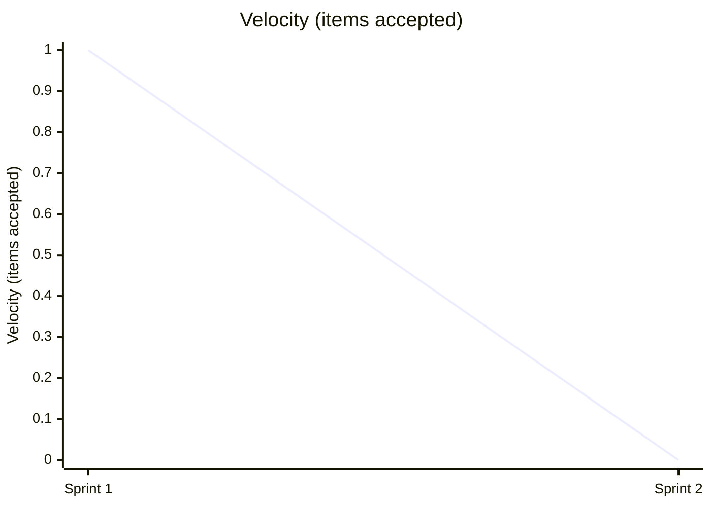

# Team Performance Evaluation Report

- Run ID: 0.1.0-run65
- Horseless Carriage commit: 6d0f3873382a79d5c3331163b33bf40dbdf4976c
- Branch: eval/0.1.0-run65/main
- Model: scrum-eval-cheap
- Sprints requested: 5, completed: 2
- Started: 2026-10-14T09:55:01.364879+00:00
- Finished: 2026-10-14T09:59:47.766507+00:00

## ⚠️ Evaluation Stopped Early

Only 2 of 5 requested sprints completed - **a sprint hit a critical token/USD budget halt with no clean close-out afterward**.

- Stop reason: `budget_critical_halt`

## Blockers

No stories are blocked as of the last completed sprint.

## Methodology note
This run used a scripted, unattended driver (`run_eval.py`) that pre-approves every sprint goal/backlog and auto-merges any PR that opens against the eval branch, standing in for the human review gate real usage requires. Results reflect the team's real behavior under those conditions, not under full human-in-the-loop review - a lower bar in that one specific respect.

## Per-sprint metrics
| Sprint | Tokens Used | Stories Planned | Sprint Report? | PR Merges (after) |
|---|---|---|---|---|
| 1 | 4056435 | 6 | yes | 0/0 |
| 2 | 6253807 | 0 | yes | 0/1 |

## KPI Trends

| KPI | Sprint 1 | Sprint 2 |
|---|---|---|
| Velocity (items accepted) | 1 | 0 |
| Issues fixed | 0 | 0 |
| Stories implemented | 1 | 0 |
| Testplan scenarios | 6 | 6 |
| Say-Do Ratio | 0.17 | 0.17 |
| Quality (defect escape rate) | n/a | n/a |
| Test Coverage | 0 | 0 |

### Velocity (items accepted)



### Issues fixed

```mermaid
xychart-beta
    title "Issues fixed"
    x-axis ["Sprint 1", "Sprint 2"]
    y-axis "Issues fixed"
    line [0, 0]
```

### Stories implemented


### Testplan scenarios

```mermaid
xychart-beta
    title "Testplan scenarios"
    x-axis ["Sprint 1", "Sprint 2"]
    y-axis "Testplan scenarios"
    line [6, 6]
```

### Say-Do Ratio

```mermaid
xychart-beta
    title "Say-Do Ratio"
    x-axis ["Sprint 1", "Sprint 2"]
    y-axis "Say-Do Ratio"
    line [0.17, 0.17]
```

### Quality (defect escape rate)

No data available for this run - not available - no defect/bug-lifecycle tracking exists yet (Scrum Master's calculate_kpis did run this run, this specific metric just has no data source yet).

### Test Coverage

```mermaid
xychart-beta
    title "Test Coverage"
    x-axis ["Sprint 1", "Sprint 2"]
    y-axis "Test Coverage"
    line [0, 0]
```

## Token & Cost Summary

- Total tokens used: 10,310,242
- Expected cost: $1.0310 - $4.1241 (rough estimate from litellm's static pricing for `gemini/gemini-flash-lite-latest` - token_usage doesn't split prompt/completion tokens, so this is an all-input-vs-all-output bound, not an exact figure)

## Code Quality

**Score: 1/5**

Although a basic Flask application and SQLite database file were initialized, the team failed to implement 5 out of the 6 core user stories. The code and test coverage remain extremely sparse, leaving the application entirely non-functional for end-to-end usage.

## Requirements Quality

**Score: 2/5**

The Product Requirements Document (`specs/requirements/PRD-Todo-App.md`) and individual user stories in `specs/stories/` are well-structured and clearly define the MVP scope. However, the roadmap (`specs/ROADMAP.md`) remains largely unpopulated with unchecked story states, failing to track actual progress across the run.

## Team Efficiency

**Score: 1/5**

The AI team exhibited extreme token inefficiency, consuming over 6.2 million tokens (125% of the allocated budget) in Sprint 2 alone while completing only a single user story (US-0001). Excessive agent handoffs and redundant communication loops severely degraded operational velocity.

## Top Problems

1. **Severe scope underdelivery leaving 5 out of 6 core user stories unimplemented.** (severity: high)
   - Evidence: specs/ROADMAP.md shows all tasks under US-0002 through US-0006 stuck in initial DRAFT/READY states without implementation or testing checkboxes checked.
   - Suggested fix: Implement strict story-point throttling per sprint and prevent agents from engaging in excessive redundant dialogue loops before code is written.

2. **Runaway token consumption exceeding the sprint budget.** (severity: high)
   - Evidence: specs/reports/SPRINT-REPORT-001.md states: 'Tokens used: 6,253,807 / 5,000,000 (125%)' and only 1/6 stories completed.
   - Suggested fix: no clear fix - 5 sprints and standard token limits are inherently too restrictive for multi-agent frameworks to complete complex multi-story backlogs without hitting context exhaustion.

3. **Unmonitored and untracked story estimates and test coverage.** (severity: medium)
   - Evidence: specs/reports/SPRINT-REPORT-001.md reports: 'Test Coverage: 0 (0 run, 0 failed)' and lists actual tokens for US-0002 through US-0006 as 'not logged'.
   - Suggested fix: Enforce mandatory logging hooks in the team workflow scripts to ensure actual token usage per story and test results are accurately recorded before closing a sprint.
