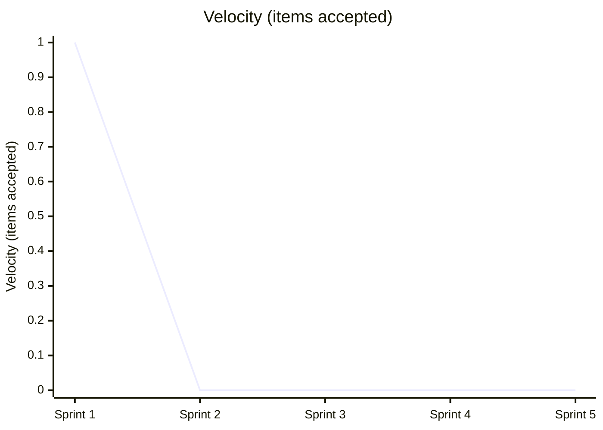
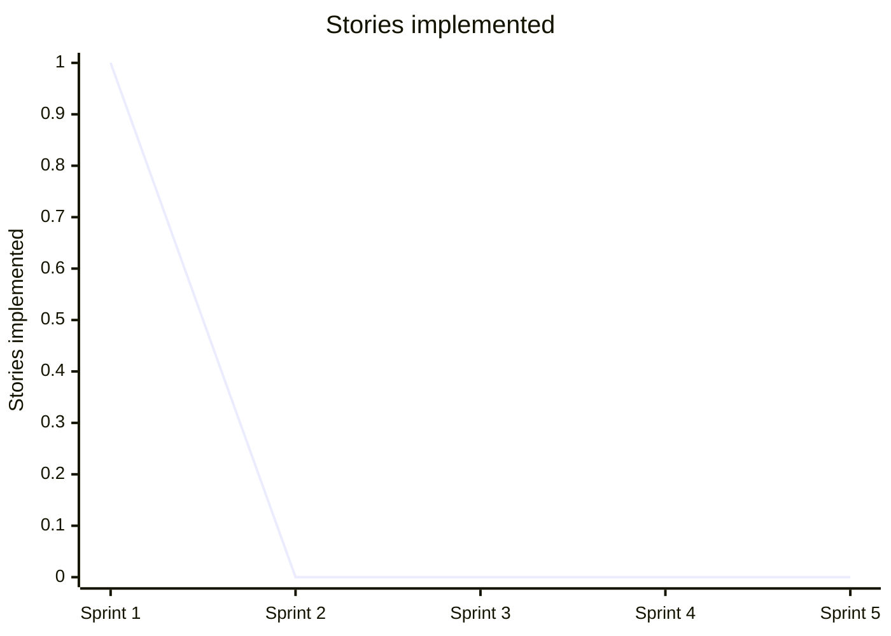

# Team Performance Evaluation Report

- Run ID: 0.1.0-run68
- Horseless Carriage commit: 5c31a540f20b1f01634680015e9e5933047e647f
- Branch: eval/0.1.0-run68/main
- Model: scrum-eval-cheap
- Sprints requested: 5, completed: 5
- Started: 2026-10-14T14:16:32.631314+00:00
- Finished: 2026-10-14T14:21:54.937685+00:00

## ⚠️ Evaluation Stopped Early

Only 5 of 5 requested sprints completed - **a BLOCKED story's category escalates straight to a human this scripted driver has no way to provide**.

- Stop reason: `blocked_needs_human`
- Blocked story: **US-0002** - product: ScrumOrchestrator and ProductOwner bounced transfer_to_agent 3x with no progress - 🔁 [TRANSFER LOOP DETECTED] ScrumOrchestrator and ProductOwner have handed off to each other 3 times in a row with no other tool call in between - refusing this transfer. Stop transferring and actually call a tool that makes progress (e.g. the mandatory step you're both routing around), or explain the blocker instead of handing off again. (raised by ScrumOrchestrator)

## Blockers

- **US-0002** (Add a task to a list) - product: ScrumOrchestrator and ProductOwner bounced transfer_to_agent 3x with no progress - 🔁 [TRANSFER LOOP DETECTED] ScrumOrchestrator and ProductOwner have handed off to each other 3 times in a row with no other tool call in between - refusing this transfer. Stop transferring and actually call a tool that makes progress (e.g. the mandatory step you're both routing around), or explain the blocker instead of handing off again. (raised by ScrumOrchestrator)

## Methodology note
This run used a scripted, unattended driver (`run_eval.py`) that pre-approves every sprint goal/backlog and auto-merges any PR that opens against the eval branch, standing in for the human review gate real usage requires. Results reflect the team's real behavior under those conditions, not under full human-in-the-loop review - a lower bar in that one specific respect.

## Per-sprint metrics
| Sprint | Tokens Used | Stories Planned | Sprint Report? | PR Merges (after) |
|---|---|---|---|---|
| 1 | 2496993 | 1 | yes | 1/1 |
| 2 | 2645730 | 0 | yes | 1/1 |
| 3 | 2761969 | 0 | yes | 0/0 |
| 4 | 3000025 | 0 | yes | 1/2 |
| 5 | 683705 | 0 | yes | 0/2 |

## KPI Trends

| KPI | Sprint 1 | Sprint 2 | Sprint 3 | Sprint 4 | Sprint 5 |
|---|---|---|---|---|---|
| Velocity (items accepted) | 1 | 0 | 0 | 0 | 0 |
| Issues fixed | 0 | 0 | 0 | 0 | 0 |
| Stories implemented | 1 | 0 | 0 | 0 | 0 |
| Testplan scenarios | 6 | 6 | 6 | 6 | 6 |
| Say-Do Ratio | 1 | 1 | 1 | 1 | 1 |
| Quality (defect escape rate) | n/a | n/a | n/a | n/a | n/a |
| Test Coverage | 0.99 | 0.99 | 0.99 | 0.99 | 0.99 |

### Velocity (items accepted)



### Issues fixed

```mermaid
xychart-beta
    title "Issues fixed"
    x-axis ["Sprint 1", "Sprint 2", "Sprint 3", "Sprint 4", "Sprint 5"]
    y-axis "Issues fixed"
    line [0, 0, 0, 0, 0]
```

### Stories implemented



### Testplan scenarios

```mermaid
xychart-beta
    title "Testplan scenarios"
    x-axis ["Sprint 1", "Sprint 2", "Sprint 3", "Sprint 4", "Sprint 5"]
    y-axis "Testplan scenarios"
    line [6, 6, 6, 6, 6]
```

### Say-Do Ratio

```mermaid
xychart-beta
    title "Say-Do Ratio"
    x-axis ["Sprint 1", "Sprint 2", "Sprint 3", "Sprint 4", "Sprint 5"]
    y-axis "Say-Do Ratio"
    line [1, 1, 1, 1, 1]
```

### Quality (defect escape rate)

No data available for this run - not_available - no defect/bug-lifecycle tracking exists yet (Scrum Master's calculate_kpis did run this run, this specific metric just has no data source yet).

### Test Coverage

```mermaid
xychart-beta
    title "Test Coverage"
    x-axis ["Sprint 1", "Sprint 2", "Sprint 3", "Sprint 4", "Sprint 5"]
    y-axis "Test Coverage"
    line [0.99, 0.99, 0.99, 0.99, 0.99]
```

## Token & Cost Summary

- Total tokens used: 11,588,422
- Expected cost: $1.1588 - $4.6354 (rough estimate from litellm's static pricing for `gemini/gemini-flash-lite-latest` - token_usage doesn't split prompt/completion tokens, so this is an all-input-vs-all-output bound, not an exact figure)

## Code Quality

**Score: 4/5**

The application codebase in app.py and templates/index.html is clean, concise, and fully implements the core to-do list web app vision using Flask and SQLAlchemy. The accompanying test suite in tests/test_app.py provides robust coverage (99%) and correctly validates list creation, task addition, completion toggling, and deletion. Code complexity is low, adhering well to the project requirements.

## Requirements Quality

**Score: 3/5**

The PRD and story files in specs/stories/ adequately capture the functional requirements for list and task management. However, the team's roadmap and story state tracking in specs/ROADMAP.md show significant degradation after Sprint 1, failing to update story status checkboxes for US-0002 through US-0006 despite the code implementing those features. Requirements traceability broke down as the sprints progressed.

## Team Efficiency

**Score: 2/5**

The agent team exhibited severe process inefficiencies, spending millions of tokens across 5 sprints while completing only a single story (US-0001) in Sprint 1 and zero stories in Sprints 2-5. The conversation transcript reveals frequent redundant agent transfers and endless handoff loops between the ScrumOrchestrator and ProductOwner. Despite consuming significant budget and time, subsequent sprints produced no net new feature delivery.

## Top Problems

1. **Story tracking in the roadmap was abandoned after Sprint 1, leaving core feature stories marked as un-implemented.** (severity: high)
   - Evidence: In specs/ROADMAP.md, US-0002 through US-0006 are marked as `[ ] IMPLEMENTED` under v1.0.0 even though the code in app.py fully supports them.
   - Suggested fix: Update the Scrum team's sprint close workflow to mandate synchronization of story status in ROADMAP.md before sprint completion.

2. **The Scrum team executed zero new stories in Sprints 2 through 5, resulting in massive token burn for administrative overhead.** (severity: high)
   - Evidence: Per-sprint metrics show 0 stories planned in Sprints 2-5 while consuming over 2.6 million tokens per sprint.
   - Suggested fix: Adjust agent prompt orchestration and backlog grooming rules to prevent multi-sprint inactivity when core features remain unassigned.

3. **Agent handover loops caused friction and process blockages between the ScrumOrchestrator and ProductOwner.** (severity: medium)
   - Evidence: Transcript excerpt in US-0002 notes: 'ScrumOrchestrator and ProductOwner bounced transfer_to_agent 3x with no progress - [TRANSFER LOOP DETECTED]'.
   - Suggested fix: Implement strict circuit breakers in the orchestration layer to automatically break agent transfer ping-pong loops.
