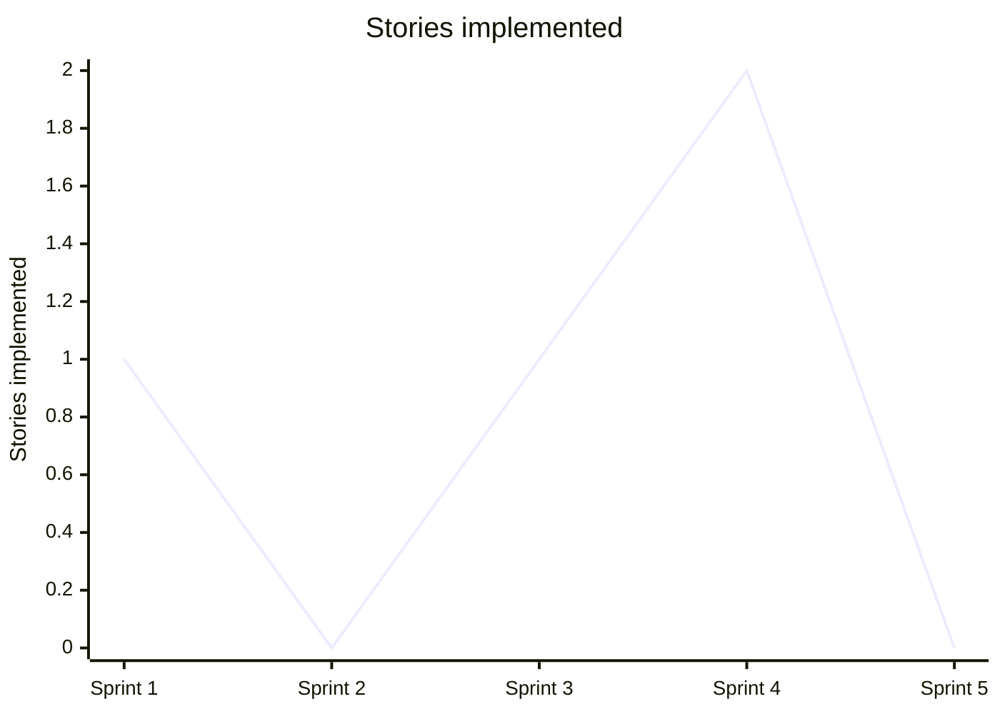
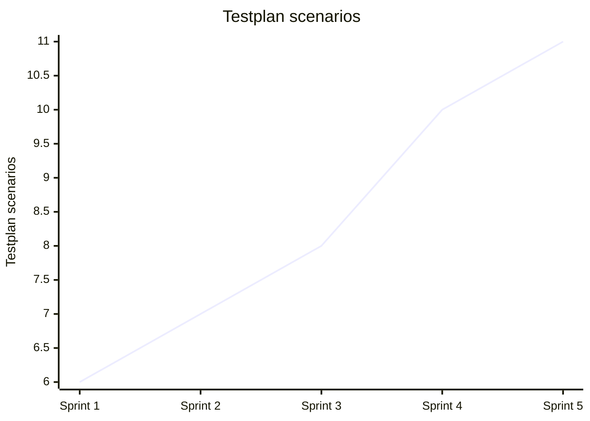
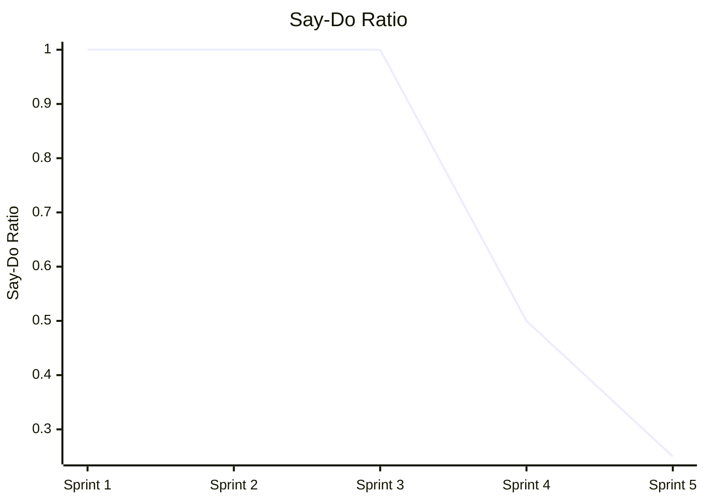

# Team Performance Evaluation Report

- Run ID: 0.1.0-run83
- Horseless Carriage commit: ad3fa6891a43e6013e2bd877c9e22ab743340985
- Branch: eval/0.1.0-run83/main
- Model: scrum-eval-cheap
- Sprints requested: 5, completed: 5
- Started: 2026-11-03T09:41:25.938999+00:00
- Finished: 2026-11-03T09:59:21.387112+00:00

## Blockers

No stories are blocked as of the last completed sprint.

## Methodology note
This run used a scripted, unattended driver (`run_eval.py`) that pre-approves every sprint goal/backlog and auto-merges any PR that opens against the eval branch, standing in for the human review gate real usage requires. Results reflect the team's real behavior under those conditions, not under full human-in-the-loop review - a lower bar in that one specific respect.

## Per-sprint metrics
| Sprint | Real Sprint # | Tokens Used | Stories Planned | Sprint Report? | PR Merges (after) |
|---|---|---|---|---|---|
| 1 | 1 | 2214332 | 1 | yes | 1/1 |
| 2 | 2 | 1356742 | 1 | yes | 1/1 |
| 3 | 3 | 2737665 | 1 | yes | 1/2 |
| 4 | 4 | 5803199 | 6 | yes | 1/3 |
| 5 | 5 | 5573600 | 1 | yes | 1/4 |

## KPI Trends

| KPI | Sprint 1 | Sprint 2 | Sprint 3 | Sprint 4 | Sprint 5 |
|---|---|---|---|---|---|
| Velocity (items accepted) | 1 | 1 | 1 | 3 | 1 |
| Issues fixed | 0 | 1 | 0 | 1 | 1 |
| Stories implemented | 1 | 0 | 1 | 2 | 0 |
| Testplan scenarios | 6 | 7 | 8 | 10 | 11 |
| Say-Do Ratio | 1 | 1 | 1 | 0.5 | 0.25 |
| Quality (defect escape rate) | n/a | n/a | n/a | n/a | n/a |
| Test Coverage | 0.91 | 0.91 | 0.91 | 0.91 | 0.91 |

### Velocity (items accepted)


### Issues fixed


### Stories implemented



### Testplan scenarios



### Say-Do Ratio



### Quality (defect escape rate)

No data available for this run - not available - no defect/bug-lifecycle tracking exists yet (Scrum Master's calculate_kpis did run this run, this specific metric just has no data source yet).

### Test Coverage

```mermaid
xychart-beta
    title "Test Coverage"
    x-axis ["Sprint 1", "Sprint 2", "Sprint 3", "Sprint 4", "Sprint 5"]
    y-axis "Test Coverage"
    line [0.91, 0.91, 0.91, 0.91, 0.91]
```

## Token & Cost Summary

- Total tokens used: 17,685,538
- Expected cost: $1.7686 - $7.0742 (rough estimate from litellm's static pricing for `gemini/gemini-flash-lite-latest` - token_usage doesn't split prompt/completion tokens, so this is an all-input-vs-all-output bound, not an exact figure)

## Code Quality

**Score: 4/5**

The application core in app.py uses standard Flask and Flask-SQLAlchemy idioms with correct relationship configurations, cascading deletes, and SQLAlchemy models. Test coverage includes specific unit tests under tests/ and schema verification checks. The code correctly implements task toggling, creation, and deletion features.

## Requirements Quality

**Score: 3/5**

The PRD outlines a 5-sprint plan covering core CRUD features, but tracking in specs/ROADMAP.md shows multiple features left incomplete or unchecked by the end of the run (e.g., [US-0005] Delete an Entire List and [US-0006] View Lists and Tasks with Visual Status remain marked as uncompleted in the roadmap). The team spent excessive cycle time filing process-compliance issues rather than executing user stories.

## Team Efficiency

**Score: 2/5**

The AI team exhibited extreme process overhead, generating numerous meta-process issues (SPEC-ISSUE-0001 through SPEC-ISSUE-0006) and workflow policy docs instead of delivering features. In Sprint 4 and 5, token budgets were exceeded (111% and 104% usage respectively) while leaving the vast majority of planned user stories untouched.

## Top Problems

1. **Core user stories US-0005 and US-0006 were left uncompleted at the end of the 5-sprint run.** (severity: high)
   - Evidence: specs/ROADMAP.md shows `- [ ] IMPLEMENTED` for [US-0005] and [US-0006] under version v1.0.0.
   - Suggested fix: Streamline sprint planning to prioritize customer-facing user stories over internal process compliance tickets.

2. **Excessive generation of meta-process issues instead of product feature work.** (severity: high)
   - Evidence: specs/requirements/ contains 6 separate SPEC-ISSUE files (SPEC-ISSUE-0001 to SPEC-ISSUE-0006) dedicated entirely to workflow adherence and process policing.
   - Suggested fix: Disable or constrain self-referential process issue generation in agent system prompts.

3. **Sprint token budgets are repeatedly exceeded during complex multi-story sprints.** (severity: medium)
   - Evidence: specs/reports/SPRINT-REPORT-004.md notes 'Tokens used: 5,567,922 / 5,000,000 (111%)' and leaves 3/6 stories unfinished.
   - Suggested fix: Increase the default per-sprint token budget or reduce story count per sprint to match agent capacity.
