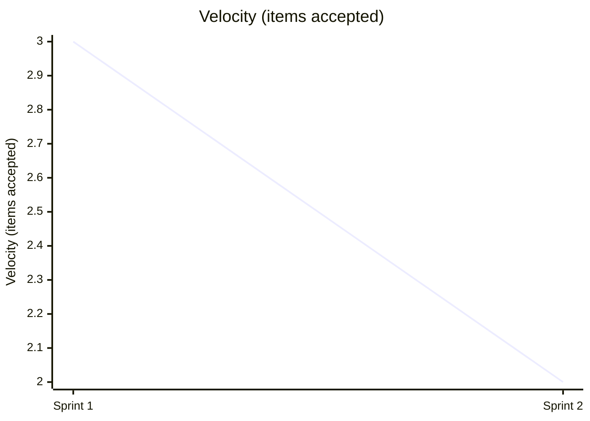
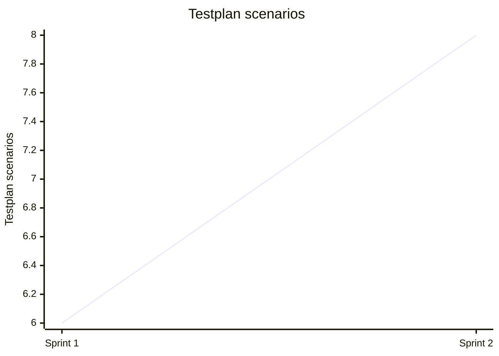
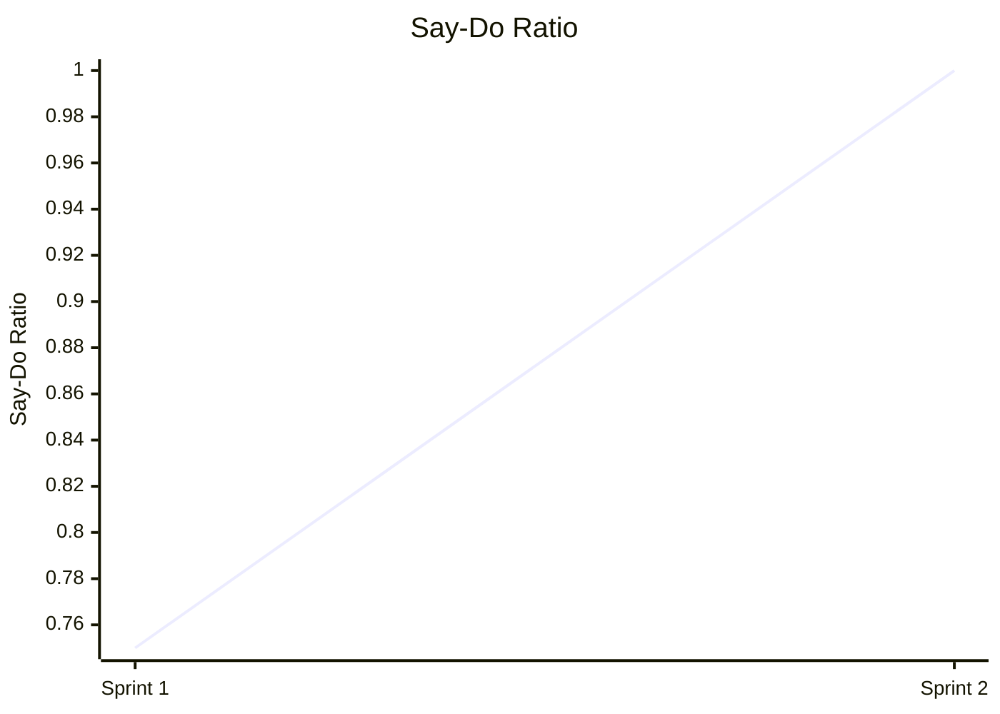

# Team Performance Evaluation Report

- Run ID: 0.2.0-run90
- Horseless Carriage commit: f0db8da9f4a0b2d703ea2ef5ce8ab43832d43327
- Branch: eval/0.2.0-run90/main
- Model: scrum-eval-cheap
- Sprints requested: 5, completed: 2
- Started: 2026-11-11T15:49:59.375907+00:00
- Finished: 2026-11-11T16:00:43.392087+00:00

## ⚠️ Evaluation Stopped Early

Only 2 of 5 requested sprints completed - **a sprint hit a critical token/USD budget halt with no clean close-out afterward**.

- Stop reason: `budget_critical_halt`

## Blockers

- **US-0004** (Delete a task) - technical: CHANGELOG.md uncommitted changes block checkout in create_release_pr. (raised by ProductOwner)
- **SPEC-ISSUE-0002** (Ensure test files correctly reference app imports before submission to avoid test collection errors.) - product: ProductOwner and ScrumOrchestrator bounced transfer_to_agent 3x with no progress - 🔁 [TRANSFER LOOP DETECTED] ProductOwner and ScrumOrchestrator have handed off to each other 3 times in a row with no other tool call in between - refusing this transfer. Stop transferring and actually call a tool that makes progress (e.g. the mandatory step you're both routing around), or explain the blocker instead of handing off again. (raised by ProductOwner)

## Methodology note
This run used a scripted, unattended driver (`run_eval.py`) that pre-approves every sprint goal/backlog and auto-merges any PR that opens against the eval branch, standing in for the human review gate real usage requires. Results reflect the team's real behavior under those conditions, not under full human-in-the-loop review - a lower bar in that one specific respect.

## Per-sprint metrics
| Sprint | Real Sprint # | Tokens Used | Stories Planned | Sprint Report? | PR Merges (after) |
|---|---|---|---|---|---|
| 1 | 1 | 6012595 | 4 | yes | 1/1 |
| 2 | 2 | 5532774 | 1 | yes | 0/0 |

## KPI Trends

| KPI | Sprint 1 | Sprint 2 |
|---|---|---|
| Velocity (items accepted) | 3 | 2 |
| Issues fixed | 0 | 1 |
| Stories implemented | 4 | 0 |
| Testplan scenarios | 6 | 8 |
| Say-Do Ratio | 0.75 | 1 |
| Quality (defect escape rate) | n/a | n/a |
| Test Coverage | 0.97 | 0.97 |

### Velocity (items accepted)



### Issues fixed

```mermaid
xychart-beta
    title "Issues fixed"
    x-axis ["Sprint 1", "Sprint 2"]
    y-axis "Issues fixed"
    line [0, 1]
```

### Stories implemented


### Testplan scenarios



### Say-Do Ratio



### Quality (defect escape rate)

No data available for this run - not available - no defect/bug-lifecycle tracking exists yet (Scrum Master's calculate_kpis did run this run, this specific metric just has no data source yet).

### Test Coverage

```mermaid
xychart-beta
    title "Test Coverage"
    x-axis ["Sprint 1", "Sprint 2"]
    y-axis "Test Coverage"
    line [0.97, 0.97]
```

## Token & Cost Summary

- Total tokens used: 11,545,369
- Expected cost: $1.1545 - $4.6181 (rough estimate from litellm's static pricing for `gemini/gemini-flash-lite-latest` - token_usage doesn't split prompt/completion tokens, so this is an all-input-vs-all-output bound, not an exact figure)

## Code Quality

**Score: 3/5**

The application code in app.py and templates/index.html is functional for core features such as list creation, task addition, toggling, and deletion using Flask and Jinja2 templates. However, persistence is strictly in-memory (lists_db dictionary in app.py) and test coverage is extremely sparse, with only a single test file (tests/test_delete_task.py) present in the repository.

## Requirements Quality

**Score: 3/5**

The Product Requirements Document (specs/requirements/PRD-TodoList-MVP.md) clearly outlines the MVP scope and out-of-scope items. User stories are properly cataloged in specs/stories/, but roadmap synchronization is incomplete, as US-0005 and US-0006 remain marked as unplanned/unimplemented in specs/ROADMAP.md despite core features being partially addressed.

## Team Efficiency

**Score: 2/5**

The team experienced significant token burn and communication overhead, consuming millions of tokens per sprint while leaving key stories like list deletion (US-0005) and viewing all lists (US-0006) undone by Sprint 2. Transfer loops and blocked states occurred (noted in SPEC-ISSUE-0002), indicating coordination inefficiencies between the ProductOwner and ScrumOrchestrator.

## Top Problems

1. **Incomplete implementation of core user stories from the product vision.** (severity: high)
   - Evidence: specs/ROADMAP.md shows US-0005 ('Delete an entire list') and US-0006 ('View all lists and tasks') as un-implemented, and app.py lacks list deletion routes.
   - Suggested fix: Implement the remaining backend routes in app.py and UI elements in templates/index.html for list deletion and comprehensive list viewing.

2. **Inadequate test coverage across the application codebase.** (severity: high)
   - Evidence: The file tree only contains a single test file: tests/test_delete_task.py.
   - Suggested fix: Add comprehensive unit and integration test files under tests/ covering list creation, task addition, and status toggling.

3. **Unresolved product/technical blocker loops recorded in requirements specs.** (severity: medium)
   - Evidence: specs/requirements/SPEC-ISSUE-0002-Ensure-test-files-correctly-reference-app-imports-before-submission-to-avoid-test-collection-errors..md notes: 'ProductOwner and ScrumOrchestrator bounced transfer_to_agent 3x with no progress'.
   - Suggested fix: Refactor agent hand-off logic in the orchestration framework to prevent infinite transfer loops between ProductOwner and ScrumOrchestrator.

4. **Roadmap state discrepancy with actual sprint deliverables.** (severity: low)
   - Evidence: specs/ROADMAP.md lists US-0005 and US-0006 under v1.0 without 'IMPLEMENTED' checkboxes, despite sprint reports indicating progress.
   - Suggested fix: Ensure the ProductOwner updates specs/ROADMAP.md during sprint review tasks to maintain synchronization with completed PRs.
