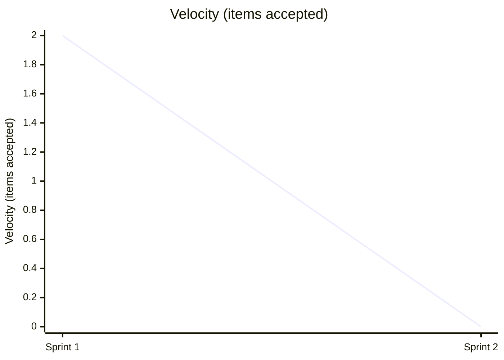

# Team Performance Evaluation Report

- Run ID: 0.1.0-run74
- Horseless Carriage commit: f071e9905fded4ee3fd7c2bd9035798e62a6f295
- Branch: eval/0.1.0-run74/main
- Model: scrum-eval-cheap
- Sprints requested: 5, completed: 2
- Started: 2026-10-27T09:46:04.107725+00:00
- Finished: 2026-10-27T09:52:01.381093+00:00

## ⚠️ Evaluation Stopped Early

Only 2 of 5 requested sprints completed - **see stop_reason below for the raw code**.

- Stop reason: `blocked_mechanically_detected`
- Blocked story: **US-0003** - technical: QA and ScrumMaster bounced transfer_to_agent 3x with no progress - 🔁 [TRANSFER LOOP DETECTED] QA and ScrumMaster have handed off to each other 3 times in a row with no other tool call in between - refusing this transfer. Stop transferring and actually call a tool that makes progress (e.g. the mandatory step you're both routing around), or explain the blocker instead of handing off again. (raised by QA)

## Blockers

- **US-0003** (Mark task as complete or incomplete) - technical: QA and ScrumMaster bounced transfer_to_agent 3x with no progress - 🔁 [TRANSFER LOOP DETECTED] QA and ScrumMaster have handed off to each other 3 times in a row with no other tool call in between - refusing this transfer. Stop transferring and actually call a tool that makes progress (e.g. the mandatory step you're both routing around), or explain the blocker instead of handing off again. (raised by QA)

## Methodology note
This run used a scripted, unattended driver (`run_eval.py`) that pre-approves every sprint goal/backlog and auto-merges any PR that opens against the eval branch, standing in for the human review gate real usage requires. Results reflect the team's real behavior under those conditions, not under full human-in-the-loop review - a lower bar in that one specific respect.

## Per-sprint metrics
| Sprint | Tokens Used | Stories Planned | Sprint Report? | PR Merges (after) |
|---|---|---|---|---|
| 1 | 5239714 | 2 | yes | 1/1 |
| 2 | 1520678 | 0 | no | 0/0 |

## KPI Trends

| KPI | Sprint 1 | Sprint 2 |
|---|---|---|
| Velocity (items accepted) | 2 | 0 |
| Issues fixed | 0 | 0 |
| Stories implemented | 2 | 0 |
| Testplan scenarios | 6 | 7 |
| Say-Do Ratio | 1 | 1 |
| Quality (defect escape rate) | n/a | n/a |
| Test Coverage | 0.91 | 0.91 |

### Velocity (items accepted)



### Issues fixed

```mermaid
xychart-beta
    title "Issues fixed"
    x-axis ["Sprint 1", "Sprint 2"]
    y-axis "Issues fixed"
    line [0, 0]
```

### Stories implemented


### Testplan scenarios


### Say-Do Ratio

```mermaid
xychart-beta
    title "Say-Do Ratio"
    x-axis ["Sprint 1", "Sprint 2"]
    y-axis "Say-Do Ratio"
    line [1, 1]
```

### Quality (defect escape rate)

No data available for this run - not available (Scrum Master's calculate_kpis did run this run, this specific metric just has no data source yet).

### Test Coverage

```mermaid
xychart-beta
    title "Test Coverage"
    x-axis ["Sprint 1", "Sprint 2"]
    y-axis "Test Coverage"
    line [0.91, 0.91]
```

## Token & Cost Summary

- Total tokens used: 6,760,392
- Expected cost: $0.6760 - $2.7042 (rough estimate from litellm's static pricing for `gemini/gemini-flash-lite-latest` - token_usage doesn't split prompt/completion tokens, so this is an all-input-vs-all-output bound, not an exact figure)

## Code Quality

**Score: 4/5**

The application is cleanly structured using Flask and SQLAlchemy, successfully implementing database relationships, cascading deletions, and routing in app.py. The templates/index.html file correctly renders dynamic lists, tasks, and completion states. While the test suite in tests/test_app.py covers creation, toggling, and deletion, there is a lingering technical debt issue documented regarding generic name test assertions.

## Requirements Quality

**Score: 3/5**

The PRD (specs/requirements/PRD-TodoList-MVP.md) and user stories outline the MVP scope clearly. However, the team's execution tracking in specs/ROADMAP.md is out of sync with actual code delivery, marking stories like US-0003 through US-0006 as unplanned/not implemented even though portions of their functionality are handled. Additionally, the sprint planning stopped after Sprint 1, leaving Sprint 2 unexecuted.

## Team Efficiency

**Score: 2/5**

The team consumed 4,956,516 out of 5,000,000 tokens (99% budget) on Sprint 1 alone while delivering only two user stories (US-0001 and US-0002). This heavy token burn left insufficient budget and context for subsequent sprints, resulting in an empty Sprint 2 and a transfer loop between QA and ScrumMaster noted in US-0003. Process overhead was high relative to output.

## Top Problems

1. **Severe token exhaustion during Sprint 1 caused the team to stall out before completing the full MVP scope.** (severity: high)
   - Evidence: specs/reports/SPRINT-REPORT-001.md states 'Tokens used: 4,956,516 / 5,000,000 (99%)' while completing only 2 stories.
   - Suggested fix: Optimize agent prompt context windows and reduce redundant peer-review handoffs to preserve token budget across multiple sprints.

2. **Roadmap status tracking is severely outdated and inconsistent with the codebase.** (severity: medium)
   - Evidence: specs/ROADMAP.md lists US-0003, US-0004, US-0005, and US-0006 as [ ] IMPLEMENTED while functional deletion and toggling code exists in app.py and tests/test_app.py.
   - Suggested fix: Enforce automated roadmap updates as part of the pull request merge checklist so story statuses accurately reflect codebase reality.

3. **Agent transfer loop detected between QA and ScrumMaster during task workflow execution.** (severity: medium)
   - Evidence: specs/stories/US-0003-Mark-task-as-complete-or-incomplete.md notes 'QA and ScrumMaster bounced transfer_to_agent 3x with no progress'.
   - Suggested fix: Update agent system prompts to prohibit direct routing loops between QA and ScrumMaster without intermediary DevTeam action.

4. **Sprint 2 was abandoned with zero stories planned or executed.** (severity: high)
   - Evidence: Per-sprint metrics show Sprint 2 used 1,520,678 tokens with 0 stories planned and no sprint report produced.
   - Suggested fix: no clear fix - 5 sprints is too few for the current token burn rate and prompt overhead to complete multi-story epics.
