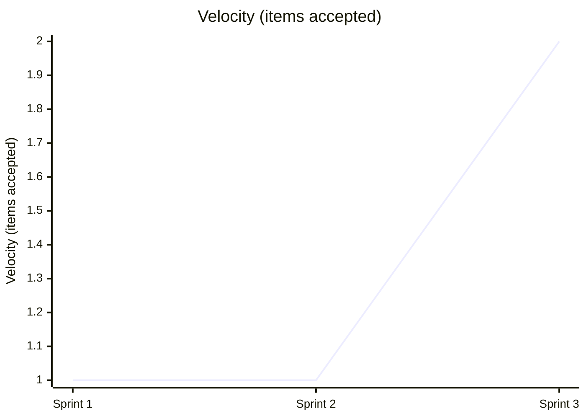
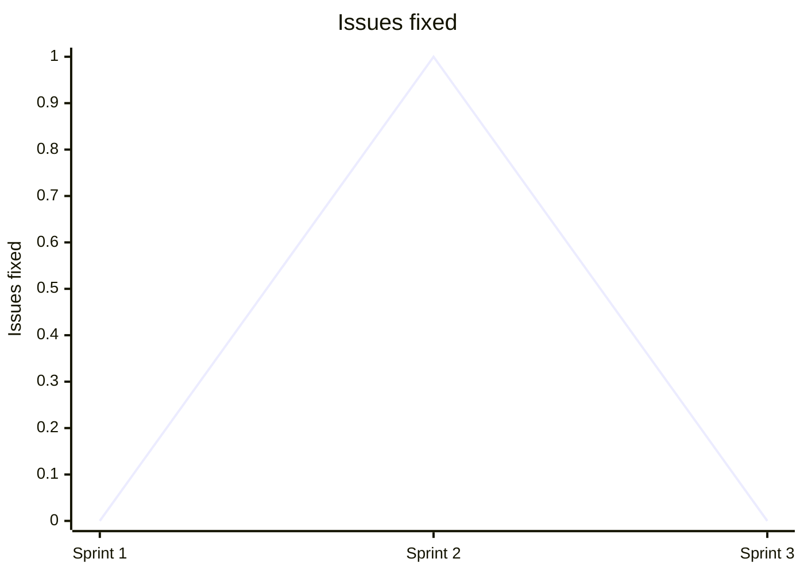
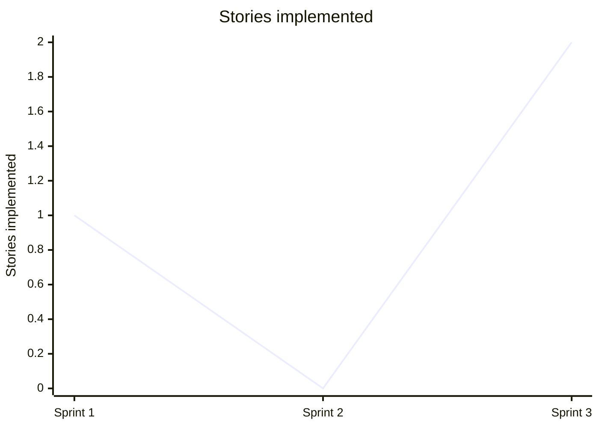
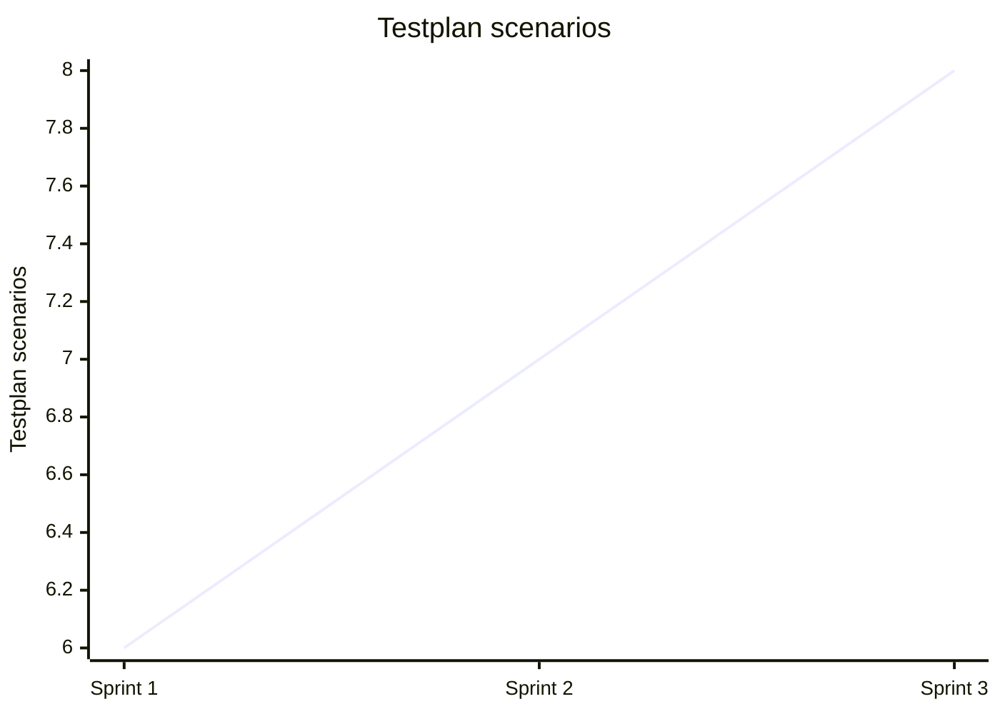

# Team Performance Evaluation Report

- Run ID: 0.2.0-run92
- Horseless Carriage commit: b33043b9879b145a94b69257c6ed3d2db90d404a
- Branch: eval/0.2.0-run92/main
- Model: scrum-eval-cheap
- Sprints requested: 5, completed: 3
- Started: 2026-11-12T13:35:13.140003+00:00
- Finished: 2026-11-12T13:45:33.107680+00:00

## ⚠️ Evaluation Stopped Early

Only 3 of 5 requested sprints completed - **a sprint exhausted this harness's own retry ceiling before its close-out (sprint report done, release PR) could finish**.

- Stop reason: `sprint_closeout_stalled`

## Blockers

No stories are blocked as of the last completed sprint.

## Methodology note
This run used a scripted, unattended driver (`run_eval.py`) that pre-approves every sprint goal/backlog and auto-merges any PR that opens against the eval branch, standing in for the human review gate real usage requires. Results reflect the team's real behavior under those conditions, not under full human-in-the-loop review - a lower bar in that one specific respect.

## Per-sprint metrics
| Sprint | Real Sprint # | Tokens Used | Stories Planned | Sprint Report? | PR Merges (after) |
|---|---|---|---|---|---|
| 1 | 1 | 2998867 | 1 | yes | 1/1 |
| 2 | 2 | 1429958 | 1 | yes | 2/3 |
| 3 | 3 | 5524015 | 5 | yes | 0/2 |

## KPI Trends

| KPI | Sprint 1 | Sprint 2 | Sprint 3 |
|---|---|---|---|
| Velocity (items accepted) | 1 | 1 | 2 |
| Issues fixed | 0 | 1 | 0 |
| Stories implemented | 1 | 0 | 2 |
| Testplan scenarios | 6 | 7 | 8 |
| Say-Do Ratio | 1 | 1 | 0.2 |
| Quality (defect escape rate) | n/a | n/a | n/a |
| Test Coverage | 0.98 | 0.98 | 0.98 |

### Velocity (items accepted)



### Issues fixed



### Stories implemented



### Testplan scenarios



### Say-Do Ratio

```mermaid
xychart-beta
    title "Say-Do Ratio"
    x-axis ["Sprint 1", "Sprint 2", "Sprint 3"]
    y-axis "Say-Do Ratio"
    line [1, 1, 0.2]
```

### Quality (defect escape rate)

No data available for this run - not available - no defect/bug-lifecycle tracking exists yet (Scrum Master's calculate_kpis did run this run, this specific metric just has no data source yet).

### Test Coverage

```mermaid
xychart-beta
    title "Test Coverage"
    x-axis ["Sprint 1", "Sprint 2", "Sprint 3"]
    y-axis "Test Coverage"
    line [0.98, 0.98, 0.98]
```

## Token & Cost Summary

- Total tokens used: 9,952,840
- Expected cost: $0.9953 - $3.9811 (rough estimate from litellm's static pricing for `gemini/gemini-flash-lite-latest` - token_usage doesn't split prompt/completion tokens, so this is an all-input-vs-all-output bound, not an exact figure)

## Code Quality

**Score: 4/5**

The application logic in app.py cleanly handles SQLite persistence, relational mapping with cascade deletes, and robust Flask routes for all required user actions. The accompanying test suite in tests/test_todo.py provides good coverage over core flows like list creation and task toggling. While the codebase is small and straightforward, it correctly satisfies the functional vision outlined in the PRD.

## Requirements Quality

**Score: 3/5**

Product requirements and user stories are properly structured in specs/requirements/PRD-Todo-App.md and specs/stories/. However, roadmap tracking in specs/ROADMAP.md shows stale completion checkboxes for US-0002 through US-0006 despite code and tests existing for them. Additionally, sprint planning over-committed by targeting five stories in Sprint 3 while running out of token budget.

## Team Efficiency

**Score: 2/5**

The team suffered from severe context and token budget exhaustion, consuming 103% of the allocated token budget in Sprint 3 while only completing 2 out of 5 planned stories (resulting in a low Say-Do Ratio of 0.2). Excessive agent-to-agent transfer chatter and circular process overhead led to diminishing returns. Consequently, the team spent valuable cycle capacity generating meta-issues like SPEC-ISSUE-0003 and steering proposals rather than shipping code.

## Top Problems

1. **Sprint planning over-commitment resulted in a low Say-Do ratio and token budget exhaustion.** (severity: high)
   - Evidence: specs/reports/SPRINT-REPORT-003.md states: 'Tokens used: 5,130,436 / 5,000,000 (103%)' and 'Stories: 2/5 completed this sprint'.
   - Suggested fix: Adjust future sprint velocity planning to match realistic agent token capacities or reduce sprint backlog scope.

2. **Roadmap task board checkboxes are out of sync with actual feature implementation status.** (severity: medium)
   - Evidence: specs/ROADMAP.md shows US-0002 through US-0006 marked with '[ ] IMPLEMENTED' despite corresponding routes and tests existing in app.py and tests/test_todo.py.
   - Suggested fix: Update the roadmap generation or team DoD workflow to automatically sync story status checkboxes upon merge.

3. **Excessive process overhead and meta-issue creation displaced actual feature delivery.** (severity: medium)
   - Evidence: specs/requirements/SPEC-ISSUE-0003-Ensure-all-recurring-issue-items-and-story-requirements-are-properly-estimated-and-tracked-before-sprint-execution..md contains empty acceptance criteria and test approaches.
   - Suggested fix: no clear fix - autonomous agent identity loops naturally generate bureaucratic process artifacts when communication rules trigger retrospectives.
