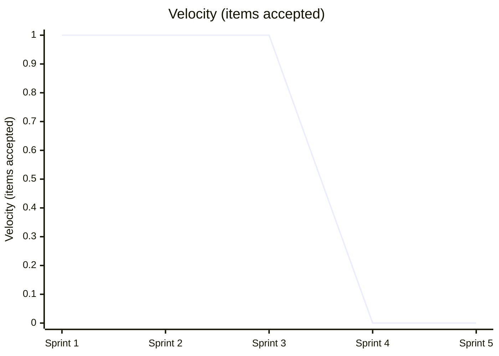
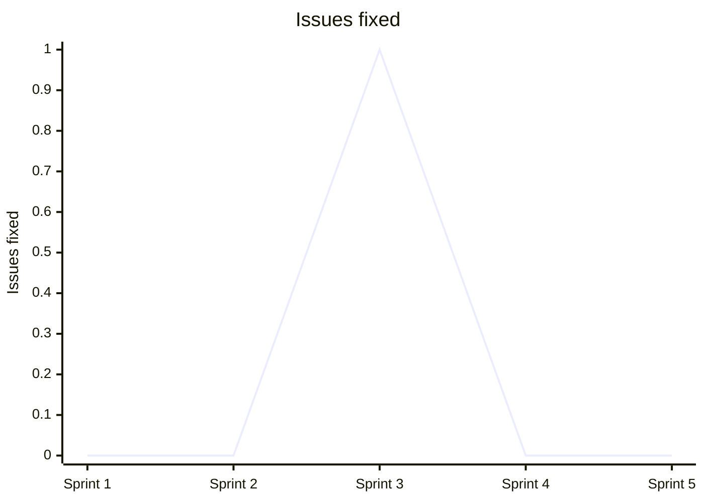
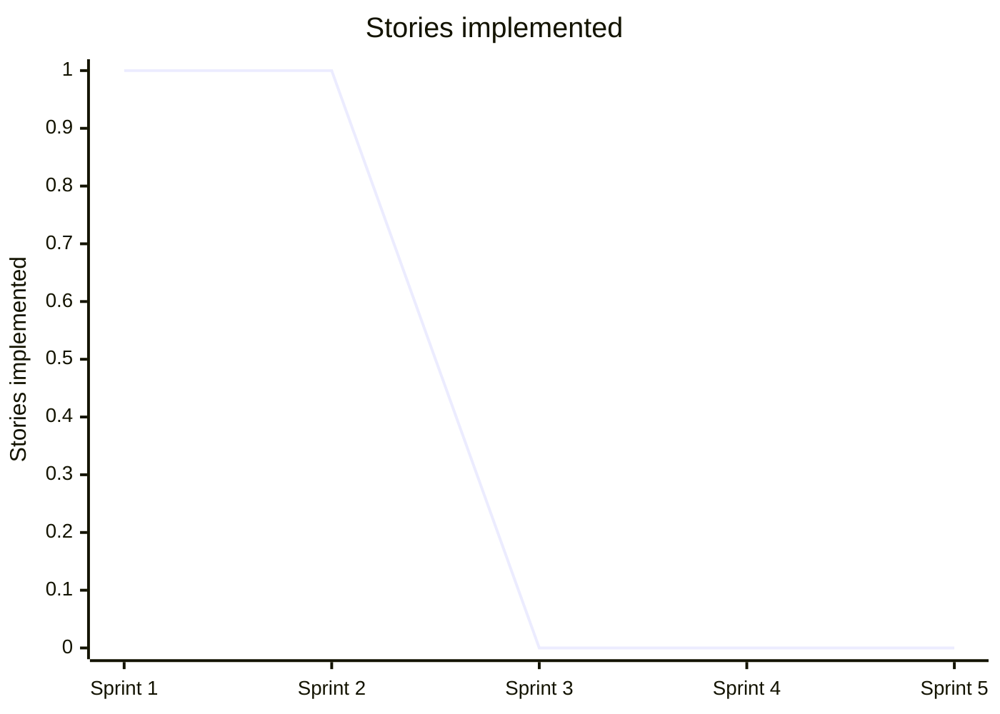
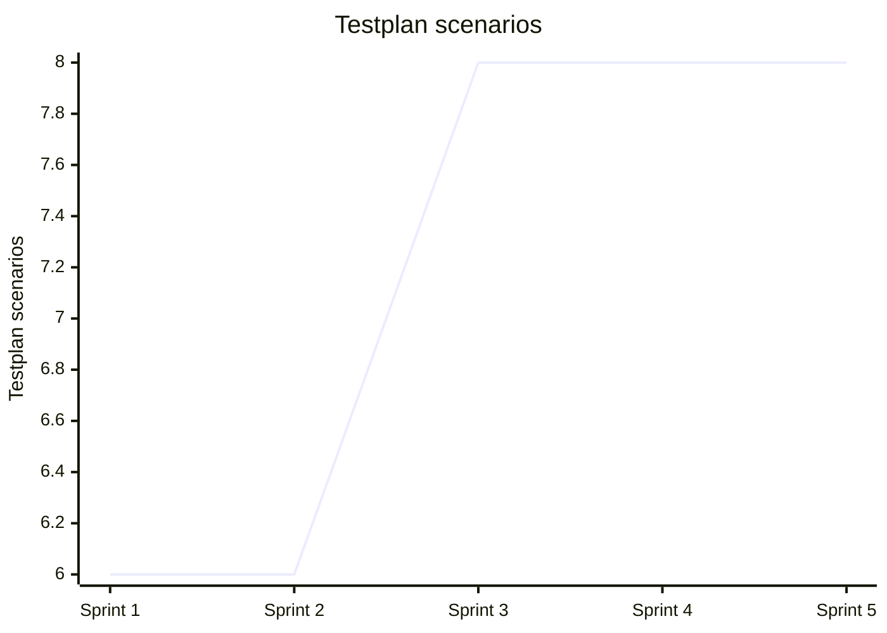

# Team Performance Evaluation Report

- Run ID: 0.2.1-run94
- Horseless Carriage commit: 2acdace04ff2fb5ef0c40644082d6fa188d1d396
- Branch: eval/0.2.1-run94/main
- Model: scrum-eval-cheap
- Sprints requested: 5, completed: 5 (3 of which were genuinely distinct real sprints - see 'Real Sprint #' below)
- Started: 2026-11-13T12:55:51.668638+00:00
- Finished: 2026-11-13T13:07:41.090101+00:00

## Blockers

No stories are blocked as of the last completed sprint.

## Methodology note
This run used a scripted, unattended driver (`run_eval.py`) that pre-approves every sprint goal/backlog and auto-merges any PR that opens against the eval branch, standing in for the human review gate real usage requires. Results reflect the team's real behavior under those conditions, not under full human-in-the-loop review - a lower bar in that one specific respect.

## Per-sprint metrics
| Sprint | Real Sprint # | Tokens Used | Stories Planned | Sprint Report? | PR Merges (after) |
|---|---|---|---|---|---|
| 1 | 1 | 3572400 | 1 | yes | 1/2 |
| 2 | 2 | 1912854 | 1 | yes | 1/3 |
| 3 | 3 | 2441658 | 1 | yes | 2/5 |
| 4 | 3 (continued) | 1900660 | 0 | yes | 1/5 |
| 5 | 3 (continued) | 1933437 | 0 | yes | 1/6 |

## KPI Trends

| KPI | Sprint 1 | Sprint 2 | Sprint 3 | Sprint 4 | Sprint 5 |
|---|---|---|---|---|---|
| Velocity (items accepted) | 1 | 1 | 1 | 0 | 0 |
| Issues fixed | 0 | 0 | 1 | 0 | 0 |
| Stories implemented | 1 | 1 | 0 | 0 | 0 |
| Testplan scenarios | 6 | 6 | 8 | 8 | 8 |
| Say-Do Ratio | 1 | 1 | 1 | n/a | n/a |
| Quality (defect escape rate) | n/a | n/a | n/a | n/a | n/a |
| Test Coverage | 0.97 | 0.97 | 0.97 | n/a | n/a |

### Velocity (items accepted)



### Issues fixed



### Stories implemented



### Testplan scenarios



### Say-Do Ratio

```mermaid
xychart-beta
    title "Say-Do Ratio"
    x-axis ["Sprint 1", "Sprint 2", "Sprint 3"]
    y-axis "Say-Do Ratio"
    line [1, 1, 1]
```

(2 of 5 sprints have no data point for this KPI and are omitted above - see the table for exactly which.)

### Quality (defect escape rate)

No data available for this run - not available - no defect/bug-lifecycle tracking exists yet (Scrum Master's calculate_kpis did run this run, this specific metric just has no data source yet).

### Test Coverage

```mermaid
xychart-beta
    title "Test Coverage"
    x-axis ["Sprint 1", "Sprint 2", "Sprint 3"]
    y-axis "Test Coverage"
    line [0.97, 0.97, 0.97]
```

(2 of 5 sprints have no data point for this KPI and are omitted above - see the table for exactly which.)

## Token & Cost Summary

- Total tokens used: 7,418,691
- Expected cost: $0.7419 - $2.9675 (rough estimate from litellm's static pricing for `gemini/gemini-flash-lite-latest` - token_usage doesn't split prompt/completion tokens, so this is an all-input-vs-all-output bound, not an exact figure)

## Code Quality

**Score: 2/5**

The application code in app.py implements basic in-memory list creation and task addition routes using Flask. However, core MVP requirements such as marking tasks complete/incomplete, deleting tasks, and deleting lists are completely unimplemented in both the backend and templates/index.html. While the code executes cleanly and passes basic pytest unit tests in tests/test_todo.py, it falls far short of a usable end-to-end to-do application.

## Requirements Quality

**Score: 2/5**

The PRD (specs/requirements/PRD-ToDo-MVP.md) correctly identifies the core features, but the team's roadmap and execution severely stalled after Sprint 2. In specs/ROADMAP.md, user stories US-0003 through US-0006 remain marked as unplanned/unimplemented, while the later sprints were wasted on internal process issues and meta-issues like SPEC-ISSUE-0002 rather than feature delivery.

## Team Efficiency

**Score: 1/5**

The AI Scrum team exhibited severe process thrashing across 5 sprint iterations, consuming over 11 million tokens while only delivering two user stories (US-0001 and US-0002). Sprints 3, 4, and 5 accomplished zero user-facing feature work, instead getting trapped in recursive retro actions, security scan triage issues (SPEC-ISSUE-0001 through 0007), and endless PR reviews.

## Top Problems

1. **Incomplete MVP implementation leaving core user stories untouched.** (severity: high)
   - Evidence: specs/ROADMAP.md shows US-0003, US-0004, US-0005, and US-0006 stuck at DRAFT/READY states with [ ] IMPLEMENTED checkboxes.
   - Suggested fix: Adjust agent task-allocation logic to prioritize finishing functional user stories before engaging in meta-process issue tracking.

2. **Sprint cycles 3, 4, and 5 completely stalled on meta-issues instead of shipping features.** (severity: high)
   - Evidence: CHANGELOG.md and sprint reports show zero user-facing changes in sprints 3-5, focusing entirely on SPEC-ISSUE-0002 and security scan triage.
   - Suggested fix: no clear fix - 5 sprints is too few and agent governance workflows over-index on retrospective bureaucracy when minor security findings are present.

3. **Redundant and duplicate security scan issue files cluttering the repository.** (severity: medium)
   - Evidence: File tree contains identical files SPEC-ISSUE-0001, SPEC-ISSUE-0003, SPEC-ISSUE-0006, and SPEC-ISSUE-0007 all titled 'Release audit: security scan findings need triage'.
   - Suggested fix: Implement deduplication checks in the ProductOwner or ScrumMaster agent workflows before creating new issue files.
