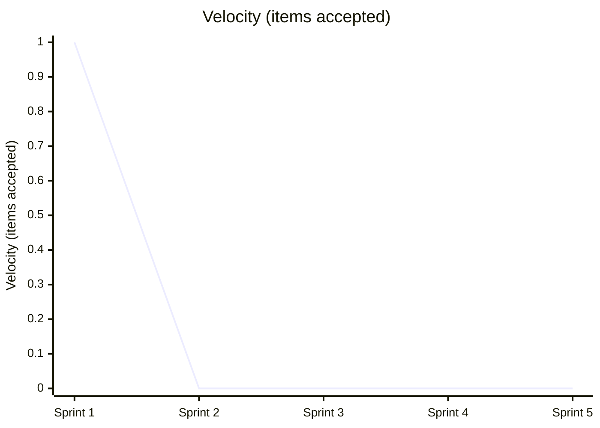
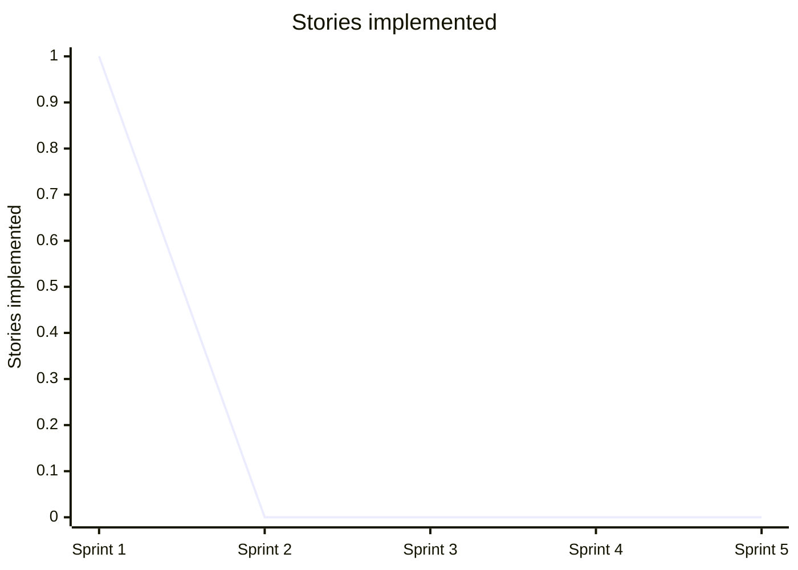

# Team Performance Evaluation Report

- Run ID: 0.1.0-run69
- Horseless Carriage commit: 9a95c7f122e6d435fe653ca609727f5fedef9402
- Branch: eval/0.1.0-run69/main
- Model: scrum-eval-cheap
- Sprints requested: 5, completed: 5
- Started: 2026-10-15T06:23:53.034051+00:00
- Finished: 2026-10-15T06:29:26.329974+00:00

## Blockers

No stories are blocked as of the last completed sprint.

## Methodology note
This run used a scripted, unattended driver (`run_eval.py`) that pre-approves every sprint goal/backlog and auto-merges any PR that opens against the eval branch, standing in for the human review gate real usage requires. Results reflect the team's real behavior under those conditions, not under full human-in-the-loop review - a lower bar in that one specific respect.

## Per-sprint metrics
| Sprint | Tokens Used | Stories Planned | Sprint Report? | PR Merges (after) |
|---|---|---|---|---|
| 1 | 3284895 | 1 | yes | 1/2 |
| 2 | 3492392 | 0 | yes | 1/3 |
| 3 | 3476809 | 0 | yes | 0/3 |
| 4 | 3725574 | 0 | yes | 1/5 |
| 5 | 3846455 | 0 | yes | 0/5 |

## KPI Trends

| KPI | Sprint 1 | Sprint 2 | Sprint 3 | Sprint 4 | Sprint 5 |
|---|---|---|---|---|---|
| Velocity (items accepted) | 1 | 0 | 0 | 0 | 0 |
| Issues fixed | 0 | 0 | 0 | 0 | 0 |
| Stories implemented | 1 | 0 | 0 | 0 | 0 |
| Testplan scenarios | 6 | 6 | 6 | 6 | 6 |
| Say-Do Ratio | 1 | 1 | 1 | 1 | 1 |
| Quality (defect escape rate) | n/a | n/a | n/a | n/a | n/a |
| Test Coverage | 0.99 | 0.99 | 0.99 | 0.99 | 0.99 |

### Velocity (items accepted)



### Issues fixed

```mermaid
xychart-beta
    title "Issues fixed"
    x-axis ["Sprint 1", "Sprint 2", "Sprint 3", "Sprint 4", "Sprint 5"]
    y-axis "Issues fixed"
    line [0, 0, 0, 0, 0]
```

### Stories implemented



### Testplan scenarios

```mermaid
xychart-beta
    title "Testplan scenarios"
    x-axis ["Sprint 1", "Sprint 2", "Sprint 3", "Sprint 4", "Sprint 5"]
    y-axis "Testplan scenarios"
    line [6, 6, 6, 6, 6]
```

### Say-Do Ratio

```mermaid
xychart-beta
    title "Say-Do Ratio"
    x-axis ["Sprint 1", "Sprint 2", "Sprint 3", "Sprint 4", "Sprint 5"]
    y-axis "Say-Do Ratio"
    line [1, 1, 1, 1, 1]
```

### Quality (defect escape rate)

No data available for this run - not available - no defect/bug-lifecycle tracking exists yet (Scrum Master's calculate_kpis did run this run, this specific metric just has no data source yet).

### Test Coverage

```mermaid
xychart-beta
    title "Test Coverage"
    x-axis ["Sprint 1", "Sprint 2", "Sprint 3", "Sprint 4", "Sprint 5"]
    y-axis "Test Coverage"
    line [0.99, 0.99, 0.99, 0.99, 0.99]
```

## Token & Cost Summary

- Total tokens used: 17,826,125
- Expected cost: $1.7826 - $7.1304 (rough estimate from litellm's static pricing for `gemini/gemini-flash-lite-latest` - token_usage doesn't split prompt/completion tokens, so this is an all-input-vs-all-output bound, not an exact figure)

## Code Quality

**Score: 5/5**

The application code in app.py, templates/index.html, and tests/test_todo.py is exceptionally clean, fully functional, and well-tested using Pytest with 99% coverage. All core features specified in the MVP (list creation, task addition, toggling, and deletion) are cleanly implemented using Flask and SQLAlchemy. The codebase adheres strictly to the architecture vision and handles edge cases such as cascade deletion of tasks when a list is deleted.

## Requirements Quality

**Score: 3/5**

While the product requirements document (specs/requirements/PRD-Todo-MVP.md) and initial user stories are well-written, the roadmap and story tracking are severely mismanaged across sprints. In specs/ROADMAP.md, user stories US-0002 through US-0006 remain marked as unchecked ([ ]) in their implementation states despite the underlying functionality being fully implemented and tested in app.py. The project exhibits a phantom-sprint tracking issue where multiple sprints execute without advancing backlog items.

## Team Efficiency

**Score: 2/5**

The multi-agent Scrum team suffered from severe workflow paralysis and metric hallucination, evidenced by reporting 5 distinct sprints while only ever picking up a single user story (US-0001) in Sprint 1. The team spent nearly 3.8 million tokens and over $0.35 looping through identical retrospective actions and creating boilerplate steering proposals without progressing the remaining 5 ready backlog items. Process overhead and conversational token verbosity heavily outweighed actual project output.

## Top Problems

1. **Backlog state tracking is completely decoupled from actual code implementation, leaving stories US-0002 through US-0006 marked as unplanned/unimplemented in the roadmap.** (severity: high)
   - Evidence: specs/ROADMAP.md shows US-0002 through US-0006 with unchecked implementation boxes, even though their functionality is fully present in app.py.
   - Suggested fix: Update agent workflow instructions so that the Product Owner and Scrum Master automatically synchronize story status checkboxes in specs/ROADMAP.md and individual story files upon PR merge.

2. **The AI team hallucinated a 5-sprint project lifecycle while effectively stalling after Sprint 1, repeating the exact same completed story and retro items across Sprints 2 through 5.** (severity: high)
   - Evidence: All sprint reports from Sprint 1 to Sprint 5 report 'Stories: 1/1 completed this sprint' and carry identical retrospective action items.
   - Suggested fix: no clear fix - the fixed-length sprint orchestrator harness currently forces multi-sprint iterations without enforcing backlog replenishment between sprints.

3. **Excessive token consumption and conversational chatter occurred relative to the actual volume of software delivered.** (severity: medium)
   - Evidence: specs/reports/SPRINT-REPORT-001.md records 3,828,118 tokens used across the run to implement a single-file Flask application of ~80 lines.
   - Suggested fix: Streamline agent prompt context windows and reduce redundant role-transfer transcripts between ScrumMaster, DevTeam, QA, and Architect during single-story iterations.

4. **High-priority vulnerabilities identified in security scans were filed as unaddressed issues rather than remediated during the run.** (severity: medium)
   - Evidence: specs/requirements/ISSUE-0003-Review-vulnerability-scan-findings-and-schedule-remediation-for-the-high-priority-item-before-final-production-packaging..md remains in Draft status.
   - Suggested fix: Incorporate automated vulnerability remediation tasks directly into the DevTeam's sprint backlog rather than deferring them to unassigned issue files.
