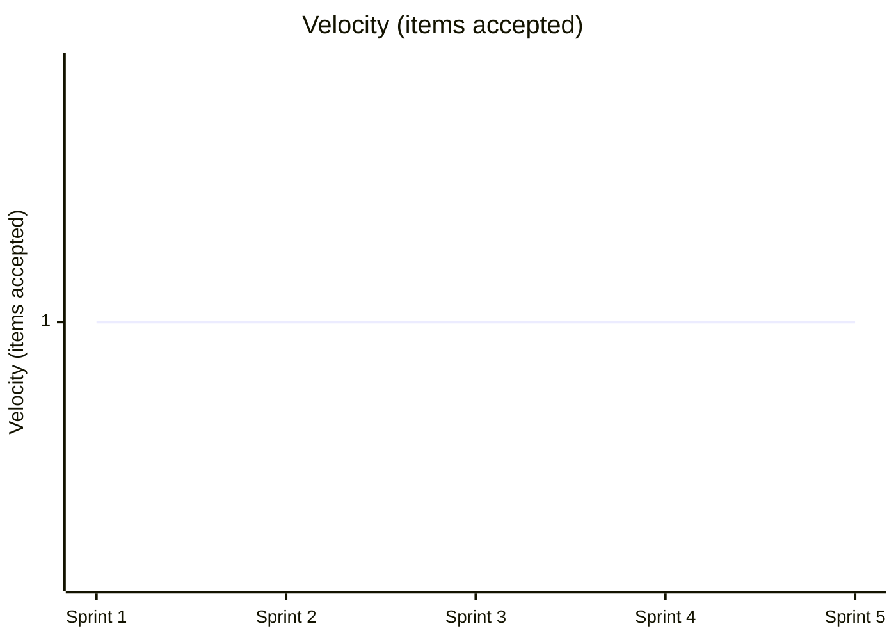
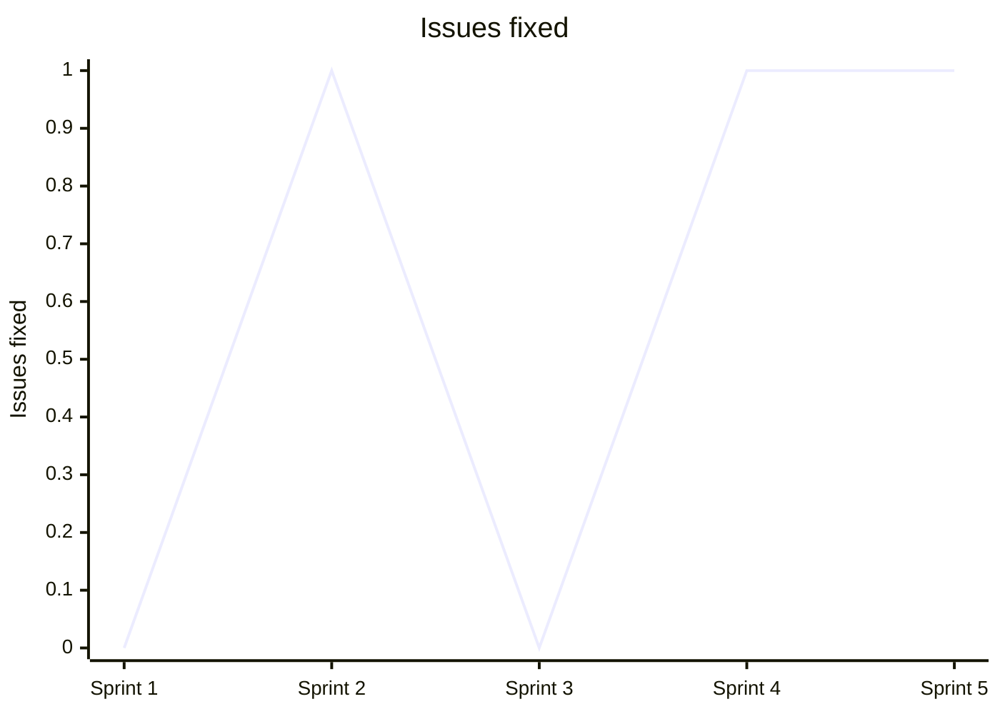
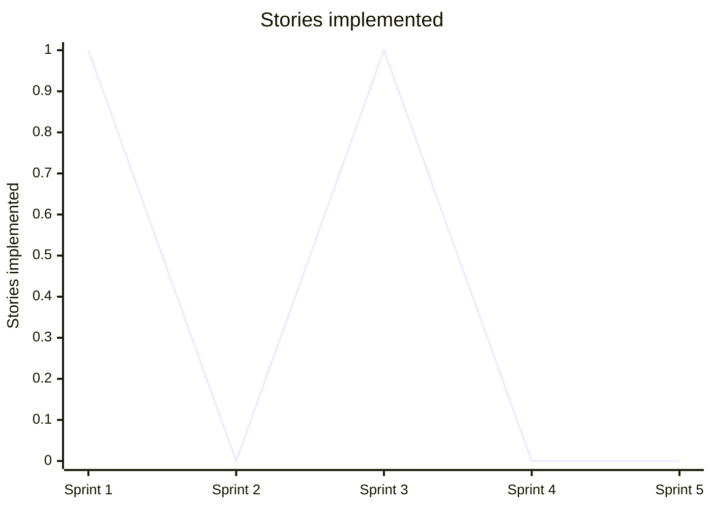
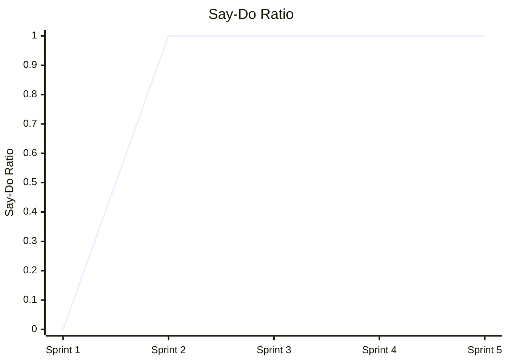
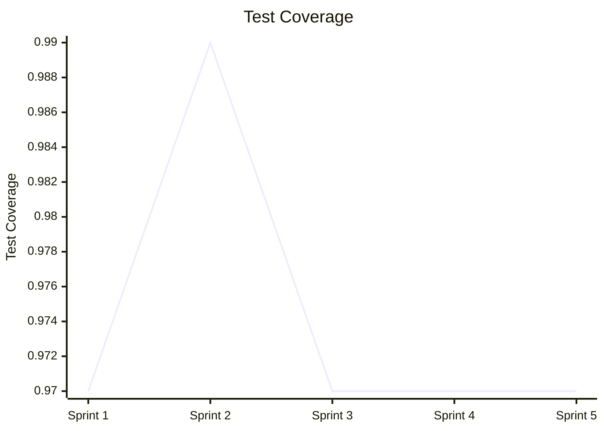

# Team Performance Evaluation Report

- Run ID: 0.1.0-run77
- Horseless Carriage commit: bb3f1fc572a13c9950ebd635e1c6393603290b76
- Branch: eval/0.1.0-run77/main
- Model: scrum-eval-cheap
- Sprints requested: 5, completed: 5
- Started: 2026-10-29T16:42:05.841452+00:00
- Finished: 2026-10-29T16:58:17.883996+00:00

## Blockers

No stories are blocked as of the last completed sprint.

## Methodology note
This run used a scripted, unattended driver (`run_eval.py`) that pre-approves every sprint goal/backlog and auto-merges any PR that opens against the eval branch, standing in for the human review gate real usage requires. Results reflect the team's real behavior under those conditions, not under full human-in-the-loop review - a lower bar in that one specific respect.

## Per-sprint metrics
| Sprint | Tokens Used | Stories Planned | Sprint Report? | PR Merges (after) |
|---|---|---|---|---|
| 1 | 3147358 | 1 | yes | 1/2 |
| 2 | 3076674 | 1 | yes | 1/3 |
| 3 | 2361638 | 1 | yes | 1/4 |
| 4 | 1339993 | 1 | yes | 1/5 |
| 5 | 1623805 | 1 | yes | 1/6 |

## KPI Trends

| KPI | Sprint 1 | Sprint 2 | Sprint 3 | Sprint 4 | Sprint 5 |
|---|---|---|---|---|---|
| Velocity (items accepted) | 1 | 1 | 1 | 1 | 1 |
| Issues fixed | 0 | 1 | 0 | 1 | 1 |
| Stories implemented | 1 | 0 | 1 | 0 | 0 |
| Testplan scenarios | 6 | 7 | 7 | 8 | 9 |
| Say-Do Ratio | 0 | 1 | 1 | 1 | 1 |
| Quality (defect escape rate) | n/a | n/a | n/a | n/a | n/a |
| Test Coverage | 0.97 | 0.99 | 0.97 | 0.97 | 0.97 |

### Velocity (items accepted)

### Issues fixed

### Stories implemented

### Testplan scenarios

### Say-Do Ratio

### Quality (defect escape rate)

No data available for this run - not available - no defect/bug-lifecycle tracking exists yet (Scrum Master's calculate_kpis did run this run, this specific metric just has no data source yet).

### Test Coverage

## Token & Cost Summary

- Total tokens used: 11,549,468
- Expected cost: $1.1549 - $4.6198 (rough estimate from litellm's static pricing for `gemini/gemini-flash-lite-latest` - token_usage doesn't split prompt/completion tokens, so this is an all-input-vs-all-output bound, not an exact figure)

## Code Quality

**Score: 2/5**

The application successfully implements core list and task creation in app.py with SQLAlchemy models, and includes a functional unit test in test_app.py. However, it fails to implement half of the product vision, leaving out task completion toggling, task deletion, list deletion, and visual completion distinctions in templates/index.html.

## Requirements Quality

**Score: 3/5**

The PRD in specs/requirements/PRD-TodoList-MVP.md and individual user stories in specs/stories/ are well-defined and structured. However, the team spent excessive effort across 5 sprints tracking internal meta-issues and dependency tasks instead of completing the core user stories US-0003 through US-0006.

## Team Efficiency

**Score: 2/5**

While the agents successfully maintained process compliance, generated sprint reports, and executed retrospectives across 5 sprints, they only completed two product user stories (US-0001 and US-0002) alongside internal infrastructure issues. The vast majority of the core product requirements remain untouched in backlog state.

## Top Problems

1. **Core product requirements for task completion, task deletion, and list deletion are completely unimplemented.** (severity: high)
   - Evidence: In specs/ROADMAP.md under version v1.0.0, user stories US-0003, US-0004, US-0005, and US-0006 remain marked as unchecked ([ ]) in backlog state.
   - Suggested fix: Allocate subsequent sprints to implementing the remaining frontend templates and backend routes specified in US-0003 through US-0006.

2. **The AI Scrum team became trapped in circular process overhead and meta-issue tracking rather than feature delivery.** (severity: high)
   - Evidence: In specs/ROADMAP.md, multiple self-referential tasks like SPEC-ISSUE-0001 through SPEC-ISSUE-0004 were prioritized ahead of actual product features across the 5 sprints.
   - Suggested fix: Adjust the agent orchestration prompt to strictly prioritize product backlog user stories over internal process compliance issues.

3. **The frontend template lacks UI elements for completion status, task deletion, and list deletion.** (severity: medium)
   - Evidence: templates/index.html only renders list creation and task addition forms without interactive controls for completing or deleting items.
   - Suggested fix: Update templates/index.html to include forms/buttons corresponding to acceptance criteria in US-0003, US-0004, and US-0005.
