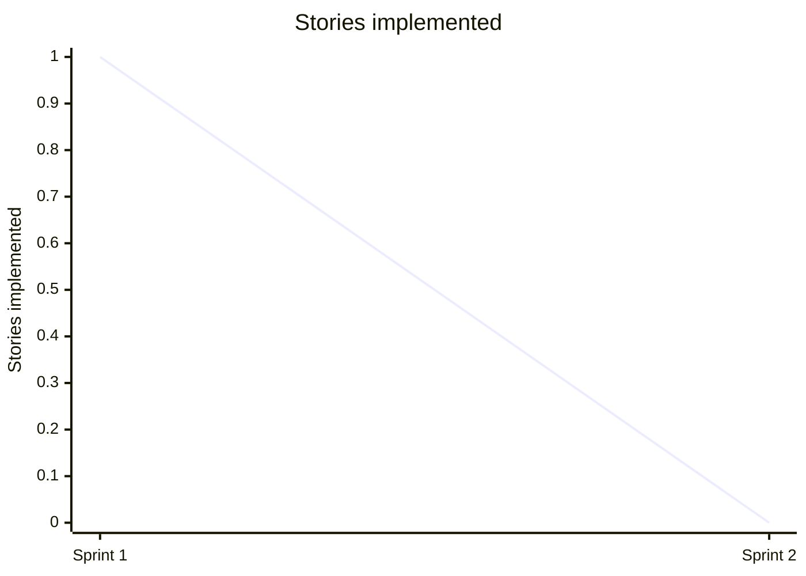

# Team Performance Evaluation Report

- Run ID: 0.2.0-run88
- Horseless Carriage commit: 76aa58ae96d52cb76e705de1c1f23f5841d951c2
- Branch: eval/0.2.0-run88/main
- Model: scrum-eval-cheap
- Sprints requested: 5, completed: 2
- Started: 2026-11-11T11:21:40.870979+00:00
- Finished: 2026-11-11T11:27:11.765570+00:00

## ⚠️ Evaluation Stopped Early

Only 2 of 5 requested sprints completed - **a sprint hit a critical token/USD budget halt with no clean close-out afterward**.

- Stop reason: `budget_critical_halt`

## Blockers

No stories are blocked as of the last completed sprint.

## Methodology note
This run used a scripted, unattended driver (`run_eval.py`) that pre-approves every sprint goal/backlog and auto-merges any PR that opens against the eval branch, standing in for the human review gate real usage requires. Results reflect the team's real behavior under those conditions, not under full human-in-the-loop review - a lower bar in that one specific respect.

## Per-sprint metrics
| Sprint | Real Sprint # | Tokens Used | Stories Planned | Sprint Report? | PR Merges (after) |
|---|---|---|---|---|---|
| 1 | 1 | 3489421 | 1 | yes | 1/1 |
| 2 | 2 | 2408128 | 1 | yes | 0/0 |

## KPI Trends

| KPI | Sprint 1 | Sprint 2 |
|---|---|---|
| Velocity (items accepted) | 1 | 1 |
| Issues fixed | 0 | 1 |
| Stories implemented | 1 | 0 |
| Testplan scenarios | 6 | 7 |
| Say-Do Ratio | 1 | 1 |
| Quality (defect escape rate) | n/a | n/a |
| Test Coverage | 0.99 | 0.99 |

### Velocity (items accepted)

```mermaid
xychart-beta
    title "Velocity (items accepted)"
    x-axis ["Sprint 1", "Sprint 2"]
    y-axis "Velocity (items accepted)"
    line [1, 1]
```

### Issues fixed

```mermaid
xychart-beta
    title "Issues fixed"
    x-axis ["Sprint 1", "Sprint 2"]
    y-axis "Issues fixed"
    line [0, 1]
```

### Stories implemented



### Testplan scenarios


### Say-Do Ratio

```mermaid
xychart-beta
    title "Say-Do Ratio"
    x-axis ["Sprint 1", "Sprint 2"]
    y-axis "Say-Do Ratio"
    line [1, 1]
```

### Quality (defect escape rate)

No data available for this run - not available - no defect/bug-lifecycle tracking exists yet (Scrum Master's calculate_kpis did run this run, this specific metric just has no data source yet).

### Test Coverage

```mermaid
xychart-beta
    title "Test Coverage"
    x-axis ["Sprint 1", "Sprint 2"]
    y-axis "Test Coverage"
    line [0.99, 0.99]
```

## Token & Cost Summary

- Total tokens used: 5,897,549
- Expected cost: $0.5898 - $2.3590 (rough estimate from litellm's static pricing for `gemini/gemini-flash-lite-latest` - token_usage doesn't split prompt/completion tokens, so this is an all-input-vs-all-output bound, not an exact figure)

## Code Quality

**Score: 4/5**

The application code in app.py and templates/index.html is clean, concise, and fully functional, implementing lists, tasks, toggling, and deletion using standard Flask and Jinja2. The test suite in tests/test_todo.py uses the Flask test client effectively and passes successfully. However, global state variables (todo_lists, next_list_id, next_task_id) in app.py limit scalability and concurrency.

## Requirements Quality

**Score: 3/5**

While the product requirements document (specs/requirements/PRD-Todo-MVP.md) and individual user stories (US-0001 through US-0006) are well-structured, the roadmap (specs/ROADMAP.md) shows severe synchronization issues where user stories US-0002 through US-0006 remain marked as [ ] To Do despite the underlying functionality being fully implemented and working in app.py and templates/index.html.

## Team Efficiency

**Score: 2/5**

The team consumed over 3.2 million tokens in Sprint 1 alone for a single user story (US-0001), reflecting excessive prompt overhead and conversational thrashing among agents. Furthermore, the agents failed to properly advance and close out user stories US-0002 through US-0006 across sprint boundaries, leading to disjointed sprint tracking.

## Top Problems

1. **User stories implemented in code are left unclosed and unaccepted in the roadmap.** (severity: high)
   - Evidence: specs/ROADMAP.md shows US-0002 through US-0006 stuck at [ ] IMPLEMENTED, while app.py and templates/index.html fully implement all corresponding features.
   - Suggested fix: Update agent workflow orchestration to ensure stories are systematically advanced to 'Accepted' upon successful feature verification and PR merge.

2. **Excessive token expenditure and process overhead for a minimal MVP.** (severity: medium)
   - Evidence: Sprint 1 report shows 3,224,706 tokens used ($0.29-$0.47 spend) to complete just one story, indicating extreme conversational redundancy.
   - Suggested fix: Refine agent prompt context windows and inter-agent communication protocols to minimize repetitive transfer turns.

3. **Mutable global state variables used for persistence and ID generation in the Flask application.** (severity: medium)
   - Evidence: app.py lines 7-10 define global variables `todo_lists = {}`, `next_list_id = 1`, and `next_task_id = 1`.
   - Suggested fix: Encapsulate state within a service class or database model layer rather than relying on un-threadsafe module-level globals.

4. **Changelog generated with repetitive, empty release notes across iterations.** (severity: low)
   - Evidence: CHANGELOG.md contains multiple redundant entries reading '## Sprint 2 - 2026-11-11 

- No user-facing changes in this release.'
   - Suggested fix: Fix changelog automation script to aggregate unique completed backlog items per release without duplication.
