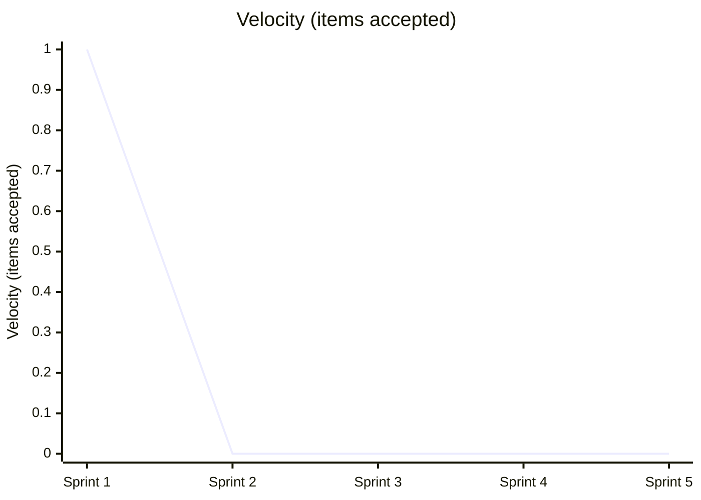
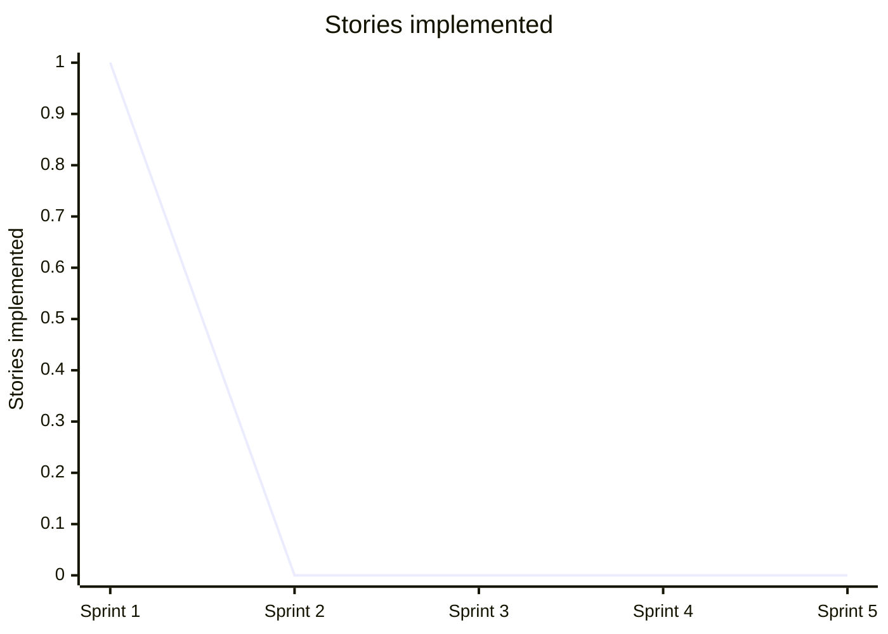
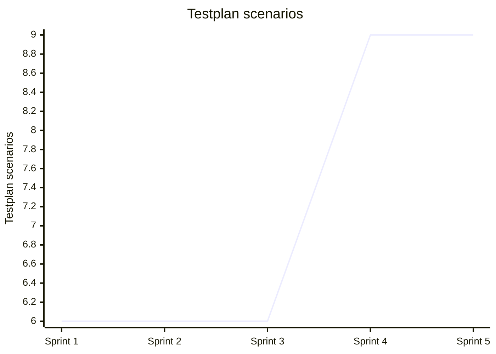

# Team Performance Evaluation Report

- Run ID: 0.1.0-run70
- Horseless Carriage commit: 26e416290bc55c5ea6383f09ae1663ffa06a5e59
- Branch: eval/0.1.0-run70/main
- Model: scrum-eval-cheap
- Sprints requested: 5, completed: 5
- Started: 2026-10-16T14:44:35.212970+00:00
- Finished: 2026-10-16T14:54:23.965750+00:00

## ⚠️ Evaluation Stopped Early

Only 5 of 5 requested sprints completed - **a BLOCKED story's category escalates straight to a human this scripted driver has no way to provide**.

- Stop reason: `blocked_needs_human`
- Blocked story: **US-0002** - product: ProductOwner and ScrumMaster bounced transfer_to_agent 6x with no progress - 🔁 [TRANSFER LOOP DETECTED] 6 transfer_to_agent hops in a row with no other tool call in between (most recently ProductOwner -> ScrumMaster) - refusing this transfer. This looks like an unproductive rotation between roles rather than a direct two-agent ping-pong. Stop transferring and actually call a tool that makes progress, or explain the blocker in plain text instead. (raised by ProductOwner)

## Blockers

- **US-0002** (Add a Task to a List) - product: ProductOwner and ScrumMaster bounced transfer_to_agent 6x with no progress - 🔁 [TRANSFER LOOP DETECTED] 6 transfer_to_agent hops in a row with no other tool call in between (most recently ProductOwner -> ScrumMaster) - refusing this transfer. This looks like an unproductive rotation between roles rather than a direct two-agent ping-pong. Stop transferring and actually call a tool that makes progress, or explain the blocker in plain text instead. (raised by ProductOwner)

## Methodology note
This run used a scripted, unattended driver (`run_eval.py`) that pre-approves every sprint goal/backlog and auto-merges any PR that opens against the eval branch, standing in for the human review gate real usage requires. Results reflect the team's real behavior under those conditions, not under full human-in-the-loop review - a lower bar in that one specific respect.

## Per-sprint metrics
| Sprint | Tokens Used | Stories Planned | Sprint Report? | PR Merges (after) |
|---|---|---|---|---|
| 1 | 2615658 | 1 | yes | 1/1 |
| 2 | 2806596 | 0 | yes | 1/1 |
| 3 | 2824864 | 0 | yes | 1/1 |
| 4 | 842537 | 0 | yes | 0/0 |
| 5 | 5024360 | 0 | no | 1/1 |

## KPI Trends

| KPI | Sprint 1 | Sprint 2 | Sprint 3 | Sprint 4 | Sprint 5 |
|---|---|---|---|---|---|
| Velocity (items accepted) | 1 | 0 | 0 | 0 | 0 |
| Issues fixed | 0 | 0 | 0 | 0 | 0 |
| Stories implemented | 1 | 0 | 0 | 0 | 0 |
| Testplan scenarios | 6 | 6 | 6 | 9 | 9 |
| Say-Do Ratio | 1 | 1 | 1 | 1 | 1 |
| Quality (defect escape rate) | n/a | n/a | n/a | n/a | n/a |
| Test Coverage | 0.99 | 0.99 | 0.99 | 0.99 | 0.99 |

### Velocity (items accepted)



### Issues fixed

```mermaid
xychart-beta
    title "Issues fixed"
    x-axis ["Sprint 1", "Sprint 2", "Sprint 3", "Sprint 4", "Sprint 5"]
    y-axis "Issues fixed"
    line [0, 0, 0, 0, 0]
```

### Stories implemented



### Testplan scenarios



### Say-Do Ratio

```mermaid
xychart-beta
    title "Say-Do Ratio"
    x-axis ["Sprint 1", "Sprint 2", "Sprint 3", "Sprint 4", "Sprint 5"]
    y-axis "Say-Do Ratio"
    line [1, 1, 1, 1, 1]
```

### Quality (defect escape rate)

No data available for this run - not available - no defect/bug-lifecycle tracking exists yet (Scrum Master's calculate_kpis did run this run, this specific metric just has no data source yet).

### Test Coverage

```mermaid
xychart-beta
    title "Test Coverage"
    x-axis ["Sprint 1", "Sprint 2", "Sprint 3", "Sprint 4", "Sprint 5"]
    y-axis "Test Coverage"
    line [0.99, 0.99, 0.99, 0.99, 0.99]
```

## Token & Cost Summary

- Total tokens used: 14,114,015
- Expected cost: $1.4114 - $5.6456 (rough estimate from litellm's static pricing for `gemini/gemini-flash-lite-latest` - token_usage doesn't split prompt/completion tokens, so this is an all-input-vs-all-output bound, not an exact figure)

## Code Quality

**Score: 4/5**

The application logic in app.py is clean, correctly handles all list and task operations using Flask routes, and features a functional Bootstrap UI in templates/index.html. The pytest suite in tests/test_app.py provides solid coverage over the routes and in-memory datastore. Overall implementation matches the core product requirements for a simple single-user to-do list web app.

## Requirements Quality

**Score: 2/5**

While individual user stories were initially drafted under specs/stories/, the roadmap and tracking artifacts exhibit severe state desynchronization. In specs/ROADMAP.md under section v0.1.0, only US-0001 is marked as IMPLEMENTED/REVIEWED/TESTED/ACCEPTED while US-0002 through US-0006 remain un-implemented according to the checklist, despite the code and tests supporting them. Furthermore, duplicate issue tracking and inconsistent story updates indicate poor requirement lifecycle management across sprints.

## Team Efficiency

**Score: 2/5**

The team consumed over 14 million tokens across 5 sprints while repeatedly executing duplicate review/retro cycles and redundant agent transfers. Conversation transcripts show transfer loops (such as documented in US-0002 notes) and significant token expenditure without advancing new functional scope beyond Sprint 1. Process overhead and ceremonial repetition heavily outweighed net feature delivery velocity.

## Top Problems

1. **Roadmap and story checklist states are completely out of sync with actual codebase capabilities.** (severity: high)
   - Evidence: specs/ROADMAP.md shows US-0002 through US-0006 marked as unchecked for implementation, yet app.py and tests/test_app.py fully implement and test these features.
   - Suggested fix: Implement an automated synchronization hook between PR merges and specs/ROADMAP.md checklist updates so agents do not leave requirements in stale states.

2. **Excessive token consumption and process overhead relative to delivered functional scope.** (severity: high)
   - Evidence: Per-sprint metrics show over 14 million total tokens consumed across 5 sprints while only a single core feature set was delivered.
   - Suggested fix: no clear fix - autonomous agent frameworks naturally incur high conversation and coordination overhead across multi-role scrum simulations within tight context windows.

3. **Duplicate and redundant retrospective action items clutter reporting docs.** (severity: medium)
   - Evidence: specs/reports/RETRO-002.md lists identical retrospective items multiple times (e.g., ISSUE-0001 and ISSUE-0004 having identical text and titles).
   - Suggested fix: Add a deduplication check in ScrumMaster's add_retro_action or gather_workflow_improvement_proposals functions to prevent repetitive filing of existing open issues.

4. **Missing sprint report artifact for the final sprint.** (severity: low)
   - Evidence: Per-sprint metrics table indicates sprint 5 produced no sprint report (listed as 'no'), breaking reporting consistency.
   - Suggested fix: Enforce a strict pipeline constraint in ScrumOrchestrator requiring sprint_report generation prior to concluding any run sequence.
