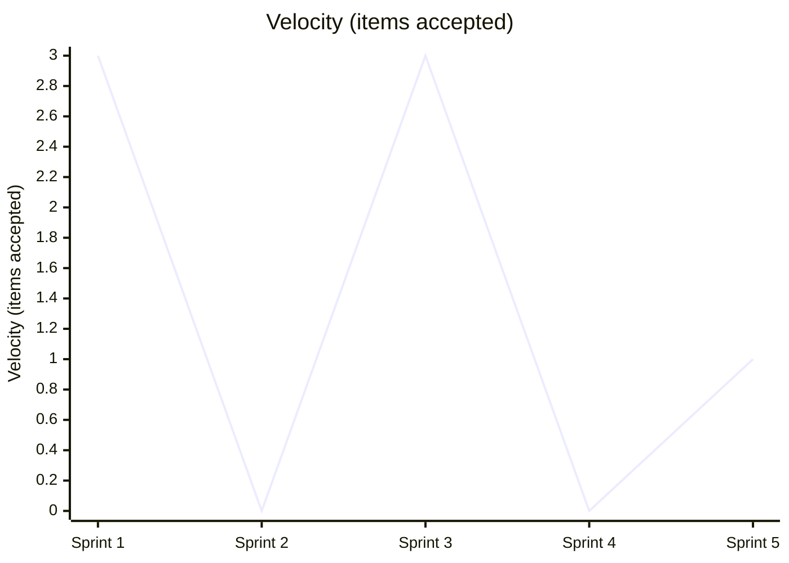
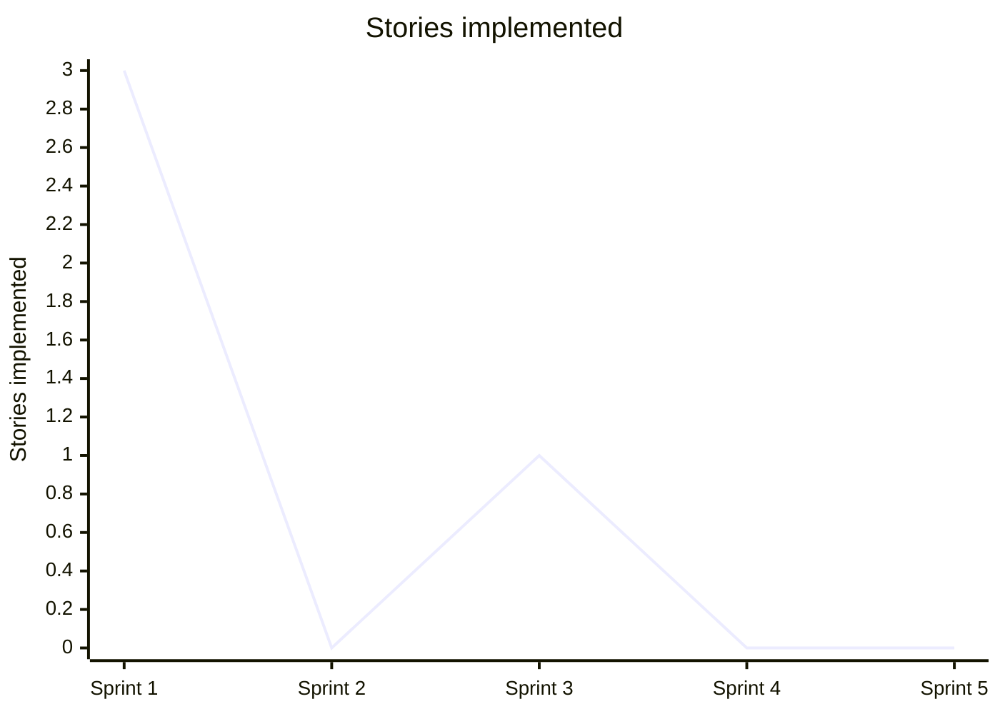
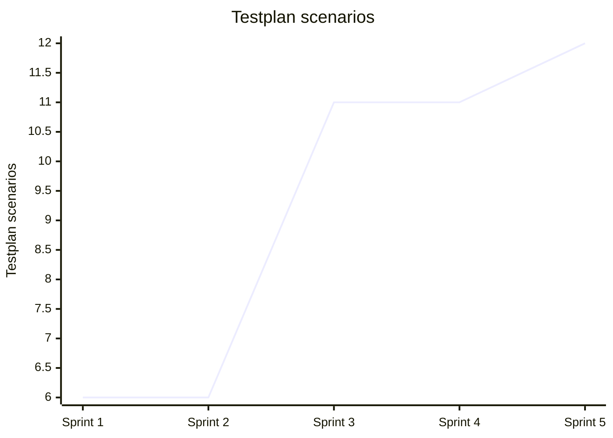
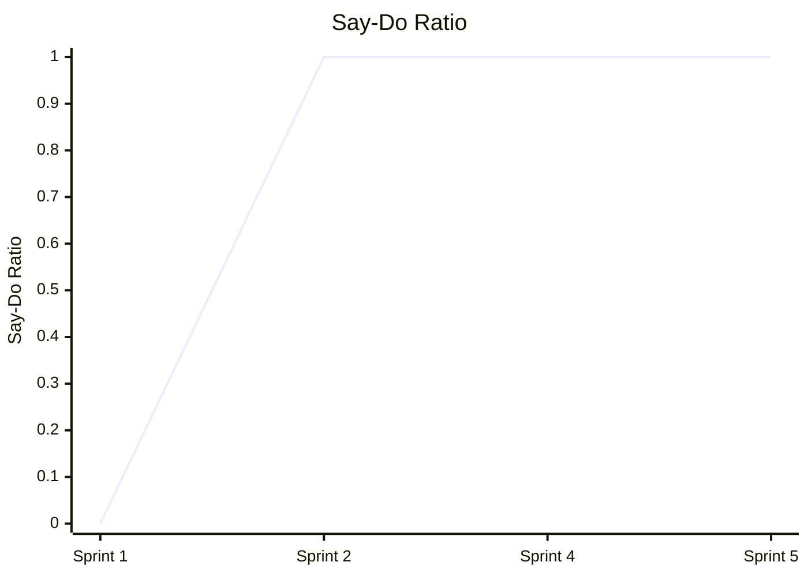

# Team Performance Evaluation Report

- Run ID: 0.1.0-run78
- Horseless Carriage commit: 99db4532225c7881d1481ae31bf4d2316434c91c
- Branch: eval/0.1.0-run78/main
- Model: scrum-eval-cheap
- Sprints requested: 5, completed: 5
- Started: 2026-10-30T07:49:41.559413+00:00
- Finished: 2026-10-30T08:01:34.631568+00:00

## Blockers

No stories are blocked as of the last completed sprint.

## Methodology note
This run used a scripted, unattended driver (`run_eval.py`) that pre-approves every sprint goal/backlog and auto-merges any PR that opens against the eval branch, standing in for the human review gate real usage requires. Results reflect the team's real behavior under those conditions, not under full human-in-the-loop review - a lower bar in that one specific respect.

## Per-sprint metrics
| Sprint | Tokens Used | Stories Planned | Sprint Report? | PR Merges (after) |
|---|---|---|---|---|
| 1 | 4888656 | 1 | yes | 1/1 |
| 2 | 5046845 | 0 | yes | 1/1 |
| 3 | 5166226 | 3 | yes | 1/1 |
| 4 | 5357127 | 0 | yes | 1/1 |
| 5 | 1682077 | 1 | yes | 1/1 |

## KPI Trends

| KPI | Sprint 1 | Sprint 2 | Sprint 3 | Sprint 4 | Sprint 5 |
|---|---|---|---|---|---|
| Velocity (items accepted) | 3 | 0 | 3 | 0 | 1 |
| Issues fixed | 0 | 0 | 2 | 0 | 1 |
| Stories implemented | 3 | 0 | 1 | 0 | 0 |
| Testplan scenarios | 6 | 6 | 11 | 11 | 12 |
| Say-Do Ratio | 0 | 1 | n/a | 1 | 1 |
| Quality (defect escape rate) | n/a | n/a | n/a | n/a | n/a |
| Test Coverage | 0.99 | 0.99 | n/a | 0.99 | 0.99 |

### Velocity (items accepted)



### Issues fixed


### Stories implemented



### Testplan scenarios



### Say-Do Ratio



(1 of 5 sprints have no data point for this KPI and are omitted above - see the table for exactly which.)

### Quality (defect escape rate)

No data available for this run - not available - no defect/bug-lifecycle tracking exists yet (Scrum Master's calculate_kpis did run this run, this specific metric just has no data source yet).

### Test Coverage

```mermaid
xychart-beta
    title "Test Coverage"
    x-axis ["Sprint 1", "Sprint 2", "Sprint 4", "Sprint 5"]
    y-axis "Test Coverage"
    line [0.99, 0.99, 0.99, 0.99]
```

(1 of 5 sprints have no data point for this KPI and are omitted above - see the table for exactly which.)

## Token & Cost Summary

- Total tokens used: 22,140,931
- Expected cost: $2.2141 - $8.8564 (rough estimate from litellm's static pricing for `gemini/gemini-flash-lite-latest` - token_usage doesn't split prompt/completion tokens, so this is an all-input-vs-all-output bound, not an exact figure)

## Code Quality

**Score: 4/5**

The application logic in app.py cleanly uses Flask and SQLAlchemy to implement necessary CRUD endpoints for lists, tasks, toggling completion, and clearing completed items. Template rendering and route handling are structured properly for a simple single-user web app. However, minor gaps remain in the Kanban release status board sync within specs/ROADMAP.md.

## Requirements Quality

**Score: 3/5**

User stories and epics are properly detailed under specs/stories/, but the product roadmap (specs/ROADMAP.md) fails to accurately map user stories under the active v0.1 release plan. Several core MVP stories such as US-0004, US-0005, and US-0006 are incorrectly left in the unplanned backlog section rather than being tracked in the active delivery plan.

## Team Efficiency

**Score: 2/5**

The multi-agent team struggled severely with token consumption limits, hitting or exceeding the 5,000,000 token budget across multiple sprints (e.g., Sprint 3 consumed 5,166,226 tokens and Sprint 4 consumed 5,357,345 tokens). Additionally, the team spent excessive cycles repeatedly logging and processing technical self-referential issues like SPEC-ISSUE-0001 and SPEC-ISSUE-0002 instead of focusing purely on product delivery.

## Top Problems

1. **Token budget exhaustion across multiple consecutive sprints.** (severity: high)
   - Evidence: Sprint 3 consumed 5,166,226 tokens and Sprint 4 consumed 5,357,345 tokens against the 5,000,000 budget.
   - Suggested fix: no clear fix - prompt optimization and agent orchestration limits are constrained by the underlying evaluation methodology.

2. **Core user stories are misplaced in the product roadmap backlog instead of the active release plan.** (severity: medium)
   - Evidence: specs/ROADMAP.md lists US-0005 ('Delete an entire list') and US-0006 ('View all lists and tasks with visual completion styling') under 'Backlog (unplanned)' despite being core MVP scope.
   - Suggested fix: Update specs/ROADMAP.md to move US-0005 and US-0006 into the active v0.1 release plan section.

3. **Excessive multi-agent process overhead spent on internal meta-issues rather than product features.** (severity: medium)
   - Evidence: specs/requirements/SPEC-ISSUE-0001-Use-PR-review-comments-instead-of-PR-approvals...md and SPEC-ISSUE-0002 consume sprint cycles on GitHub API limitations.
   - Suggested fix: Streamline agent operational guardrails so agents do not file and process workflow meta-issues as primary backlog items during evaluation runs.
