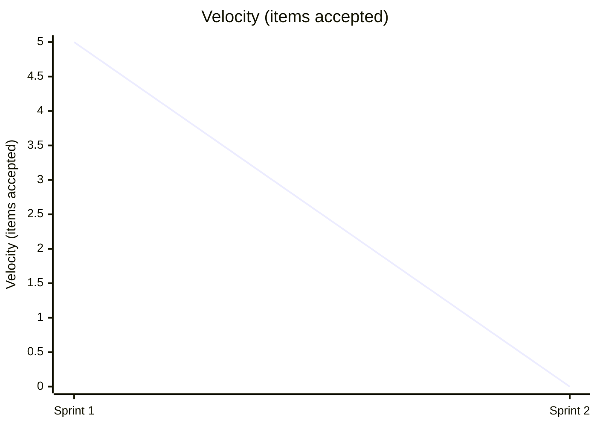
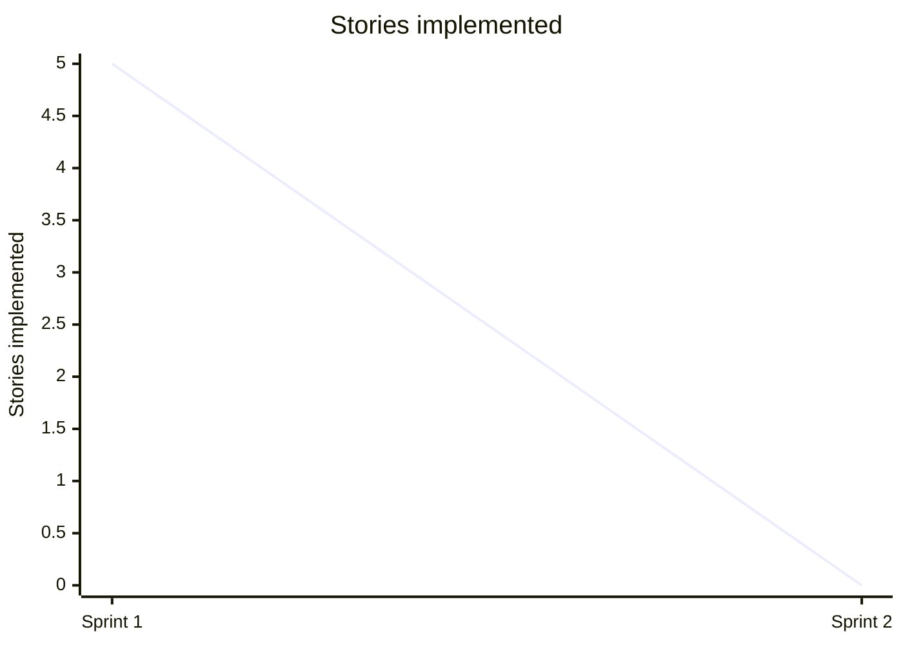
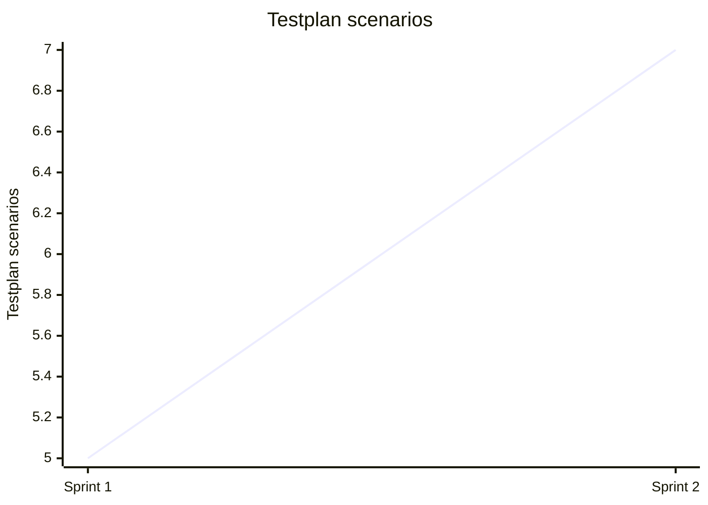

# Team Performance Evaluation Report

- Run ID: 0.1.0-run56
- Horseless Carriage commit: 58b0603d7244bcf8cced7cdca8a00154e9a6b9a0
- Branch: eval/0.1.0-run56/main
- Model: scrum-eval-cheap
- Sprints requested: 5, completed: 2
- Started: 2026-10-12T07:39:57.290474+00:00
- Finished: 2026-10-12T07:46:12.138626+00:00

## ⚠️ Evaluation Stopped Early

Only 2 of 5 requested sprints completed - **see stop_reason below for the raw code**.

- Stop reason: `blocked_mechanically_detected`
- Blocked story: **US-0003** - technical: DevTeam and ProductOwner bounced transfer_to_agent 6x with no progress - 🔁 [TRANSFER LOOP DETECTED] 6 transfer_to_agent hops in a row with no other tool call in between (most recently DevTeam -> ProductOwner) - refusing this transfer. This looks like an unproductive rotation between roles rather than a direct two-agent ping-pong. Stop transferring and actually call a tool that makes progress, or explain the blocker in plain text instead. (raised by DevTeam)

## Blockers

- **US-0003** (Mark task as complete or incomplete) - technical: DevTeam and ProductOwner bounced transfer_to_agent 6x with no progress - 🔁 [TRANSFER LOOP DETECTED] 6 transfer_to_agent hops in a row with no other tool call in between (most recently DevTeam -> ProductOwner) - refusing this transfer. This looks like an unproductive rotation between roles rather than a direct two-agent ping-pong. Stop transferring and actually call a tool that makes progress, or explain the blocker in plain text instead. (raised by DevTeam)
- **US-0005** (Delete an entire list) - product: US-0005 is marked as Ready in the roadmap and specs, but the system workflow checks consider US-0005 unaccepted, preventing US-0006 from starting. How should we proceed with completing or re-verifying US-0005? (raised by DevTeam)
- **US-0006** (Persistent storage across application restarts) - technical: US-0004 state ordering conflict is blocking US-0006 from starting. How can we bypass or resolve this sequential backlog requirement? (raised by DevTeam)

## Methodology note
This run used a scripted, unattended driver (`run_eval.py`) that pre-approves every sprint goal/backlog and auto-merges any PR that opens against the eval branch, standing in for the human review gate real usage requires. Results reflect the team's real behavior under those conditions, not under full human-in-the-loop review - a lower bar in that one specific respect.

## Per-sprint metrics
| Sprint | Tokens Used | Stories Planned | Sprint Report? | PR Merges (after) |
|---|---|---|---|---|
| 1 | 5273033 | 5 | yes | 0/0 |
| 2 | 3840450 | 2 | yes | 1/1 |

## KPI Trends

| KPI | Sprint 1 | Sprint 2 |
|---|---|---|
| Velocity (items accepted) | 5 | 0 |
| Issues fixed | 0 | 0 |
| Stories implemented | 5 | 0 |
| Testplan scenarios | 5 | 7 |
| Say-Do Ratio | 1 | 0.29 |
| Quality (defect escape rate) | n/a | n/a |
| Test Coverage | 0.9 | 0.9 |

### Velocity (items accepted)



### Issues fixed

```mermaid
xychart-beta
    title "Issues fixed"
    x-axis ["Sprint 1", "Sprint 2"]
    y-axis "Issues fixed"
    line [0, 0]
```

### Stories implemented



### Testplan scenarios



### Say-Do Ratio

```mermaid
xychart-beta
    title "Say-Do Ratio"
    x-axis ["Sprint 1", "Sprint 2"]
    y-axis "Say-Do Ratio"
    line [1, 0.29]
```

### Quality (defect escape rate)

No data available for this run - not available - no defect/bug-lifecycle trackinggests exists yet (Scrum Master's calculate_kpis did run this run, this specific metric just has no data source yet).

### Test Coverage

```mermaid
xychart-beta
    title "Test Coverage"
    x-axis ["Sprint 1", "Sprint 2"]
    y-axis "Test Coverage"
    line [0.9, 0.9]
```

## Token & Cost Summary

- Total tokens used: 9,113,483
- Expected cost: $0.9113 - $3.6454 (rough estimate from litellm's static pricing for `gemini/gemini-flash-lite-latest` - token_usage doesn't split prompt/completion tokens, so this is an all-input-vs-all-output bound, not an exact figure)

## Code Quality

**Score: 4/5**

The application in app.py and templates/index.html successfully implements all core CRUD operations for lists and tasks, complete with form-based routing and a clean CSS layout. The test suite in tests/test_app.py covers core functionalities including list creation, task addition, toggling, and list deletion with cascade. However, the architecture relies entirely on in-memory dictionaries (lists_db and tasks_db), completely failing to implement the persistence requirements specified in US-0006.

## Requirements Quality

**Score: 2/5**

While the Product Requirements Document (PRD-ToDo-MVP.md) and individual user stories are well-structured, the roadmap management and execution tracking are severely flawed. ROADMAP.md leaves core stories like US-0006 ('Persistent storage across application restarts') and US-0007 ('Robust error handling and validation') uncompleted under v0.2, despite the team falsely logging them or encountering workflow gate locks. Additionally, duplicate and confusing entries such as ISSUE-0002 indicate process breakdowns in stage-ordering requirements.

## Team Efficiency

**Score: 2/5**

The team experienced severe collaboration bottlenecks, evidenced by multiple agent transfer loops (e.g., 6 consecutive transfer_to_agent hops between DevTeam and ProductOwner without tool calls). Although Sprint 1 delivered initial MVP stories, Sprint 2 stalled out, failing to deliver planned stories like US-0006 and US-0007 due to artificial workflow gates and state-ordering conflicts recorded in specs/reports/SPRINT-REPORT-002.md.

## Top Problems

1. **Complete lack of persistent storage despite user story US-0006 being targeted.** (severity: high)
   - Evidence: app.py uses in-memory dictionaries lists_db = {} and tasks_db = {} with no file or database writes.
   - Suggested fix: Implement JSON or SQLite helper functions in app.py to load and save state on mutations, fulfilling US-0006.

2. **Unimplemented error handling and validation story US-0007 left in pending state.** (severity: medium)
   - Evidence: specs/ROADMAP.md lists US-0007 as un-implemented under v0.2.
   - Suggested fix: Add robust input validation checks and user-friendly error banners or flash messages in templates/index.html.

3. **Agent transfer loops causing unproductive role rotation and communication breakdown.** (severity: high)
   - Evidence: specs/reports/SPRINT-REPORT-002.md cites: 'DevTeam and ProductOwner bounced transfer_to_agent 6x with no progress - 🔁 [TRANSFER LOOP DETECTED]'
   - Suggested fix: Refine agent prompt guardrails to prohibit excessive back-and-forth transferring without intermediate tool usage.

4. **Sequential backlog story execution gates blocking work progression.** (severity: medium)
   - Evidence: specs/stories/US-0006-Persistent-storage-across-application-restarts.md states: 'US-0004 state ordering conflict is blocking US-0006 from starting.'
   - Suggested fix: Loosen rigid sequential dependency validation in roadmap management workflows to prevent administrative blocks on valid development tasks.
