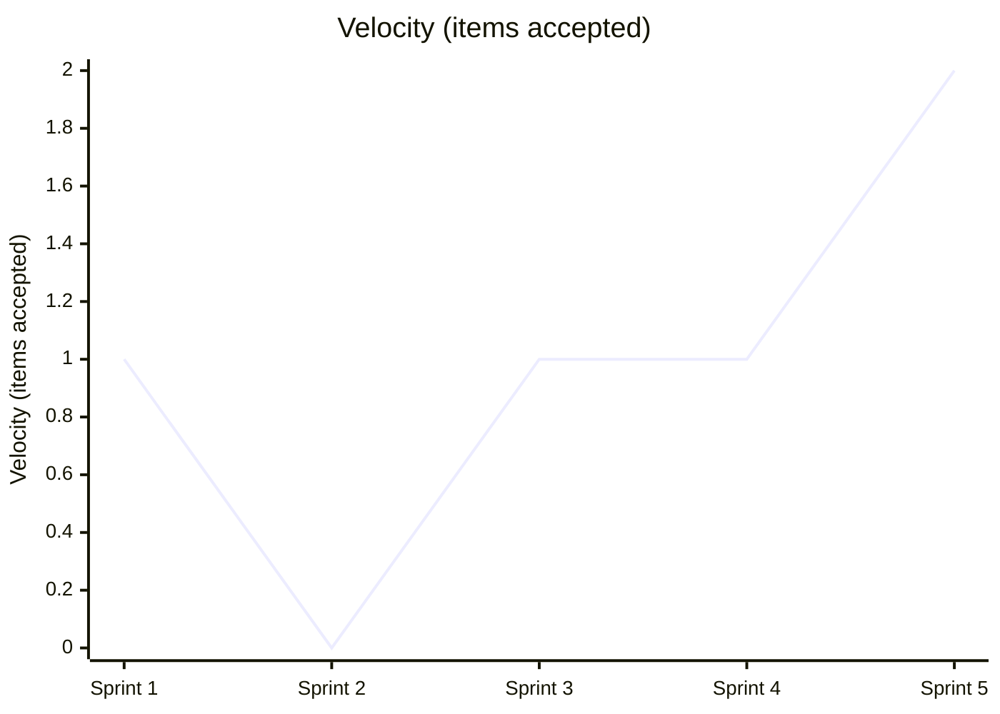
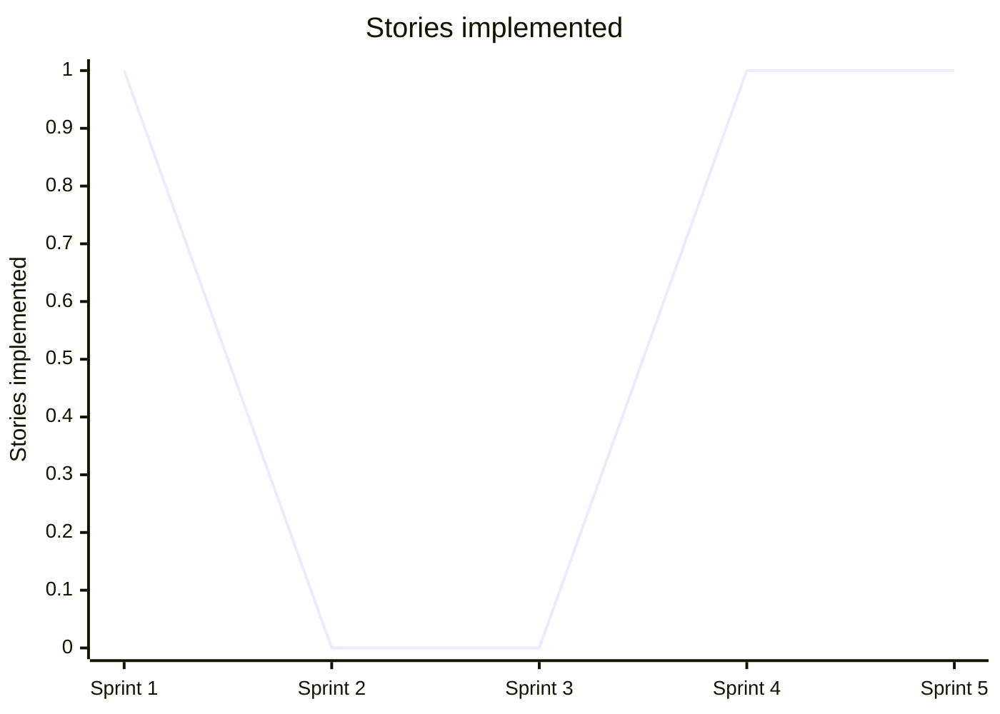
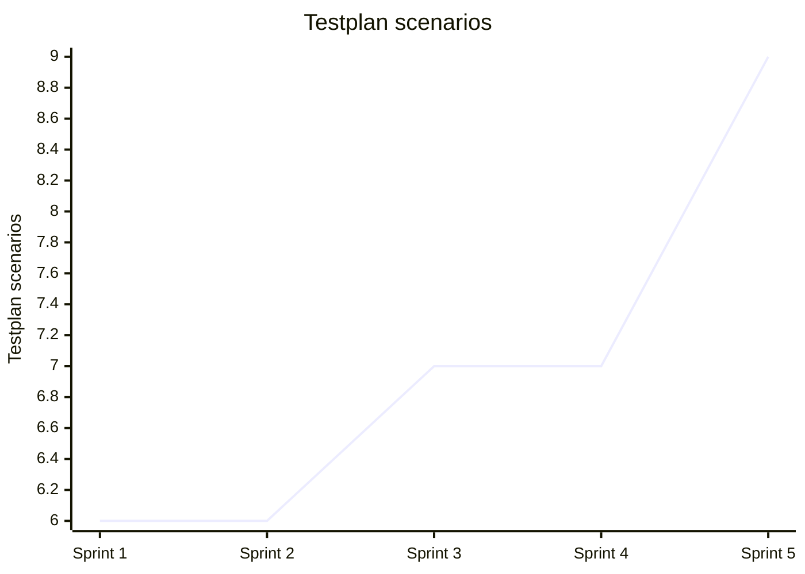
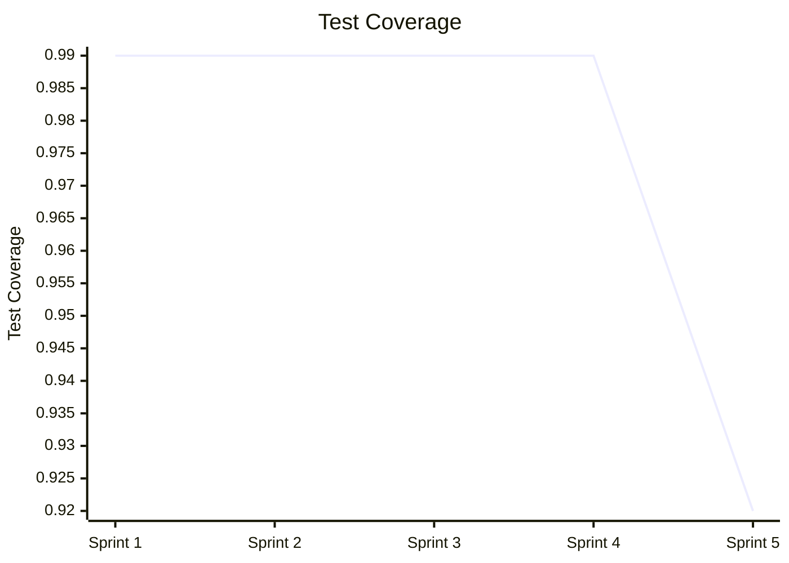

# Team Performance Evaluation Report

- Run ID: 0.1.0-run82
- Horseless Carriage commit: 979dfa557a03979cbbbd1ce646ba4eeabef18191
- Branch: eval/0.1.0-run82/main
- Model: scrum-eval-cheap
- Sprints requested: 5, completed: 5 (4 of which were genuinely distinct real sprints - see 'Real Sprint #' below)
- Started: 2026-11-02T13:27:56.702199+00:00
- Finished: 2026-11-02T13:42:57.955761+00:00

## ⚠️ Evaluation Stopped Early

Only 5 of 5 requested sprints completed - **a sprint hit a critical token/USD budget halt with no clean close-out afterward**.

- Stop reason: `budget_critical_halt`

## Blockers

- **US-0003** (Mark Task Complete or Incomplete) - technical: advance_story_stage('US-0003', 'Tested') has been rejected 3 times in a row for the same reason - most recently: Cannot mark 'US-0003' Tested - posting the review via gh_pr_review failed: failed to create review: GraphQL: Review Can not approve your own pull request (addPullRequestReview) (raised by QA)

## Methodology note
This run used a scripted, unattended driver (`run_eval.py`) that pre-approves every sprint goal/backlog and auto-merges any PR that opens against the eval branch, standing in for the human review gate real usage requires. Results reflect the team's real behavior under those conditions, not under full human-in-the-loop review - a lower bar in that one specific respect.

## Per-sprint metrics
| Sprint | Real Sprint # | Tokens Used | Stories Planned | Sprint Report? | PR Merges (after) |
|---|---|---|---|---|---|
| 1 | 1 | 5367066 | 1 | fallback | 1/1 |
| 2 | 1 (continued) | 5522323 | 0 | yes | 1/1 |
| 3 | 2 | 1443595 | 1 | yes | 1/1 |
| 4 | 3 | 3157779 | 1 | yes | 1/1 |
| 5 | 4 | 6108831 | 3 | yes | 1/1 |

## KPI Trends

| KPI | Sprint 1 | Sprint 2 | Sprint 3 | Sprint 4 | Sprint 5 |
|---|---|---|---|---|---|
| Velocity (items accepted) | 1 | 0 | 1 | 1 | 2 |
| Issues fixed | 0 | 0 | 1 | 0 | 2 |
| Stories implemented | 1 | 0 | 0 | 1 | 1 |
| Testplan scenarios | 6 | 6 | 7 | 7 | 9 |
| Say-Do Ratio | 1 | 1 | 1 | 1 | 0.67 |
| Quality (defect escape rate) | n/a | n/a | n/a | n/a | n/a |
| Test Coverage | 0.99 | 0.99 | 0.99 | 0.99 | 0.92 |

### Velocity (items accepted)

### Issues fixed

### Stories implemented

### Testplan scenarios

### Say-Do Ratio

### Quality (defect escape rate)

No data available for this run - not available - no defect/bug-lifecycle tracking exists yet (Scrum Master's calculate_kpis did run this run, this specific metric just has no data source yet).

### Test Coverage

## Token & Cost Summary

- Total tokens used: 16,232,528
- Expected cost: $1.6233 - $6.4930 (rough estimate from litellm's static pricing for `gemini/gemini-flash-lite-latest` - token_usage doesn't split prompt/completion tokens, so this is an all-input-vs-all-output bound, not an exact figure)

## Code Quality

**Score: 3/5**

The Flask application in app.py implements basic in-memory CRUD operations for lists and tasks, along with JSON API endpoints. However, it relies heavily on global mutable state lists and fragile ID generation logic, leading to test leakage and flaking across test runs. Additionally, input validation is minimal and error handling is rudimentary.

## Requirements Quality

**Score: 3/5**

The PRD (specs/requirements/PRD-TodoApp.md) and roadmap define a clean MVP scope covering list and task operations. While user stories are present in specs/stories/, execution fell behind in later sprints, leaving several core stories (such as US-0003 through US-0006) marked incomplete or stuck in review in the roadmap (specs/ROADMAP.md).

## Team Efficiency

**Score: 2/5**

The AI Scrum team exhibited repeated process breakdowns, notably getting blocked multiple times by GitHub GraphQL self-approval restrictions on pull requests (SPEC-ISSUE-0004). Token budgets were frequently exceeded, and coordination loops resulted in redundant reviews and failed review stage transitions.

## Top Problems

1. **Pull request review workflows repeatedly failed due to GitHub GraphQL self-approval restrictions.** (severity: high)
   - Evidence: specs/reports/SPRINT-REPORT-LATEST.md cites: 'GraphQL: Review Can not approve your own pull request (addPullRequestReview)'
   - Suggested fix: Configure the agent harness to use comment-based approvals or designate distinct reviewer personas that do not trigger self-review blocks.

2. **Application relies on global mutable lists without thread-safe persistence or proper state isolation.** (severity: high)
   - Evidence: app.py defines 'lists = []' and 'tasks = []' as global variables modified directly by route handlers.
   - Suggested fix: Refactor app.py to encapsulate state within an application factory pattern or a dedicated repository class.

3. **Core user stories remained incomplete or stuck at the end of the 5-sprint run.** (severity: medium)
   - Evidence: specs/ROADMAP.md shows US-0003 through US-0006 unchecked under version v0.1.0 release goals.
   - Suggested fix: Adjust sprint planning velocity and token budgets to prevent running out of capacity before completing core MVP scope.
