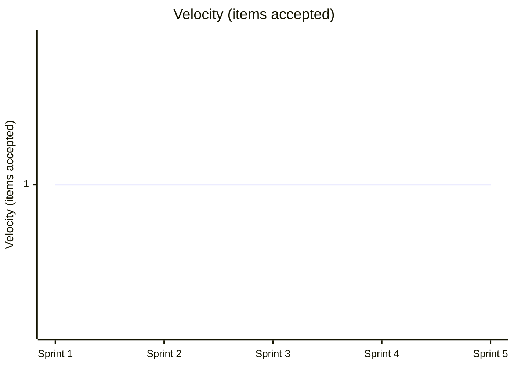
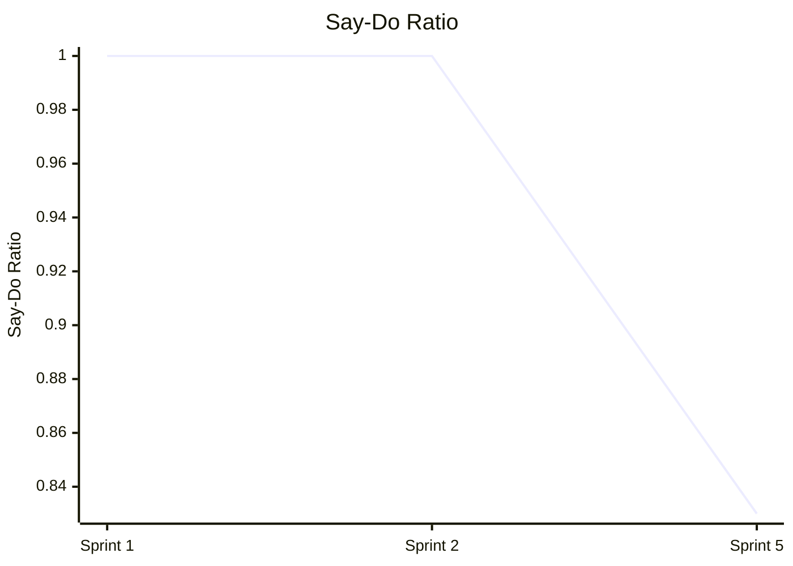

# Team Performance Evaluation Report

- Run ID: 0.1.0-run57
- Horseless Carriage commit: 80be64f4844283663660d3336db1ee503332dd42
- Branch: eval/0.1.0-run57/main
- Model: scrum-eval-cheap
- Sprints requested: 5, completed: 5
- Started: 2026-10-12T08:34:20.479420+00:00
- Finished: 2026-10-12T08:46:09.321374+00:00

## ⚠️ Evaluation Stopped Early

Only 5 of 5 requested sprints completed - **a sprint hit a critical token/USD budget halt with no clean close-out afterward**.

- Stop reason: `budget_critical_halt`

## Blockers

No stories are blocked as of the last completed sprint.

## Methodology note
This run used a scripted, unattended driver (`run_eval.py`) that pre-approves every sprint goal/backlog and auto-merges any PR that opens against the eval branch, standing in for the human review gate real usage requires. Results reflect the team's real behavior under those conditions, not under full human-in-the-loop review - a lower bar in that one specific respect.

## Per-sprint metrics
| Sprint | Tokens Used | Stories Planned | Sprint Report? | PR Merges (after) |
|---|---|---|---|---|
| 1 | 2479746 | 1 | yes | 1/1 |
| 2 | 2574071 | 1 | yes | 1/1 |
| 3 | 3873771 | 1 | yes | 1/1 |
| 4 | 5168595 | 1 | yes | 1/1 |
| 5 | 6353952 | 2 | fallback | 0/0 |

## KPI Trends

| KPI | Sprint 1 | Sprint 2 | Sprint 3 | Sprint 4 | Sprint 5 |
|---|---|---|---|---|---|
| Velocity (items accepted) | 1 | 1 | 1 | 1 | 1 |
| Issues fixed | 0 | 0 | 0 | 0 | 0 |
| Stories implemented | 1 | 1 | 1 | 1 | 1 |
| Testplan scenarios | 6 | 6 | 6 | 6 | 6 |
| Say-Do Ratio | 1 | 1 | n/a | n/a | 0.83 |
| Quality (defect escape rate) | n/a | n/a | n/a | n/a | n/a |
| Test Coverage | 0.97 | 0.97 | n/a | n/a | 0.99 |

### Velocity (items accepted)



### Issues fixed

```mermaid
xychart-beta
    title "Issues fixed"
    x-axis ["Sprint 1", "Sprint 2", "Sprint 3", "Sprint 4", "Sprint 5"]
    y-axis "Issues fixed"
    line [0, 0, 0, 0, 0]
```

### Stories implemented

```mermaid
xychart-beta
    title "Stories implemented"
    x-axis ["Sprint 1", "Sprint 2", "Sprint 3", "Sprint 4", "Sprint 5"]
    y-axis "Stories implemented"
    line [1, 1, 1, 1, 1]
```

### Testplan scenarios

```mermaid
xychart-beta
    title "Testplan scenarios"
    x-axis ["Sprint 1", "Sprint 2", "Sprint 3", "Sprint 4", "Sprint 5"]
    y-axis "Testplan scenarios"
    line [6, 6, 6, 6, 6]
```

### Say-Do Ratio



(2 of 5 sprints have no data point for this KPI and are omitted above - see the table for exactly which.)

### Quality (defect escape rate)

No data available for this run - not available - no defect/bug-lifecycle tracking exists yet (Scrum Master's calculate_kpis did run this run, this specific metric just has no data source yet).

### Test Coverage


(2 of 5 sprints have no data point for this KPI and are omitted above - see the table for exactly which.)

## Token & Cost Summary

- Total tokens used: 20,450,135
- Expected cost: $2.0450 - $8.1801 (rough estimate from litellm's static pricing for `gemini/gemini-flash-lite-latest` - token_usage doesn't split prompt/completion tokens, so this is an all-input-vs-all-output bound, not an exact figure)

## Code Quality

**Score: 3/5**

The application code in app.py and templates/index.html correctly implements core CRUD features for lists and tasks using an in-memory dictionary. However, missing features like US-0005 (Delete Entire List) and US-0006 remain incomplete due to budget exhaustion in sprint 5. The codebase remains clean, well-structured, and integrated with pytest.

## Requirements Quality

**Score: 3/5**

The PRD and user stories are thoroughly documented in specs/requirements/PRD-Todo-App.md and specs/stories/. The backlog is structured into sprints, but the team failed to complete the full MVP scope before hitting token limits, leaving US-0005 and US-0006 unfinished.

## Team Efficiency

**Score: 3/5**

The AI scrum team adhered closely to agile ceremonies, producing detailed sprint reports, transcripts, and retro logs. Despite this structured overhead, token and financial budgets ran out during sprint 5 before the remaining stories could be executed.

## Top Problems

1. **User story US-0005 (Delete Entire List) remains unimplemented and unstarted.** (severity: high)
   - Evidence: specs/ROADMAP.md shows US-0005 marked as unchecked ([ ] IMPLEMENTED) under backlog.
   - Suggested fix: Implement the list deletion route in app.py and corresponding UI button in templates/index.html.

2. **User story US-0006 (View All Lists and Tasks) was not delivered within the 5-sprint budget.** (severity: high)
   - Evidence: specs/ROADMAP.md lists US-0006 with unchecked implementation status.
   - Suggested fix: Ensure dashboard view requirements are bundled into earlier sprints or adjust velocity expectations.

3. **Sprint 5 budget was exhausted before agent reports and tasks could finish cleanly.** (severity: medium)
   - Evidence: specs/reports/SPRINT-REPORT-LATEST.md notes 'This sprint's token/USD budget was used in full before Scrum Master's own create_sprint_report call could run'.
   - Suggested fix: no clear fix - token caps and fixed sprint lengths are inherent constraints of the evaluation harness.
