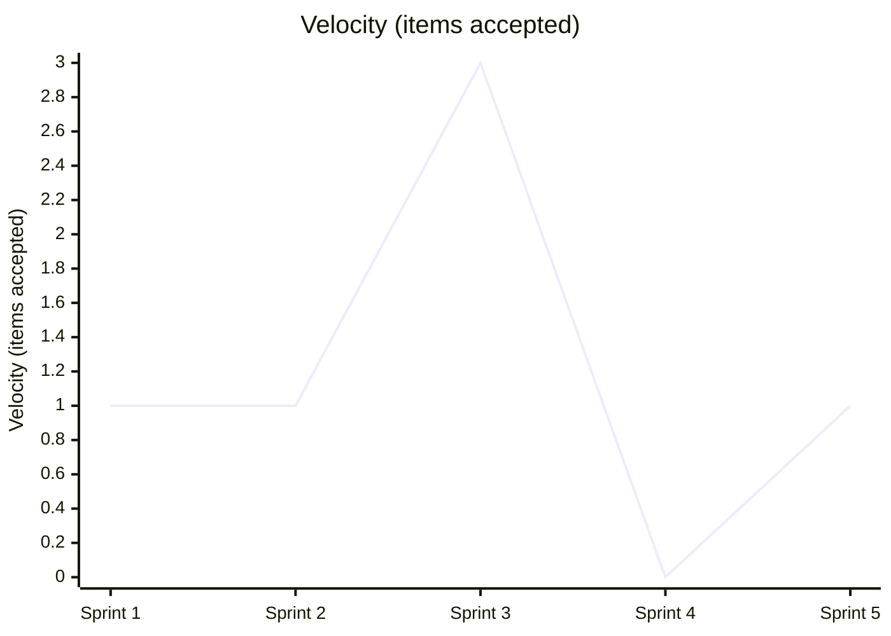
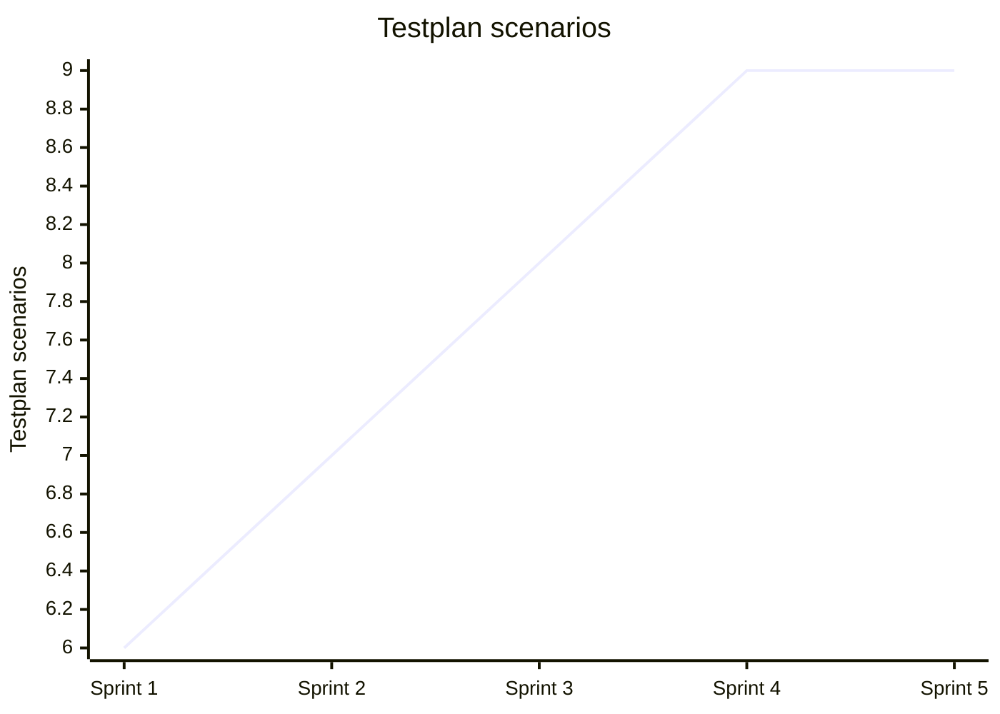

# Team Performance Evaluation Report

- Run ID: 0.1.0-run76
- Horseless Carriage commit: f8d94e6145c23f1aa6a48ca3e6f4026de0741bb1
- Branch: eval/0.1.0-run76/main
- Model: scrum-eval-cheap
- Sprints requested: 5, completed: 5
- Started: 2026-10-27T15:45:57.306329+00:00
- Finished: 2026-10-27T16:05:01.415252+00:00

## Blockers

No stories are blocked as of the last completed sprint.

## Methodology note
This run used a scripted, unattended driver (`run_eval.py`) that pre-approves every sprint goal/backlog and auto-merges any PR that opens against the eval branch, standing in for the human review gate real usage requires. Results reflect the team's real behavior under those conditions, not under full human-in-the-loop review - a lower bar in that one specific respect.

## Per-sprint metrics
| Sprint | Tokens Used | Stories Planned | Sprint Report? | PR Merges (after) |
|---|---|---|---|---|
| 1 | 3011298 | 1 | yes | 1/1 |
| 2 | 2096935 | 1 | yes | 1/2 |
| 3 | 6122023 | 6 | yes | 1/3 |
| 4 | 636152 | 1 | no | 0/2 |
| 5 | 2413339 | 0 | yes | 1/4 |

## KPI Trends

| KPI | Sprint 1 | Sprint 2 | Sprint 3 | Sprint 4 | Sprint 5 |
|---|---|---|---|---|---|
| Velocity (items accepted) | 1 | 1 | 3 | 0 | 1 |
| Issues fixed | 0 | 0 | 0 | 0 | 0 |
| Stories implemented | 1 | 1 | 3 | 0 | 1 |
| Testplan scenarios | 6 | 7 | 8 | 9 | 9 |
| Say-Do Ratio | 1 | 1 | 0.5 | n/a | 0.25 |
| Quality (defect escape rate) | n/a | n/a | n/a | n/a | n/a |
| Test Coverage | 0.99 | 0.99 | 0.99 | n/a | 0.99 |

### Velocity (items accepted)



### Issues fixed

```mermaid
xychart-beta
    title "Issues fixed"
    x-axis ["Sprint 1", "Sprint 2", "Sprint 3", "Sprint 4", "Sprint 5"]
    y-axis "Issues fixed"
    line [0, 0, 0, 0, 0]
```

### Stories implemented


### Testplan scenarios



### Say-Do Ratio

```mermaid
xychart-beta
    title "Say-Do Ratio"
    x-axis ["Sprint 1", "Sprint 2", "Sprint 3", "Sprint 5"]
    y-axis "Say-Do Ratio"
    line [1, 1, 0.5, 0.25]
```

(1 of 5 sprints have no data point for this KPI and are omitted above - see the table for exactly which.)

### Quality (defect escape rate)

No data available for this run - not available - no defect/bug-lifecycle tracking exists yet (Scrum Master's calculate_kpis did run this run, this specific metric just has no data source yet).

### Test Coverage

```mermaid
xychart-beta
    title "Test Coverage"
    x-axis ["Sprint 1", "Sprint 2", "Sprint 3", "Sprint 5"]
    y-axis "Test Coverage"
    line [0.99, 0.99, 0.99, 0.99]
```

(1 of 5 sprints have no data point for this KPI and are omitted above - see the table for exactly which.)

## Token & Cost Summary

- Total tokens used: 14,279,747
- Expected cost: $1.4280 - $5.7119 (rough estimate from litellm's static pricing for `gemini/gemini-flash-lite-latest` - token_usage doesn't split prompt/completion tokens, so this is an all-input-vs-all-output bound, not an exact figure)

## Code Quality

**Score: 2/5**

The repository exhibits a profound architectural disconnect between `app.py` and `templates/index.html`. While `app.py` renders an inline string template containing lists and tasks with completion status spans, `templates/index.html` expects POST routes like `/lists` and `/lists/{{ lst.id }}/tasks` that are entirely missing from `app.py`. Additionally, leftover artifact files like `app_us0006.py` containing dummy print statements pollute the source tree.

## Requirements Quality

**Score: 3/5**

The product requirements, user stories (US-0001 through US-0006), and epics are thoroughly documented under `specs/` with clear acceptance criteria and roadmap tracking. However, the team repeatedly filed recursive self-referential process issues (e.g., SPEC-ISSUE-0001 through SPEC-ISSUE-0004) to address local test runs rather than focusing strictly on product features.

## Team Efficiency

**Score: 2/5**

Process overhead and agent dialogue volume are disproportionately high relative to actual functional code delivery. Across 5 sprints, the team burned millions of tokens on ceremonial handoffs, sprint reports, and redundant retro actions while leaving core application routes unimplemented in `app.py`.

## Top Problems

1. **App implementation in app.py does not match the frontend template in templates/index.html.** (severity: high)
   - Evidence: app.py defines lists = [] and renders an inline string via render_template_string, whereas templates/index.html uses form actions like action="/lists" and action="/lists/{{ lst.id }}/tasks" which do not exist in app.py.
   - Suggested fix: Rewrite app.py to use Flask's render_template('index.html', lists=lists) and implement the necessary route handlers for list creation, task addition, completion toggling, and deletion.

2. **Unused and dead artifact files present in the source root.** (severity: low)
   - Evidence: File `app_us0006.py` contains only print("US-0006 implementation file update").
   - Suggested fix: Delete `app_us0006.py` and ensure agents clean up temporary implementation scratch files before merging.

3. **Excessive recursive process issue generation instead of feature delivery.** (severity: medium)
   - Evidence: Files `specs/requirements/SPEC-ISSUE-0001-*.md` through `SPEC-ISSUE-0004-*.md` and multiple RETRO reports obsess over local test execution workflows rather than building the web application.
   - Suggested fix: no clear fix - agent prompts encourage procedural ceremony and retrospective action logging that naturally spawn recursive meta-issues.
