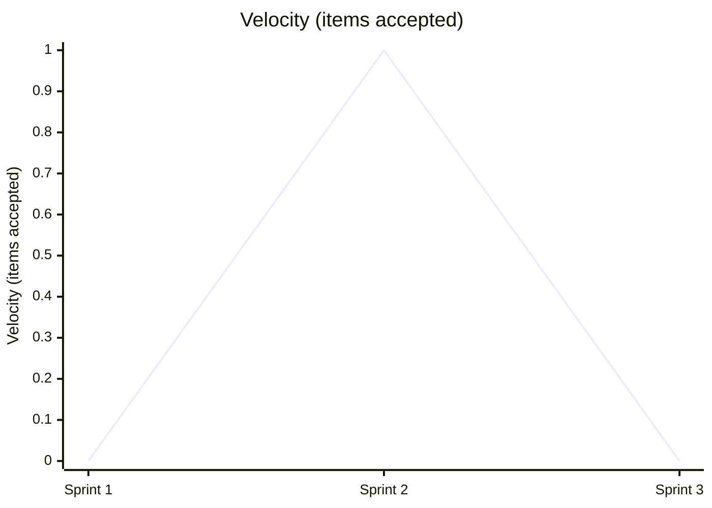
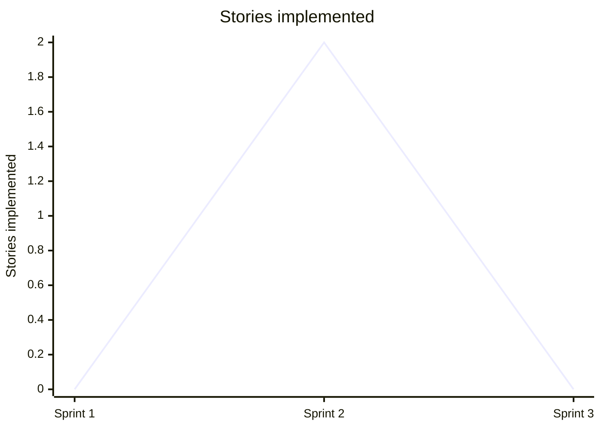
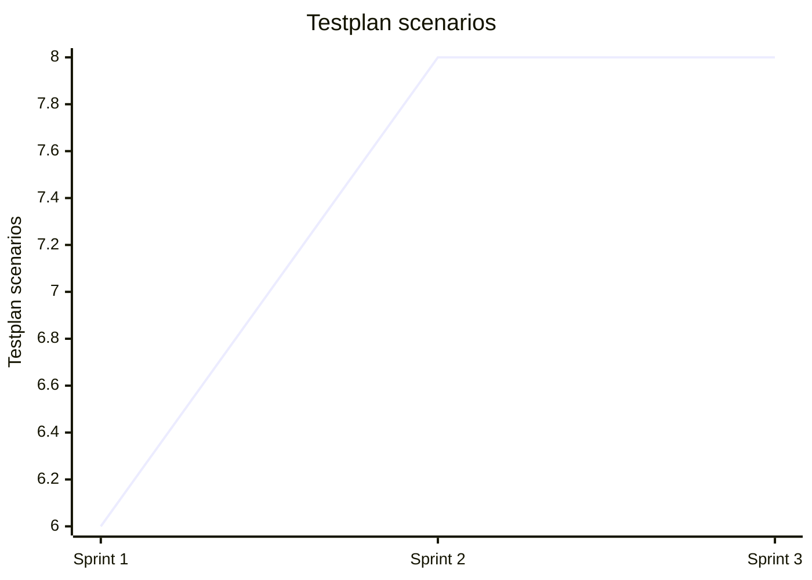
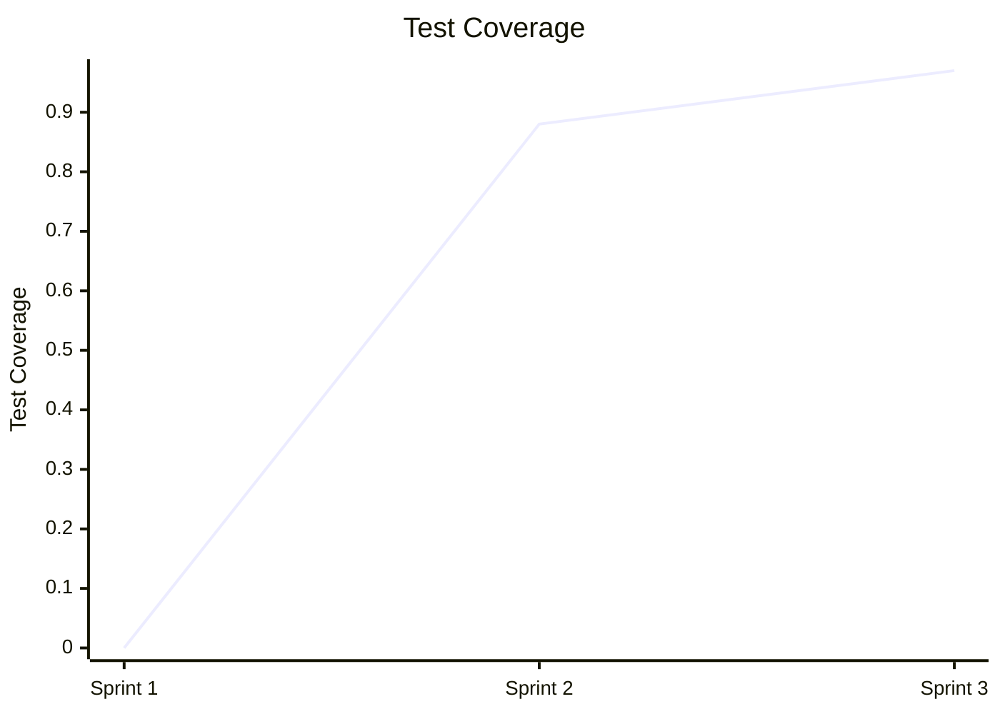

# Team Performance Evaluation Report

- Run ID: 0.1.0-run71
- Horseless Carriage commit: 8d1a0993c42848d1d4c36da9eb094559a296c9a7
- Branch: eval/0.1.0-run71/main
- Model: scrum-eval-cheap
- Sprints requested: 5, completed: 3
- Started: 2026-10-26T10:06:10.392592+00:00
- Finished: 2026-10-26T10:14:35.029110+00:00

## ⚠️ Evaluation Stopped Early

Only 3 of 5 requested sprints completed - **a BLOCKED story was still unresolved after a full sprint's own budget to fix it**.

- Stop reason: `blocked_unresolved_across_sprint`
- Blocked story: **US-0002** - technical: advance_story_stage('US-0002', 'Tested') has been rejected 3 times in a row for the same reason - most recently: Cannot mark 'US-0002' Tested - 1 of 3 tests failed. Fix the failing tests before retrying. (raised by QA)

## Blockers

- **US-0002** (US-02: Add Task to List) - technical: advance_story_stage('US-0002', 'Tested') has been rejected 3 times in a row for the same reason - most recently: Cannot mark 'US-0002' Tested - 1 of 3 tests failed. Fix the failing tests before retrying. (raised by QA)

## Methodology note
This run used a scripted, unattended driver (`run_eval.py`) that pre-approves every sprint goal/backlog and auto-merges any PR that opens against the eval branch, standing in for the human review gate real usage requires. Results reflect the team's real behavior under those conditions, not under full human-in-the-loop review - a lower bar in that one specific respect.

## Per-sprint metrics
| Sprint | Tokens Used | Stories Planned | Sprint Report? | PR Merges (after) |
|---|---|---|---|---|
| 1 | 3368086 | 6 | yes | 1/1 |
| 2 | 5387218 | 0 | fallback | 1/1 |
| 3 | 5659588 | 0 | yes | 1/4 |

## KPI Trends

| KPI | Sprint 1 | Sprint 2 | Sprint 3 |
|---|---|---|---|
| Velocity (items accepted) | 0 | 1 | 0 |
| Issues fixed | 0 | 0 | 0 |
| Stories implemented | 0 | 2 | 0 |
| Testplan scenarios | 6 | 8 | 8 |
| Say-Do Ratio | 0 | 0.17 | 0.17 |
| Quality (defect escape rate) | n/a | n/a | n/a |
| Test Coverage | 0 | 0.88 | 0.97 |

### Velocity (items accepted)



### Issues fixed

```mermaid
xychart-beta
    title "Issues fixed"
    x-axis ["Sprint 1", "Sprint 2", "Sprint 3"]
    y-axis "Issues fixed"
    line [0, 0, 0]
```

### Stories implemented



### Testplan scenarios



### Say-Do Ratio


### Quality (defect escape rate)

No data available for this run - not available - no defect/bug-lifecycle tracking exists yet (Scrum Master's calculate_kpis did run this run, this specific metric just has no data source yet).

### Test Coverage



## Token & Cost Summary

- Total tokens used: 14,414,892
- Expected cost: $1.4415 - $5.7660 (rough estimate from litellm's static pricing for `gemini/gemini-flash-lite-latest` - token_usage doesn't split prompt/completion tokens, so this is an all-input-vs-all-output bound, not an exact figure)

## Code Quality

**Score: 2/5**

The implementation in app.py handles only basic list creation via a Flask POST route, while the index.html template and test suite leave core user stories entirely unimplemented. In-memory storage uses global structures (lists and counter) that lack persistence, and test coverage is incomplete for stories US-0002 through US-0006.

## Requirements Quality

**Score: 3/5**

Product requirements in specs/requirements/PRD-Todo-MVP.md and individual story files under specs/stories/ are well-structured and detailed. However, tracking in specs/ROADMAP.md contains massive duplication and out-of-date checklist states that do not accurately reflect the actual progress.

## Team Efficiency

**Score: 2/5**

The team consumed its full token budget across multiple sprints while completing only one user story (US-0001) out of six planned. Heavy process overhead, repeated test failure loops during QA testing (as noted in specs/reports/RETRO-003.md), and feedback gate friction severely hampered throughput.

## Top Problems

1. **Core user stories US-0002 through US-0006 remain completely unimplemented in the codebase.** (severity: high)
   - Evidence: app.py only implements list creation (`create_list` route), leaving task addition, completion, and deletion functions missing.
   - Suggested fix: Allocate subsequent sprint iterations strictly to implementing the remaining route handlers and UI elements for task management.

2. **The product roadmap file contains severe duplication and unsynchronized checklist states.** (severity: medium)
   - Evidence: specs/ROADMAP.md lists story entries multiple times under v1.0 with conflicting checkbox states.
   - Suggested fix: Clean up specs/ROADMAP.md to maintain a single, canonical list of user stories mapped to release versions.

3. **Test failure loops during QA testing blocked story advancement and consumed significant token budgets.** (severity: medium)
   - Evidence: specs/reports/RETRO-003.md states: 'Encountered a temporary test failure on US-0002 during QA testing, which was subsequently resolved by the team.'
   - Suggested fix: Enforce local unit test execution via pytest prior to submitting code for QA review, as recommended in SPEC-ISSUE-0003.

4. **Automated sprint backlog merging interacted poorly with team feedback gates, causing workflow friction.** (severity: low)
   - Evidence: specs/reports/RETRO-003.md states: 'Sprint backlog PR was merged by start_sprint hook without a PR object, preventing DevTeam, Architect, and QA from posting PR comments.'
   - Suggested fix: no clear fix - framework evaluation hooks automatically merge sprint backlogs, which bypasses manual PR comment feedback gates by design.
