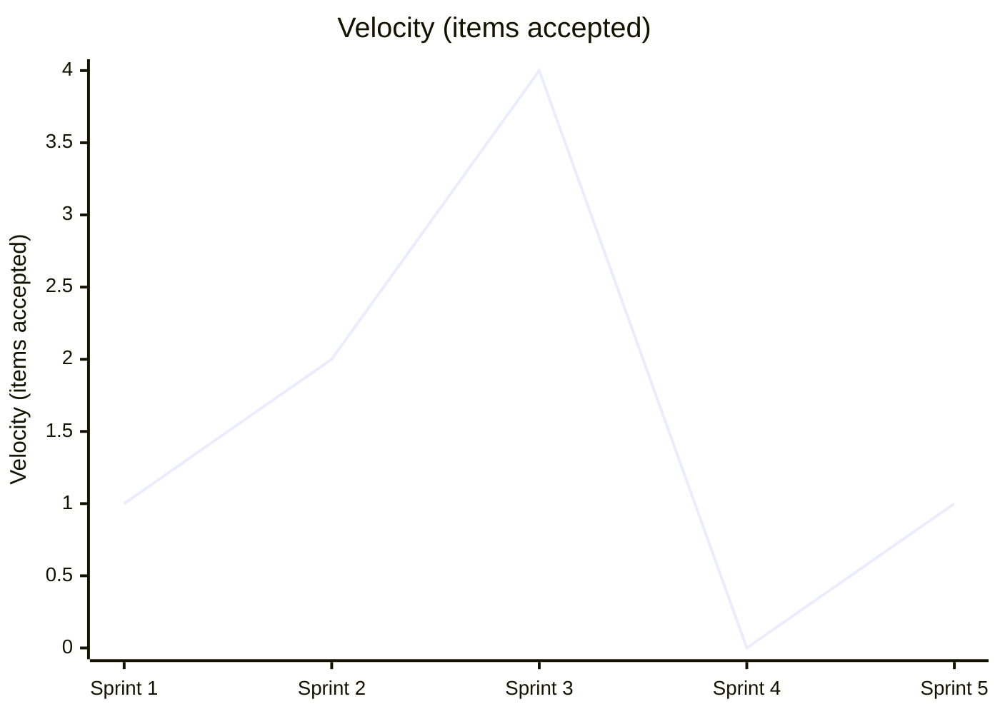
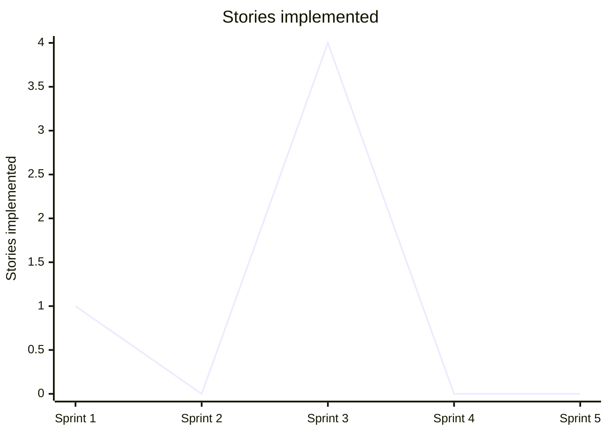
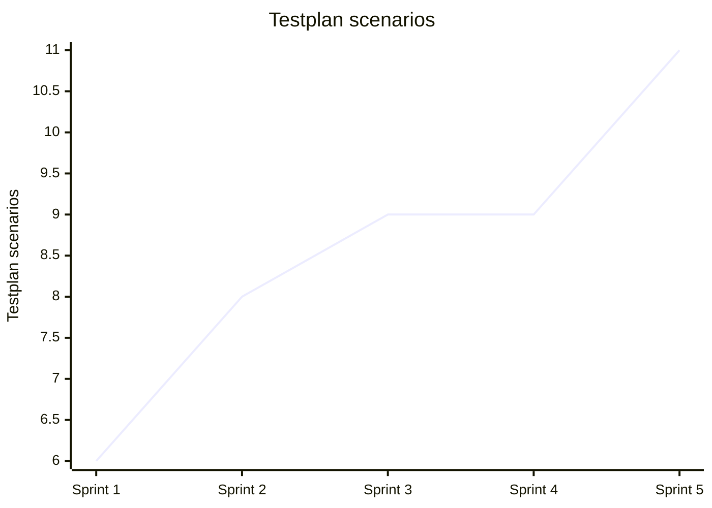
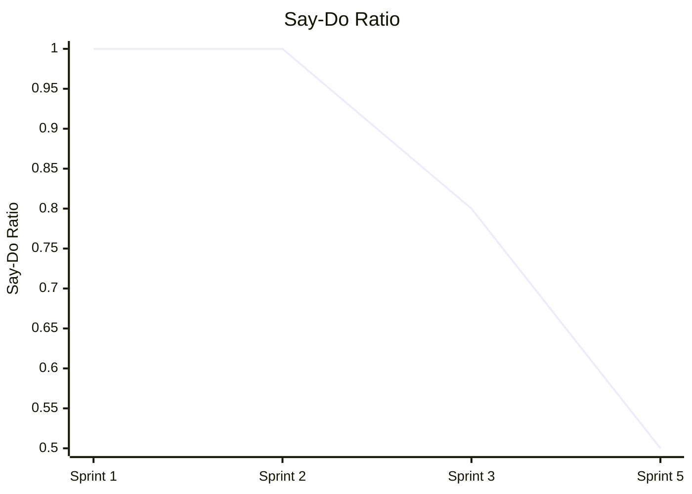

# Team Performance Evaluation Report

- Run ID: 0.1.0-run84
- Horseless Carriage commit: 0831d0e570d72a9686ba61ae29a3a25ba0d9df30
- Branch: eval/0.1.0-run84/main
- Model: scrum-eval-cheap
- Sprints requested: 5, completed: 5 (4 of which were genuinely distinct real sprints - see 'Real Sprint #' below)
- Started: 2026-11-05T14:18:26.732565+00:00
- Finished: 2026-11-05T14:36:09.124261+00:00

## Blockers

No stories are blocked as of the last completed sprint.

## Methodology note
This run used a scripted, unattended driver (`run_eval.py`) that pre-approves every sprint goal/backlog and auto-merges any PR that opens against the eval branch, standing in for the human review gate real usage requires. Results reflect the team's real behavior under those conditions, not under full human-in-the-loop review - a lower bar in that one specific respect.

## Per-sprint metrics
| Sprint | Real Sprint # | Tokens Used | Stories Planned | Sprint Report? | PR Merges (after) |
|---|---|---|---|---|---|
| 1 | 1 | 4990211 | 1 | yes | 1/1 |
| 2 | 2 | 2605066 | 2 | yes | 1/3 |
| 3 | 3 | 6294585 | 5 | yes | 1/4 |
| 4 | 3 (continued) | 5296272 | 0 | yes | 1/5 |
| 5 | 4 | 1357741 | 1 | yes | 1/6 |

## KPI Trends

| KPI | Sprint 1 | Sprint 2 | Sprint 3 | Sprint 4 | Sprint 5 |
|---|---|---|---|---|---|
| Velocity (items accepted) | 1 | 2 | 4 | 0 | 1 |
| Issues fixed | 0 | 2 | 0 | 0 | 1 |
| Stories implemented | 1 | 0 | 4 | 0 | 0 |
| Testplan scenarios | 6 | 8 | 9 | 9 | 11 |
| Say-Do Ratio | 1 | 1 | 0.8 | n/a | 0.5 |
| Quality (defect escape rate) | n/a | n/a | n/a | n/a | n/a |
| Test Coverage | 0.82 | 0.82 | 0.82 | n/a | 0.82 |

### Velocity (items accepted)



### Issues fixed


### Stories implemented



### Testplan scenarios



### Say-Do Ratio



(1 of 5 sprints have no data point for this KPI and are omitted above - see the table for exactly which.)

### Quality (defect escape rate)

No data available for this run - not available - no defect/bug-lifecycle tracking exists yet (Scrum Master's calculate_kpis did run this run, this specific metric just has no data source yet).

### Test Coverage

```mermaid
xychart-beta
    title "Test Coverage"
    x-axis ["Sprint 1", "Sprint 2", "Sprint 3", "Sprint 5"]
    y-axis "Test Coverage"
    line [0.82, 0.82, 0.82, 0.82]
```

(1 of 5 sprints have no data point for this KPI and are omitted above - see the table for exactly which.)

## Token & Cost Summary

- Total tokens used: 14,249,290
- Expected cost: $1.4249 - $5.6997 (rough estimate from litellm's static pricing for `gemini/gemini-flash-lite-latest` - token_usage doesn't split prompt/completion tokens, so this is an all-input-vs-all-output bound, not an exact figure)

## Code Quality

**Score: 4/5**

The Flask application in app.py cleanly handles in-memory storage, list creation, task addition, toggling, and deletion with robust dual-support for form posts and JSON/content-type negotiation. Routes correctly return appropriate HTTP status codes (201, 200, 404, 400) and redirect or JSON as requested. However, storage is strictly volatile in-memory dictionary objects without persistence, and test coverage relies heavily on basic assertions.

## Requirements Quality

**Score: 3/5**

The team documented user stories under specs/stories/ and tracked progress in specs/ROADMAP.md. However, tracking became messy across sprints, with several meta-issues (SPEC-ISSUE-0001 through SPEC-ISSUE-0005) crowding out product backlog items, and US-0006 left unimplemented in the roadmap index.

## Team Efficiency

**Score: 3/5**

The AI Scrum team executed multiple sprints and successfully delivered core CRUD functionality, handling automated PR reviews and QA sign-offs. Efficiency suffered from repetitive token budget overages in Sprint 3 (124%) and heavy process overhead spent filing redundant retrospective action items and steering proposals.

## Top Problems

1. **US-0006 (View Lists and Tasks UI) was left unimplemented and unchecked in the product roadmap.** (severity: high)
   - Evidence: specs/ROADMAP.md shows US-0006 with unchecked boxes under v0.1.0.
   - Suggested fix: Allocate proper sprint capacity to ensure all core user stories in the MVP release plan are fully implemented and tested.

2. **Duplicate and redundant retrospective action items are repeatedly filed across sprints.** (severity: medium)
   - Evidence: specs/reports/RETRO-004.md lists identical items like SPEC-ISSUE-0004 and SPEC-ISSUE-0005 ('Maintain rigorous review participation and CI checks for all upcoming stories').
   - Suggested fix: Update the ScrumMaster agent prompt/workflow to deduplicate recurring retro items rather than creating new issue files every sprint.

3. **Per-sprint token budgets are frequently exceeded due to high agent conversation volume.** (severity: medium)
   - Evidence: Sprint 3 report notes 6,210,277 / 5,000,000 tokens used (124%).
   - Suggested fix: Increase the default sprint token budget or streamline agent transfer protocols to reduce unnecessary conversational turns.
