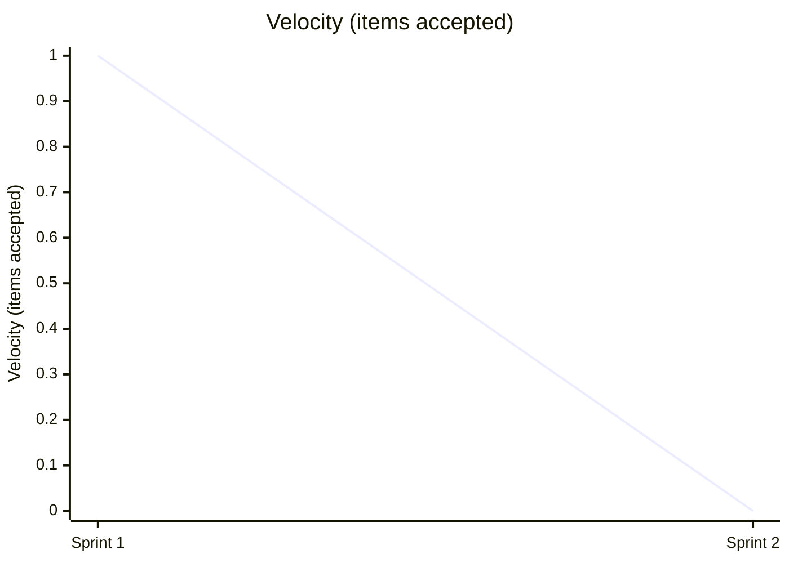

# Team Performance Evaluation Report

- Run ID: 0.1.0-run67
- Horseless Carriage commit: e259430cfc76d2cf79553ed6ec315ed91333a6bd
- Branch: eval/0.1.0-run67/main
- Model: scrum-eval-cheap
- Sprints requested: 5, completed: 2
- Started: 2026-10-14T13:45:56.303454+00:00
- Finished: 2026-10-14T13:51:24.699227+00:00

## ⚠️ Evaluation Stopped Early

Only 2 of 5 requested sprints completed - **the run crashed with an unhandled exception**.

- Stop reason: `crashed`
- Crashed during sprint: 3
- Crash error: `AttributeError: 'float' object has no attribute 'get'`

## Blockers

No stories are blocked as of the last completed sprint.

## Methodology note
This run used a scripted, unattended driver (`run_eval.py`) that pre-approves every sprint goal/backlog and auto-merges any PR that opens against the eval branch, standing in for the human review gate real usage requires. Results reflect the team's real behavior under those conditions, not under full human-in-the-loop review - a lower bar in that one specific respect.

## Per-sprint metrics
| Sprint | Tokens Used | Stories Planned | Sprint Report? | PR Merges (after) |
|---|---|---|---|---|
| 1 | 5126836 | 1 | no | 0/0 |
| 2 | 5213310 | 0 | yes | 0/0 |

## KPI Trends

| KPI | Sprint 1 | Sprint 2 |
|---|---|---|
| Velocity (items accepted) | 1 | 0 |
| Issues fixed | 0 | 0 |
| Stories implemented | 2 | 0 |
| Testplan scenarios | 6 | 6 |
| Say-Do Ratio | 1 | 1 |
| Quality (defect escape rate) | n/a | n/a |
| Test Coverage | 0 | n/a |

### Velocity (items accepted)



### Issues fixed

```mermaid
xychart-beta
    title "Issues fixed"
    x-axis ["Sprint 1", "Sprint 2"]
    y-axis "Issues fixed"
    line [0, 0]
```

### Stories implemented


### Testplan scenarios

```mermaid
xychart-beta
    title "Testplan scenarios"
    x-axis ["Sprint 1", "Sprint 2"]
    y-axis "Testplan scenarios"
    line [6, 6]
```

### Say-Do Ratio

```mermaid
xychart-beta
    title "Say-Do Ratio"
    x-axis ["Sprint 1", "Sprint 2"]
    y-axis "Say-Do Ratio"
    line [1, 1]
```

### Quality (defect escape rate)

No data available for this run - not available - no defect/bug-lifecycle tracking exists yet (Scrum Master's calculate_kpis did run this run, this specific metric just has no data source yet).

### Test Coverage

```mermaid
xychart-beta
    title "Test Coverage"
    x-axis ["Sprint 1"]
    y-axis "Test Coverage"
    line [0]
```

(1 of 2 sprints have no data point for this KPI and are omitted above - see the table for exactly which.)

## Token & Cost Summary

- Total tokens used: 10,340,146
- Expected cost: $1.0340 - $4.1361 (rough estimate from litellm's static pricing for `gemini/gemini-flash-lite-latest` - token_usage doesn't split prompt/completion tokens, so this is an all-input-vs-all-output bound, not an exact figure)

## Code Quality

**Score: 2/5**

While the test suite in tests/test_app.py covers the core routes for list creation and task management, the actual application file `app` is missing from the file tree, causing test collection to fail with an ImportError (`ModuleNotFoundError: No module named 'app'`). The code appears to be referenced correctly in tests, but the omission of the implementation file makes the repository non-functional.

## Requirements Quality

**Score: 2/5**

The user stories US-0001 through US-0006 are well-defined in specs/stories/ with clear acceptance criteria for creating lists, managing tasks, and deletion. However, the requirement issues ISSUE-0001 through ISSUE-0003 are left in 'Draft' status with empty acceptance criteria and notes, failing to track the workflow properly.

## Team Efficiency

**Score: 1/5**

The team consumed over 5 million tokens across multiple sprints while producing zero functional source code files outside of tests. The sprint reports and transcripts show excessive loop transfers and overrides (as noted in ISSUE-0001 and ISSUE-0002), indicating poor coordination overhead.

## Top Problems

1. **Missing application source code file (app.py) causes test suite collection failure.** (severity: high)
   - Evidence: tests/test_app.py line 2: `from app import app, lists, tasks` resulting in `ModuleNotFoundError: No module named 'app'` in SPRINT-REPORT-LATEST.md.
   - Suggested fix: Ensure the DevTeam writes and commits the `app.py` module alongside `tests/test_app.py` during implementation.

2. **Requirement issue files lack structured acceptance criteria and remain in Draft status.** (severity: medium)
   - Evidence: specs/requirements/ISSUE-0001-...md shows empty `## Acceptance Criteria` and `Draft` status.
   - Suggested fix: Prompt the ScrumMaster and ProductOwner to populate acceptance criteria before moving issues out of draft.

3. **Excessive agent token consumption and orchestration overhead yielding minimal completed artifacts.** (severity: medium)
   - Evidence: SPRINT-REPORT-LATEST.md shows 5,196,175 tokens used for a single sprint with only 1/1 stories completed.
   - Suggested fix: Streamline agent prompts and reduce redundant handoffs between ScrumOrchestrator, Architect, and QA.
