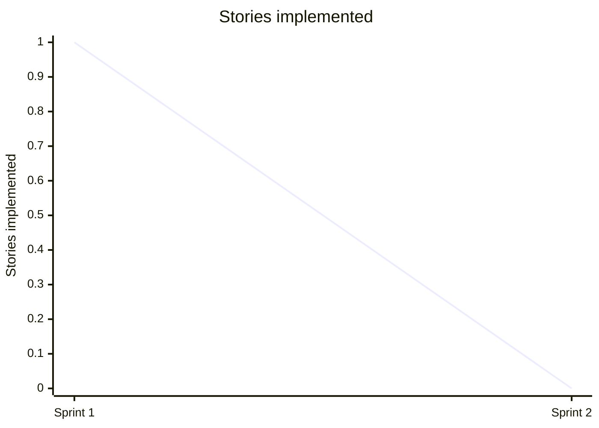
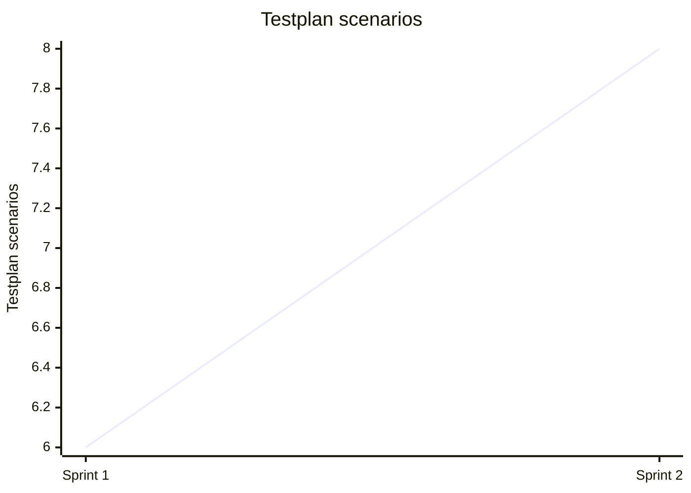

# Team Performance Evaluation Report

- Run ID: 0.2.0-run91
- Horseless Carriage commit: f0db8da9f4a0b2d703ea2ef5ce8ab43832d43327
- Branch: eval/0.2.0-run91/main
- Model: scrum-eval-cheap
- Sprints requested: 5, completed: 2
- Started: 2026-11-11T16:36:04.399135+00:00
- Finished: 2026-11-11T16:42:26.767714+00:00

## ⚠️ Evaluation Stopped Early

Only 2 of 5 requested sprints completed - **a sprint exhausted this harness's own retry ceiling before its close-out (sprint report done, release PR) could finish**.

- Stop reason: `sprint_closeout_stalled`

## Blockers

- **SPEC-ISSUE-0003** (Ensure all team members check git status before triggering release PRs to avoid untracked file conflicts.) - technical: DevTeam and ProductOwner bounced transfer_to_agent 6x with no progress - 🔁 [TRANSFER LOOP DETECTED] 6 transfer_to_agent hops in a row with no other tool call in between (most recently DevTeam -> ProductOwner) - refusing this transfer. This looks like an unproductive rotation between roles rather than a direct two-agent ping-pong. Stop transferring and actually call a tool that makes progress, or explain the blocker in plain text instead. (raised by DevTeam)
- **US-0002** (Add Task to List) - product: ScrumOrchestrator and ProductOwner bounced transfer_to_agent 3x with no progress - 🔁 [TRANSFER LOOP DETECTED] ScrumOrchestrator and ProductOwner have handed off to each other 3 times in a row with no other tool call in between - refusing this transfer. Stop transferring and actually call a tool that makes progress (e.g. the mandatory step you're both routing around), or explain the blocker instead of handing off again. (raised by ScrumOrchestrator)

## Methodology note
This run used a scripted, unattended driver (`run_eval.py`) that pre-approves every sprint goal/backlog and auto-merges any PR that opens against the eval branch, standing in for the human review gate real usage requires. Results reflect the team's real behavior under those conditions, not under full human-in-the-loop review - a lower bar in that one specific respect.

## Per-sprint metrics
| Sprint | Real Sprint # | Tokens Used | Stories Planned | Sprint Report? | PR Merges (after) |
|---|---|---|---|---|---|
| 1 | 1 | 1952620 | 1 | yes | 1/1 |
| 2 | 2 | 4647370 | 1 | yes | 0/0 |

## KPI Trends

| KPI | Sprint 1 | Sprint 2 |
|---|---|---|
| Velocity (items accepted) | 1 | 1 |
| Issues fixed | 0 | 1 |
| Stories implemented | 1 | 0 |
| Testplan scenarios | 6 | 8 |
| Say-Do Ratio | 1 | 1 |
| Quality (defect escape rate) | n/a | n/a |
| Test Coverage | 0.97 | 0.97 |

### Velocity (items accepted)

```mermaid
xychart-beta
    title "Velocity (items accepted)"
    x-axis ["Sprint 1", "Sprint 2"]
    y-axis "Velocity (items accepted)"
    line [1, 1]
```

### Issues fixed

```mermaid
xychart-beta
    title "Issues fixed"
    x-axis ["Sprint 1", "Sprint 2"]
    y-axis "Issues fixed"
    line [0, 1]
```

### Stories implemented



### Testplan scenarios



### Say-Do Ratio

```mermaid
xychart-beta
    title "Say-Do Ratio"
    x-axis ["Sprint 1", "Sprint 2"]
    y-axis "Say-Do Ratio"
    line [1, 1]
```

### Quality (defect escape rate)

No data available for this run - not available - no defect/bug-lifecycle tracking exists yet (Scrum Master's calculate_kpis did run this run, this specific metric just has no data source yet).

### Test Coverage

```mermaid
xychart-beta
    title "Test Coverage"
    x-axis ["Sprint 1", "Sprint 2"]
    y-axis "Test Coverage"
    line [0.97, 0.97]
```

## Token & Cost Summary

- Total tokens used: 6,599,990
- Expected cost: $0.6600 - $2.6400 (rough estimate from litellm's static pricing for `gemini/gemini-flash-lite-latest` - token_usage doesn't split prompt/completion tokens, so this is an all-input-vs-all-output bound, not an exact figure)

## Code Quality

**Score: 2/5**

The application successfully implements a FastAPI backend skeleton and basic list creation in app.py, accompanied by a single test in test_app.py. However, it completely fails to implement core product requirements such as adding tasks, toggling completion, or deleting lists as mandated by PRD-TodoList-MVP.md. The frontend interface embedded in app.py only handles list creation and provides no UI components for task interaction.

## Requirements Quality

**Score: 3/5**

The product requirements, epics, and user stories (US-0001 through US-0006) are thoroughly documented in specs/requirements/PRD-TodoList-MVP.md and specs/stories/. However, execution against the roadmap (specs/ROADMAP.md) stalled after Sprint 1, leaving user stories US-0002 through US-0006 in an uncompleted state and triggering agent transfer loops.

## Team Efficiency

**Score: 1/5**

The AI scrum team suffered from severe coordination breakdowns, notably persistent transfer loops between ScrumOrchestrator and ProductOwner as captured in specs/requirements/SPEC-ISSUE-0003.md and SPRINT-REPORT-LATEST.md. Despite consuming millions of tokens across two sprints, only a single user story (US-0001) was fully delivered, resulting in extreme process overhead and blocked feature progression.

## Top Problems

1. **Core product requirements for task management (US-0002 through US-0006) remain unimplemented in app.py.** (severity: high)
   - Evidence: app.py contains only list creation endpoints and lacks routes for adding, toggling, or deleting tasks.
   - Suggested fix: Extend app.py to implement task addition, completion toggling, and deletion endpoints corresponding to US-0002 through US-0005.

2. **Persistent agent transfer loops between ScrumOrchestrator and ProductOwner caused workflow blockages.** (severity: high)
   - Evidence: specs/requirements/SPEC-ISSUE-0003.md states: 'DevTeam and ProductOwner bounced transfer_to_agent 6x with no progress - 🔁 [TRANSFER LOOP DETECTED]'
   - Suggested fix: Refine the orchestrator prompt and agent coordination protocol to prevent repetitive hand-off bouncing without intermediate tool execution.

3. **Roadmap tracking in specs/ROADMAP.md shows zero progress on core feature stories outside of US-0001.** (severity: medium)
   - Evidence: specs/ROADMAP.md lists US-0002 through US-0006 with unchecked implementation stages under v1.0.0.
   - Suggested fix: Update sprint planning constraints to ensure subsequent sprints actually schedule and implement pending user stories instead of focusing solely on process meta-issues.
