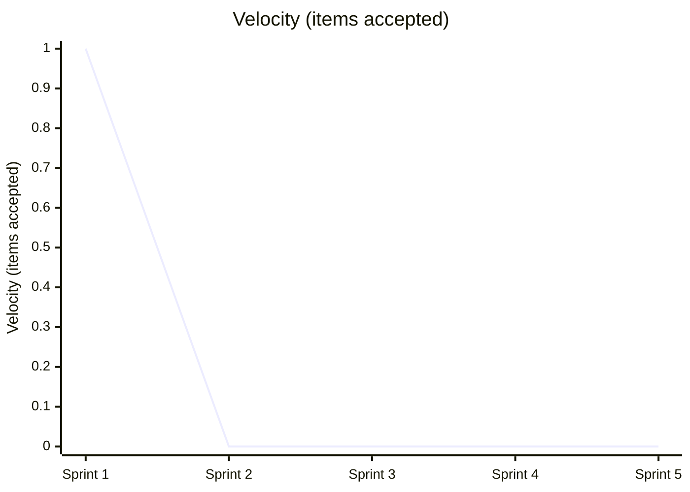
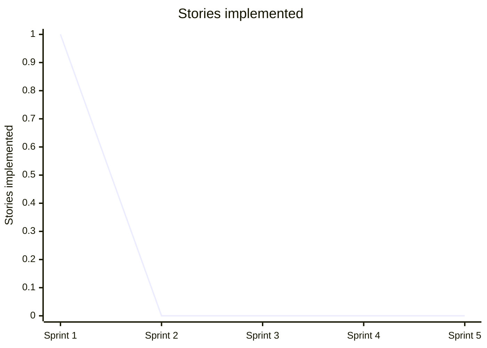

# Team Performance Evaluation Report

- Run ID: 0.1.0-run61
- Horseless Carriage commit: 0941da213c10667d0928386a8419a61356c38d60
- Branch: eval/0.1.0-run61/main
- Model: scrum-eval-cheap
- Sprints requested: 5, completed: 5
- Started: 2026-10-13T10:11:57.683745+00:00
- Finished: 2026-10-13T10:21:00.814700+00:00

## Blockers

No stories are blocked as of the last completed sprint.

## Methodology note
This run used a scripted, unattended driver (`run_eval.py`) that pre-approves every sprint goal/backlog and auto-merges any PR that opens against the eval branch, standing in for the human review gate real usage requires. Results reflect the team's real behavior under those conditions, not under full human-in-the-loop review - a lower bar in that one specific respect.

## Per-sprint metrics
| Sprint | Tokens Used | Stories Planned | Sprint Report? | PR Merges (after) |
|---|---|---|---|---|
| 1 | 3582842 | 6 | yes | 1/2 |
| 2 | 1510522 | 0 | yes | 0/2 |
| 3 | 1429101 | 0 | yes | 1/4 |
| 4 | 1759219 | 0 | yes | 1/5 |
| 5 | 1890347 | 0 | yes | 1/6 |

## KPI Trends

| KPI | Sprint 1 | Sprint 2 | Sprint 3 | Sprint 4 | Sprint 5 |
|---|---|---|---|---|---|
| Velocity (items accepted) | 1 | 0 | 0 | 0 | 0 |
| Issues fixed | 0 | 0 | 0 | 0 | 0 |
| Stories implemented | 1 | 0 | 0 | 0 | 0 |
| Testplan scenarios | 6 | 6 | 6 | 6 | 6 |
| Say-Do Ratio | 0 | n/a | n/a | n/a | n/a |
| Quality (defect escape rate) | n/a | n/a | n/a | n/a | n/a |
| Test Coverage | n/a | n/a | n/a | n/a | n/a |

### Velocity (items accepted)



### Issues fixed

```mermaid
xychart-beta
    title "Issues fixed"
    x-axis ["Sprint 1", "Sprint 2", "Sprint 3", "Sprint 4", "Sprint 5"]
    y-axis "Issues fixed"
    line [0, 0, 0, 0, 0]
```

### Stories implemented



### Testplan scenarios

```mermaid
xychart-beta
    title "Testplan scenarios"
    x-axis ["Sprint 1", "Sprint 2", "Sprint 3", "Sprint 4", "Sprint 5"]
    y-axis "Testplan scenarios"
    line [6, 6, 6, 6, 6]
```

### Say-Do Ratio

```mermaid
xychart-beta
    title "Say-Do Ratio"
    x-axis ["Sprint 1"]
    y-axis "Say-Do Ratio"
    line [0]
```

(4 of 5 sprints have no data point for this KPI and are omitted above - see the table for exactly which.)

### Quality (defect escape rate)

No data available for this run - not available (Scrum Master's calculate_kpis did run this run, this specific metric just has no data source yet).

### Test Coverage

No data available for this run - coverage summary not found in pytest output (exit code 2) (Scrum Master's calculate_kpis did run this run, this specific metric just has no data source yet).

## Token & Cost Summary

- Total tokens used: 10,172,031
- Expected cost: $1.0172 - $4.0688 (rough estimate from litellm's static pricing for `gemini/gemini-flash-lite-latest` - token_usage doesn't split prompt/completion tokens, so this is an all-input-vs-all-output bound, not an exact figure)

## Code Quality

**Score: 2/5**

While a basic Flask application and test suite were successfully stood up in Sprint 1, subsequent sprints failed to implement the remaining user stories (US-0002 through US-0006). The project completely stalled out functionally after the first sprint, leaving essential core features like task creation, completion toggling, and list deletion unimplemented in the codebase.

## Requirements Quality

**Score: 2/5**

The Product Owner properly established the PRD, Epics, and all 6 user stories in `specs/requirements/PRD-TodoList-MVP.md` and `specs/stories/`, mapping out a clear path for the MVP. However, the roadmap (`specs/ROADMAP.md`) remains entirely incomplete with unassigned goals and unverified story status checkboxes across all releases.

## Team Efficiency

**Score: 1/5**

The AI Scrum team suffered from extreme process thrashing, consuming millions of tokens across 5 sprints while completing only 1 out of 6 user stories. Sprints 2 through 5 recorded zero stories completed, repeatedly getting bogged down in endless backlog planning, cross-functional sign-off ceremonies, and steering proposals.

## Top Problems

1. **Only 1 out of 6 core user stories was implemented and accepted across the entire 5-sprint run.** (severity: high)
   - Evidence: In specs/ROADMAP.md, stories US-0002 through US-0006 show all checkboxes for IMPLEMENTED, REVIEWED, TESTED, and ACCEPTED unchecked.
   - Suggested fix: no clear fix - the multi-agent framework fails to maintain velocity past the initial bootstrap sprint, getting trapped in circular planning loops.

2. **Sprints 2 through 5 completely failed to assign or plan any sprint backlog items.** (severity: high)
   - Evidence: In specs/reports/SPRINT-REPORT-005.md, the Sprint Length Feedback section states: 'Stories: 0/0 completed this sprint - No sprint backlog recorded'.
   - Suggested fix: Modify agent orchestration prompts to enforce active backlog carryover and execution rather than repeating retrospective and planning cycles.

3. **Product roadmap status tracking is completely abandoned and out of sync with actual delivery.** (severity: medium)
   - Evidence: In specs/ROADMAP.md, the v1.0.0 release section lists goals and stories with all workflow state checkboxes left blank.
   - Suggested fix: Instruct the Product Owner agent to automatically update and check off roadmap story states upon sprint completion.
