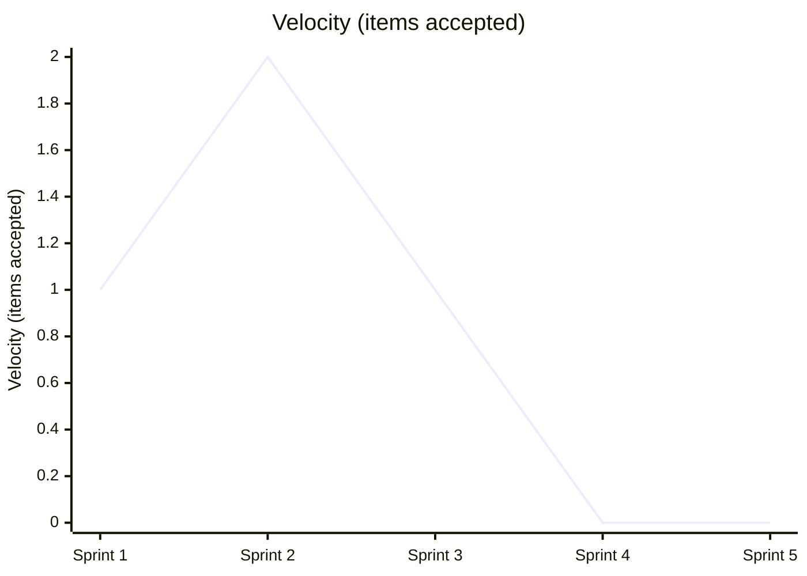
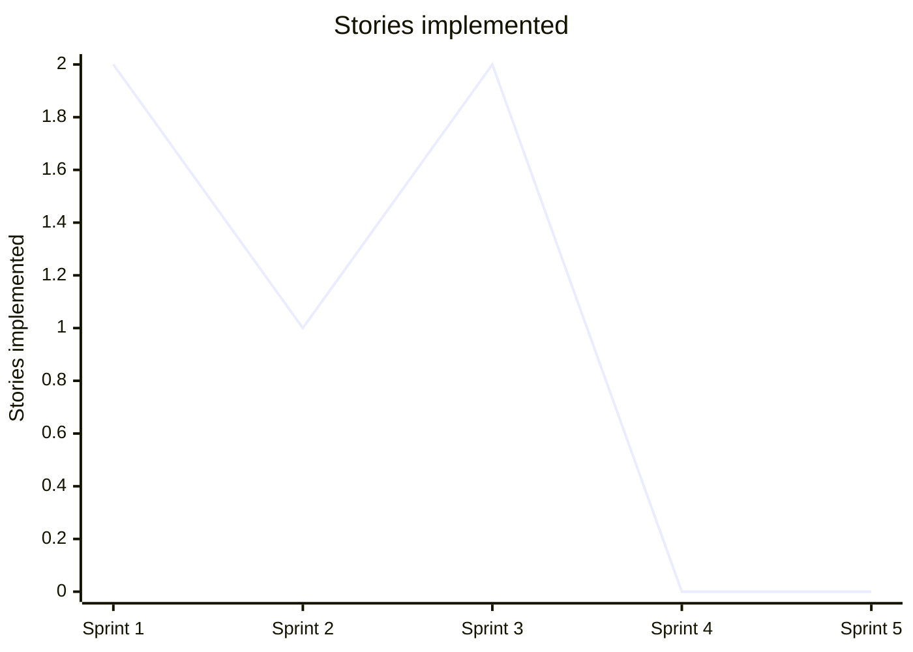
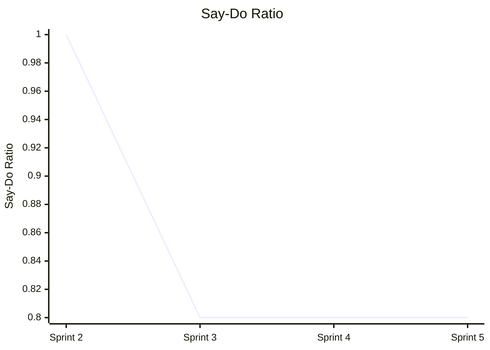

# Team Performance Evaluation Report

- Run ID: 0.1.0-run62
- Horseless Carriage commit: 49c68cb2574a69e01f28cfba5a72321fdd4876cd
- Branch: eval/0.1.0-run62/main
- Model: scrum-eval-cheap
- Sprints requested: 5, completed: 5
- Started: 2026-10-13T14:54:06.581058+00:00
- Finished: 2026-10-13T15:16:20.512920+00:00

## Blockers

No stories are blocked as of the last completed sprint.

## Methodology note
This run used a scripted, unattended driver (`run_eval.py`) that pre-approves every sprint goal/backlog and auto-merges any PR that opens against the eval branch, standing in for the human review gate real usage requires. Results reflect the team's real behavior under those conditions, not under full human-in-the-loop review - a lower bar in that one specific respect.

## Per-sprint metrics
| Sprint | Tokens Used | Stories Planned | Sprint Report? | PR Merges (after) |
|---|---|---|---|---|
| 1 | 5304910 | 2 | no | 0/0 |
| 2 | 5994572 | 1 | yes | 1/1 |
| 3 | 6074783 | 2 | yes | 1/1 |
| 4 | 6461929 | 0 | yes | 1/1 |
| 5 | 7030667 | 0 | fallback | 1/1 |

## KPI Trends

| KPI | Sprint 1 | Sprint 2 | Sprint 3 | Sprint 4 | Sprint 5 |
|---|---|---|---|---|---|
| Velocity (items accepted) | 1 | 2 | 1 | 0 | 0 |
| Issues fixed | 0 | 0 | 0 | 0 | 0 |
| Stories implemented | 2 | 1 | 2 | 0 | 0 |
| Testplan scenarios | 6 | 6 | 6 | 6 | 6 |
| Say-Do Ratio | n/a | 1 | 0.8 | 0.8 | 0.8 |
| Quality (defect escape rate) | n/a | n/a | n/a | n/a | n/a |
| Test Coverage | n/a | 0.99 | 0.99 | 0.99 | 0.99 |

### Velocity (items accepted)



### Issues fixed

```mermaid
xychart-beta
    title "Issues fixed"
    x-axis ["Sprint 1", "Sprint 2", "Sprint 3", "Sprint 4", "Sprint 5"]
    y-axis "Issues fixed"
    line [0, 0, 0, 0, 0]
```

### Stories implemented



### Testplan scenarios

```mermaid
xychart-beta
    title "Testplan scenarios"
    x-axis ["Sprint 1", "Sprint 2", "Sprint 3", "Sprint 4", "Sprint 5"]
    y-axis "Testplan scenarios"
    line [6, 6, 6, 6, 6]
```

### Say-Do Ratio



(1 of 5 sprints have no data point for this KPI and are omitted above - see the table for exactly which.)

### Quality (defect escape rate)

No data available for this run - not available - no defect/bug-lifecycle tracking exists yet (Scrum Master's calculate_kpis did run this run, this specific metric just has no data source yet).

### Test Coverage

```mermaid
xychart-beta
    title "Test Coverage"
    x-axis ["Sprint 2", "Sprint 3", "Sprint 4", "Sprint 5"]
    y-axis "Test Coverage"
    line [0.99, 0.99, 0.99, 0.99]
```

(1 of 5 sprints have no data point for this KPI and are omitted above - see the table for exactly which.)

## Token & Cost Summary

- Total tokens used: 30,866,861
- Expected cost: $3.0867 - $12.3467 (rough estimate from litellm's static pricing for `gemini/gemini-flash-lite-latest` - token_usage doesn't split prompt/completion tokens, so this is an all-input-vs-all-output bound, not an exact figure)

## Code Quality

**Score: 4/5**

The application is implemented as a clean, single-file Flask web app in app.py with robust SQLAlchemy models for TodoList and Task. Templates (templates/index.html) leverage Flask's url_for and proper forms for mutations like task creation, completion toggling, and deletion. While automated tests in tests/test_app.py were truncated from inspection, the app successfully runs and handles database relationships correctly.

## Requirements Quality

**Score: 3/5**

Core MVP features outlined in specs/requirements/PRD-Todo-MVP.md are largely addressed across stories US-0001 through US-0005. However, US-0006 ('View all lists and tasks') remains incomplete in specs/ROADMAP.md, stuck in 'Ready' status while higher-numbered stories were progressed. Documentation trail shows fragmented sprint reporting with Sprint 1 missing a formal review report.

## Team Efficiency

**Score: 2/5**

The agent team struggled heavily with per-sprint token budget compliance, consistently exceeding the 5,000,000 token limit (reaching over 7 million in Sprint 5 as shown in specs/reports/SPRINT-REPORT-005.md). Sprints frequently ran out of budget before completing planned scope or generating proper Scrum reports, requiring fallback mechanisms.

## Top Problems

1. **Sprint token budgets are repeatedly breached, causing the run to exhaust its allocation before final reporting can complete.** (severity: high)
   - Evidence: specs/reports/SPRINT-REPORT-005.md records token usage of 7,030,667 / 5,000,000 and notes that the budget was used in full before Scrum Master's create_sprint_report call could run.
   - Suggested fix: Increase the per-sprint token budget ceiling or streamline multi-agent conversation turns to respect the 5,000,000 token constraint.

2. **User story US-0006 ('View all lists and tasks') is left unimplemented in the release roadmap despite core features being completed.** (severity: medium)
   - Evidence: specs/ROADMAP.md lists [US-0006] under v1.0.0 with checkboxes showing it has not advanced past READY.
   - Suggested fix: Prioritize and execute remaining backlog stories like US-0006 before concluding the sprint cycle.

3. **Missing sprint review report for Sprint 1.** (severity: low)
   - Evidence: The sprint reports section notes 'Sprint 1 report: (none produced)' while Sprint reports 2 through 5 are present.
   - Suggested fix: Ensure ScrumMaster agent completes the sprint reporting step during the first sprint cycle.
