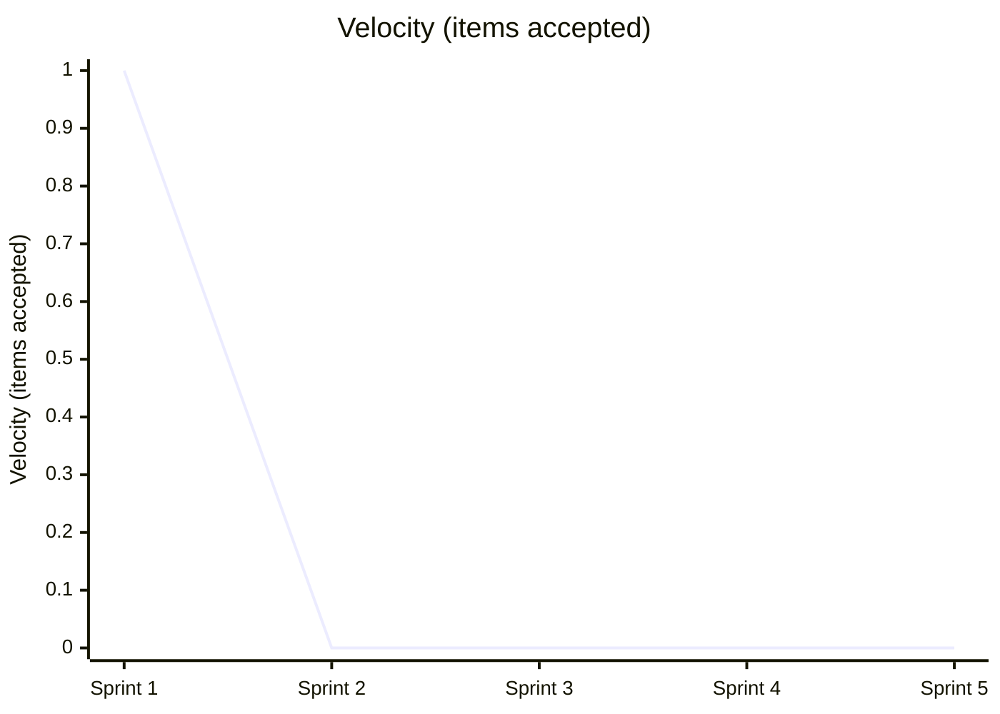
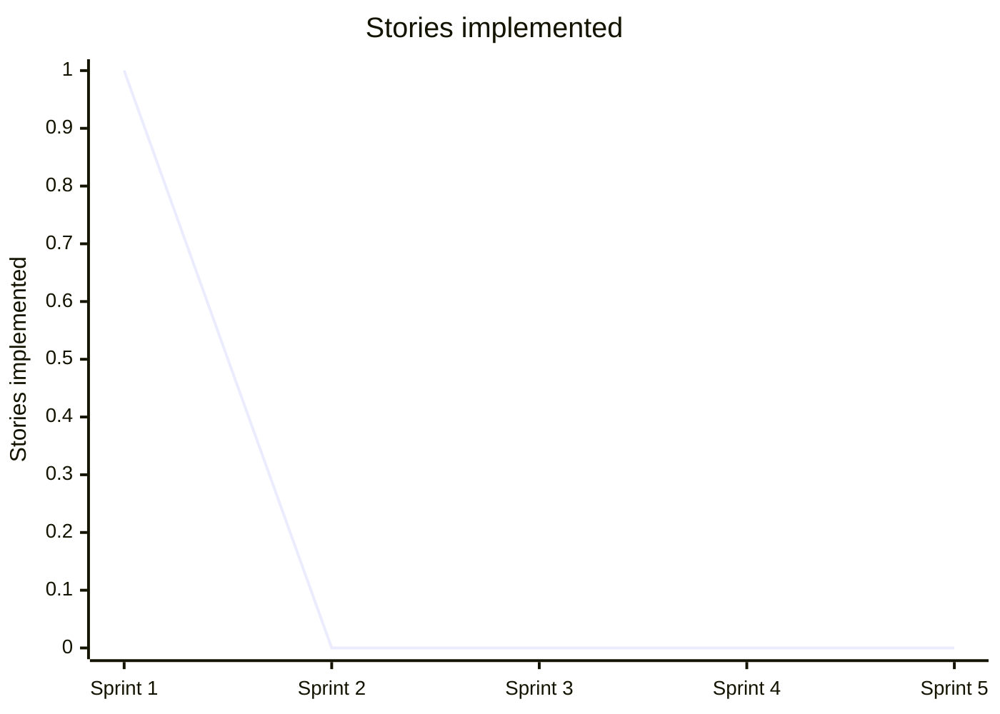
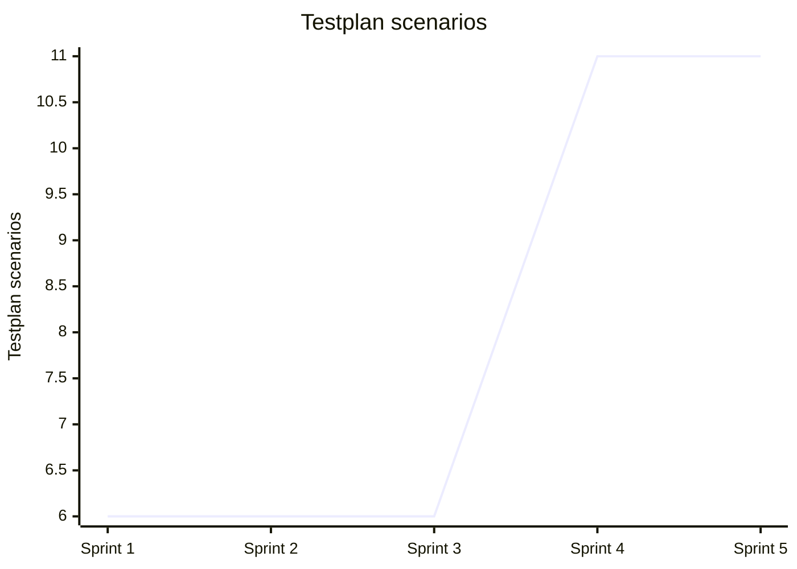

# Team Performance Evaluation Report

- Run ID: 0.1.0-run73
- Horseless Carriage commit: 8c1bd09a77f9a563e3609e161a141d3b0951c2c0
- Branch: eval/0.1.0-run73/main
- Model: scrum-eval-cheap
- Sprints requested: 5, completed: 5
- Started: 2026-10-27T09:06:07.894116+00:00
- Finished: 2026-10-27T09:11:26.107753+00:00

## Blockers

No stories are blocked as of the last completed sprint.

## Methodology note
This run used a scripted, unattended driver (`run_eval.py`) that pre-approves every sprint goal/backlog and auto-merges any PR that opens against the eval branch, standing in for the human review gate real usage requires. Results reflect the team's real behavior under those conditions, not under full human-in-the-loop review - a lower bar in that one specific respect.

## Per-sprint metrics
| Sprint | Tokens Used | Stories Planned | Sprint Report? | PR Merges (after) |
|---|---|---|---|---|
| 1 | 4114083 | 1 | yes | 1/1 |
| 2 | 4298134 | 0 | yes | 1/1 |
| 3 | 4480099 | 0 | yes | 1/1 |
| 4 | 755256 | 0 | yes | 1/1 |
| 5 | 907741 | 0 | yes | 1/1 |

## KPI Trends

| KPI | Sprint 1 | Sprint 2 | Sprint 3 | Sprint 4 | Sprint 5 |
|---|---|---|---|---|---|
| Velocity (items accepted) | 1 | 0 | 0 | 0 | 0 |
| Issues fixed | 0 | 0 | 0 | 0 | 0 |
| Stories implemented | 1 | 0 | 0 | 0 | 0 |
| Testplan scenarios | 6 | 6 | 6 | 11 | 11 |
| Say-Do Ratio | 1 | 1 | 1 | 1 | 1 |
| Quality (defect escape rate) | n/a | n/a | n/a | n/a | n/a |
| Test Coverage | 0.97 | 0.97 | 0.97 | 0.97 | 0.97 |

### Velocity (items accepted)



### Issues fixed

```mermaid
xychart-beta
    title "Issues fixed"
    x-axis ["Sprint 1", "Sprint 2", "Sprint 3", "Sprint 4", "Sprint 5"]
    y-axis "Issues fixed"
    line [0, 0, 0, 0, 0]
```

### Stories implemented



### Testplan scenarios



### Say-Do Ratio

```mermaid
xychart-beta
    title "Say-Do Ratio"
    x-axis ["Sprint 1", "Sprint 2", "Sprint 3", "Sprint 4", "Sprint 5"]
    y-axis "Say-Do Ratio"
    line [1, 1, 1, 1, 1]
```

### Quality (defect escape rate)

No data available for this run - not available - no defect/bug-lifecycle tracking exists yet (Scrum Master's calculate_kpis did run this run, this specific metric just has no data source yet).

### Test Coverage

```mermaid
xychart-beta
    title "Test Coverage"
    x-axis ["Sprint 1", "Sprint 2", "Sprint 3", "Sprint 4", "Sprint 5"]
    y-axis "Test Coverage"
    line [0.97, 0.97, 0.97, 0.97, 0.97]
```

## Token & Cost Summary

- Total tokens used: 14,555,313
- Expected cost: $1.4555 - $5.8221 (rough estimate from litellm's static pricing for `gemini/gemini-flash-lite-latest` - token_usage doesn't split prompt/completion tokens, so this is an all-input-vs-all-output bound, not an exact figure)

## Code Quality

**Score: 1/5**

The application is severely incomplete, implementing only user story US-0001 (creating a to-do list) while leaving US-0002 through US-0006 completely unimplemented in both `app.py` and `templates/index.html`. Persistence is entirely volatile using in-memory Python dictionaries (`lists_db` and `tasks_db`), meaning all data is lost on restart. Furthermore, the test suite in `tests/test_app.py` only covers index loading and list creation.

## Requirements Quality

**Score: 2/5**

The product requirements document (`specs/requirements/PRD-Todo-App.md`) correctly captures the six core user stories needed for a simple to-do app. However, the roadmap (`specs/ROADMAP.md`) and story tracking files (e.g., `specs/stories/US-0002-Add-a-task-to-a-list.md` through `US-0006`) remain in placeholder states with dummy text like 'As a <role>, I want <capability>, so that <benefit>.' Despite reporting a 1.0 Say/Do ratio across multiple sprint reports, the team delivered almost none of the planned product scope.

## Team Efficiency

**Score: 1/5**

The AI Scrum team exhibited catastrophic token inefficiency and process hallucination across their fixed-length run, burning over 14 million tokens across 5 sprints while repeatedly executing redundant sprint close sequences and retrospective actions without delivering actual code. Instead of progressing through the product backlog, the agents became trapped in ceremonial loops, filing duplicate technical issues (`SPEC-ISSUE-0001` through `SPEC-ISSUE-0007`) and congratulating themselves on completing single stories per sprint.

## Top Problems

1. **Five out of six core user stories from the PRD remain completely unimplemented in the codebase.** (severity: high)
   - Evidence: `app.py` only implements `index()` and `create_list()`, omitting routes for adding tasks, marking complete/incomplete, deleting tasks, and deleting lists.
   - Suggested fix: Expand the agent prompt instructions and workflow execution guards to mandate functional feature delivery per sprint rather than allowing agents to close sprints prematurely after delivering a single story.

2. **Data persistence relies entirely on volatile in-memory Python dictionaries.** (severity: high)
   - Evidence: `lists_db = {}` and `tasks_db = {}` in `app.py` cause all lists and tasks to disappear immediately upon server restart.
   - Suggested fix: Implement SQLite or JSON file persistence as specified in the Architecture Vision (`specs/architecture/ARCHITECTURE-VISION.md`).

3. **User story markdown files contain unrendered template placeholders instead of real acceptance criteria.** (severity: medium)
   - Evidence: `specs/stories/US-0002-Add-a-task-to-a-list.md` contains literal template text: 'As a <role>, I want <capability>, so that <benefit>.'
   - Suggested fix: Enforce strict Definition of Ready checks that fail if story files still contain angle-bracket placeholder text before development begins.

4. **Sprint reports falsely claim successful full backlog delivery despite only one story being implemented.** (severity: medium)
   - Evidence: `specs/reports/SPRINT-REPORT-002.md` states: 'Successfully delivered all planned stories for Sprint 5 with a perfect 1.0 Say/Do ratio.'
   - Suggested fix: Align sprint reporting KPI calculations with actual code artifacts and backlog state rather than relying on agent self-reported metrics.

5. **The AI Scrum team gets trapped in ceremonial loops, generating endless retrospective issues without writing code.** (severity: high)
   - Evidence: `specs/reports/RETRO-002.md` lists repetitive technical issues like SPEC-ISSUE-0001 and SPEC-ISSUE-0006 across multiple sprints.
   - Suggested fix: no clear fix - 5 sprints is too few and the agent orchestration framework lacks state enforcement to break repetitive administrative loops.
