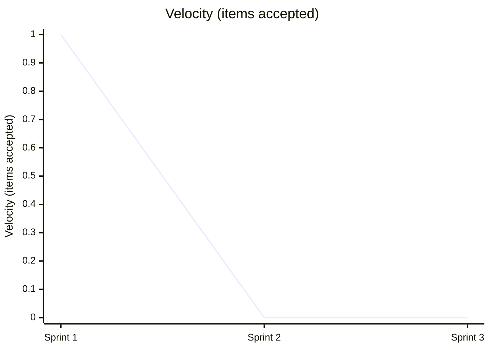
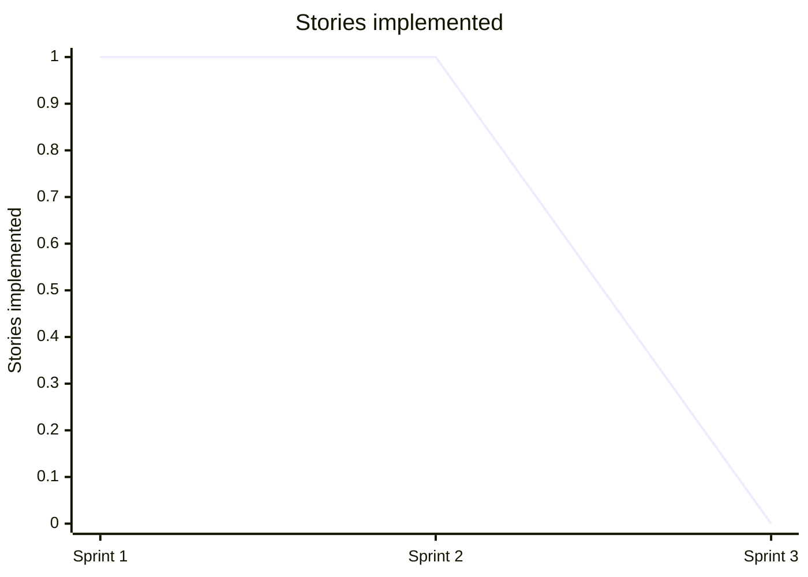

# Team Performance Evaluation Report

- Run ID: 0.2.1-run95
- Horseless Carriage commit: b6bc4938c305cf80a0cf0934729ed3b98dcb2da8
- Branch: eval/0.2.1-run95/main
- Model: scrum-eval-cheap
- Sprints requested: 5, completed: 3 (1 of which were genuinely distinct real sprints - see 'Real Sprint #' below)
- Started: 2026-11-24T10:27:53.010919+00:00
- Finished: 2026-11-24T10:42:30.902512+00:00

## ⚠️ Evaluation Stopped Early

Only 3 of 5 requested sprints completed - **a sprint hit a critical token/USD budget halt with no clean close-out afterward**.

- Stop reason: `budget_critical_halt`

## Blockers

- **US-0002** (Implement Data Model for Lists and Tasks) - product: ProductOwner and ScrumMaster bounced transfer_to_agent 6x with no progress - 🔁 [TRANSFER LOOP DETECTED] 6 transfer_to_agent hops in a row with no other tool call in between (most recently ProductOwner -> ScrumMaster) - refusing this transfer. This looks like an unproductive rotation between roles rather than a direct two-agent ping-pong. Stop transferring and actually call a tool that makes progress, or explain the blocker in plain text instead. (raised by ProductOwner)

## Methodology note
This run used a scripted, unattended driver (`run_eval.py`) that pre-approves every sprint goal/backlog and auto-merges any PR that opens against the eval branch, standing in for the human review gate real usage requires. Results reflect the team's real behavior under those conditions, not under full human-in-the-loop review - a lower bar in that one specific respect.

## Per-sprint metrics
| Sprint | Real Sprint # | Tokens Used | Stories Planned | Sprint Report? | PR Merges (after) |
|---|---|---|---|---|---|
| 1 | 1 | 6172370 | 12 | yes | 1/1 |
| 2 | 1 (continued) | 6319851 | 0 | yes | 1/1 |
| 3 | 1 (continued) | 6457471 | 0 | fallback | 1/1 |

## KPI Trends

| KPI | Sprint 1 | Sprint 2 | Sprint 3 |
|---|---|---|---|
| Velocity (items accepted) | 1 | 0 | 0 |
| Issues fixed | 0 | 0 | 0 |
| Stories implemented | 1 | 1 | 0 |
| Testplan scenarios | 76 | 76 | 76 |
| Say-Do Ratio | 0.08 | n/a | n/a |
| Quality (defect escape rate) | n/a | n/a | n/a |
| Test Coverage | 0.93 | n/a | n/a |

### Velocity (items accepted)



### Issues fixed

```mermaid
xychart-beta
    title "Issues fixed"
    x-axis ["Sprint 1", "Sprint 2", "Sprint 3"]
    y-axis "Issues fixed"
    line [0, 0, 0]
```

### Stories implemented



### Testplan scenarios

```mermaid
xychart-beta
    title "Testplan scenarios"
    x-axis ["Sprint 1", "Sprint 2", "Sprint 3"]
    y-axis "Testplan scenarios"
    line [76, 76, 76]
```

### Say-Do Ratio

```mermaid
xychart-beta
    title "Say-Do Ratio"
    x-axis ["Sprint 1"]
    y-axis "Say-Do Ratio"
    line [0.08]
```

(2 of 3 sprints have no data point for this KPI and are omitted above - see the table for exactly which.)

### Quality (defect escape rate)

No data available for this run - not available - no defect/bug-lifecycle tracking exists yet (Scrum Master's calculate_kpis did run this run, this specific metric just has no data source yet).

### Test Coverage

```mermaid
xychart-beta
    title "Test Coverage"
    x-axis ["Sprint 1"]
    y-axis "Test Coverage"
    line [0.93]
```

(2 of 3 sprints have no data point for this KPI and are omitted above - see the table for exactly which.)

## Token & Cost Summary

- Total tokens used: 6,457,471
- Expected cost: $0.6457 - $2.5830 (rough estimate from litellm's static pricing for `gemini/gemini-flash-lite-latest` - token_usage doesn't split prompt/completion tokens, so this is an all-input-vs-all-output bound, not an exact figure)

## Code Quality

**Score: 2/5**

Only one story (US-0001, documentation) was actually accepted; US-0002 (data model) exists in partial state across 3 sprints but never reached Tested/Accepted. The codebase has no actual Flask application files (`app/__init__.py`, `app/routes.py`, `app/data.py`, `app/static/`, `app/templates/` are all missing), no working backend API, and no frontend UI despite 3 sprints of effort. Test files exist but test a bare Flask app stub in conftest.py, not the promised data model or routes.

## Requirements Quality

**Score: 1/5**

The PRD is well-written (`specs/requirements/PRD-TodoApp-MVP.md`), but the product vision is completely undelivered. After 3 sprints and 6.5M+ tokens, users cannot create lists, add tasks, mark tasks complete, or see any UI. Zero of the 6 core features are functional end-to-end. The README.md documents what *should* exist (architecture, setup, API endpoints, project structure) but none of it is actually implemented in code.

## Team Efficiency

**Score: 1/5**

Sprint 1–3 each exhausted their 5M token budget with cumulative Say-Do ratio of 0.08 (only 1 of 12 stories accepted across all sprints). Tokens were consumed by story planning, discussion, and partial implementation work that never completed the pipeline. Sprint 3 introduced a new failure mode: US-0002 work is 'complete' but trapped in Implemented/Reviewed state, unable to advance due to phase-boundary enforcement, creating a backlog jam. No actual product increment delivered to users after 3 iterations.

## Top Problems

1. **No Flask application or API routes exist despite US-0003 and US-0004 being Ready for 3 sprints.** (severity: high)
   - Evidence: File tree shows no `app/` directory, no `app/__init__.py`, no `app/routes.py`, no `app/data.py`. README.md documents API endpoints (`GET /lists`, `POST /lists`, etc.) but `specs/stories/US-0003-Implement-Backend-API-Routes-for-List-Operations.md` and `specs/stories/US-0004-Implement-Backend-API-Routes-for-Task-Operations.md` remain at 'Ready' status with zero implementation.
   - Suggested fix: Allocate dedicated sprint budget solely for US-0003 and US-0004 implementation (backend API layer). Block all other work. Use actual Flask route handlers, not pseudocode or discussions. Commit to file-system artifacts (app/routes.py with actual @app.route decorators) as acceptance criteria, not planning documents.

2. **No HTML UI, CSS, or JavaScript frontend exists despite US-0005 through US-0011 requiring it.** (severity: high)
   - Evidence: File tree shows no `app/templates/index.html`, no `app/static/css/style.css`, no `app/static/js/app.js`. README.md documents the entire UI layer with specific form requirements, task completion toggles, and delete buttons, but no actual frontend code exists. All 7 UI stories remain at Ready status.
   - Suggested fix: After backend API is functional, dedicate Sprint 4 entirely to US-0005–US-0007 (core UI views). Use vanilla JavaScript fetch() calls to test against the actual API. Create minimal but complete HTML templates covering all 6 user operations. Acceptance criteria must include browser testing, not just file existence.

3. **US-0002 (data model) is architecturally incomplete and trapped in Review state across 3 sprints without progression to Tested/Accepted.** (severity: high)
   - Evidence: `specs/stories/US-0002-Implement-Data-Model-for-Lists-and-Tasks.md` shows all lifecycle stages as Draft and Ready only (never reached Tested or Accepted). `specs/reports/RETRO-001.md` and `specs/reports/SPRINT-REPORT-LATEST.md` document: 'US-0002 (data model) implementation is complete, reviewed (Architect approved), and ready for testing, but phase boundary enforcement prevents advancing it to Tested/Accepted stages during Review/Retro/Release phase.' No actual code file `app/data.py` or `app/models.py` appears in the deliverable tree despite DevTeam claiming it wrote one.
   - Suggested fix: Clarify whether phase-boundary gates (Draft→Ready→Implemented→Reviewed→Tested→Accepted) should block work initiated in Development phase from completing in Review/Retro phase. If gates are too strict, relax them to allow completion of initiated work. If gates are intentional, then reduce sprint scope to 1 story per sprint so it completes the full pipeline within one sprint's time boundary. Currently, the pipeline is broken: 'work is objectively done; the gate is purely temporal.'

4. **Sprint scope (12 stories per sprint) massively exceeds token budget (5M/sprint); only 1 story completed across 3 sprints.** (severity: high)
   - Evidence: `specs/ROADMAP.md` shows all 12 stories (US-0001 through US-0012) planned for v0.1 'MVP' with no version release cut. `specs/reports/SPRINT-REPORT-001.md` states: 'Only 1 of 12 planned stories reached Accepted.' `specs/reports/SPRINT-REPORT-LATEST.md` shows 11/12 stories still at Ready after 6.5M tokens spent. Per-sprint token budget (5M) is insufficient; suggested budgets in sprint reports range from 82–89M tokens per sprint to deliver 12 stories.
   - Suggested fix: Either (a) increase per-sprint token budget to 8–10M tokens and reduce story count to 2–3 implementation stories/sprint, or (b) accept a 15–20 sprint timeline at 5M tokens/sprint to deliver all 12 stories. Current 5-sprint plan cannot complete the MVP with current scope/estimates. Rebaseline immediately in Sprint 4 planning.

5. **Transfer-loop deadlock in Sprint 3 between ProductOwner and ScrumMaster; no tool calls for 6 consecutive transfers.** (severity: high)
   - Evidence: `specs/reports/SPRINT-REPORT-LATEST.md` documents: '[TRANSFER LOOP DETECTED] 6 transfer_to_agent hops in a row with no other tool call in between (most recently ProductOwner -> ScrumMaster).' `specs/reports/TRANSCRIPT-LATEST.md` shows DevTeam transferring to ScrumMaster, ScrumMaster attempting actions, then loop back without progress.
   - Suggested fix: Establish escalation protocol: if an agent cannot make forward progress within 2 turns, it must state the blocker explicitly (not transfer) and log it as an impediment. Break role transfers into async handoff documents (story details, blocker summary, next-agent action list) instead of expecting real-time collaboration within token budget.

6. **README.md documents a complete product that does not exist (architecture diagram, API endpoints, data model, setup instructions all assume code that is not present).** (severity: medium)
   - Evidence: README.md sections: 'High-Level Design' with ASCII diagram (lines 136–152), 'API Endpoints' listing 8 routes (lines 155–174), 'Data Model' (lines 176–200), 'Project Structure' (lines 272–287) showing `app/`, `tests/`, `specs/` with specific file names. Actual file tree has only `tests/conftest.py`, `tests/test_setup.py`, `tests/__init__.py`, and specification documents; no `app/` directory, no `run.py`, no actual `app/routes.py` or `app/data.py`.
   - Suggested fix: Either remove unimplemented sections from README.md (mark them as 'Planned' or 'In Development'), or commit actual code files to match the documented structure. Currently, README serves a documentation-first function that misleads readers into thinking the app is farther along than it is.

7. **Test suite tests Flask import and project setup, not actual business logic or user flows.** (severity: medium)
   - Evidence: `tests/test_setup.py` contains only: `test_flask_import()`, `test_pytest_available()`, `test_flask_app_creation()`, `test_requirements_documented()`, `test_readme_exists()`. No tests for List/Task CRUD, no tests for API routes, no tests for data persistence, no end-to-end flow tests. `conftest.py` creates a bare Flask app with no routes or models. Zero test coverage of the 6 core requirements.
   - Suggested fix: After US-0002 and US-0003/US-0004 are implemented, replace project-setup tests with actual unit and integration tests. For each API route, write tests covering success, 400 Bad Request, 404 Not Found, and 500 Server Error cases. Add end-to-end tests covering the full user flow (create list → add task → toggle completion → delete task → delete list).

8. **No run.py or Flask entry point exists; unclear how to actually start the application.** (severity: medium)
   - Evidence: README.md documents 'Run the application' section (lines 251–258) showing: `python run.py` and `flask --app app run --debug`. File tree has no `run.py` and no actual `app/` module. User cannot execute either command.
   - Suggested fix: Create `run.py` as a minimal entry point: `from app import create_app; app = create_app(); if __name__ == '__main__': app.run(debug=True)`. Implement `app/__init__.py` with the Flask app factory and route registration. Test locally that `python run.py` starts a working server on `http://localhost:5000`.
