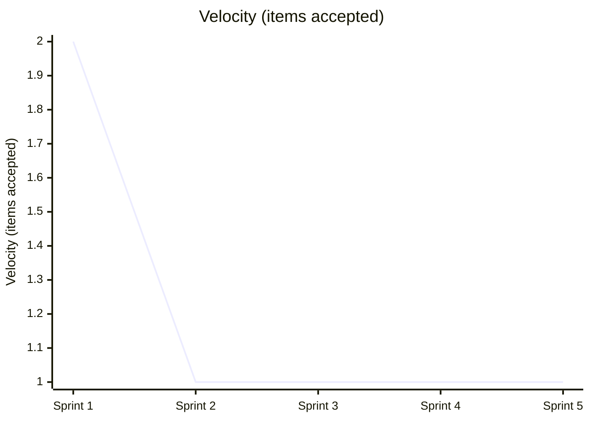
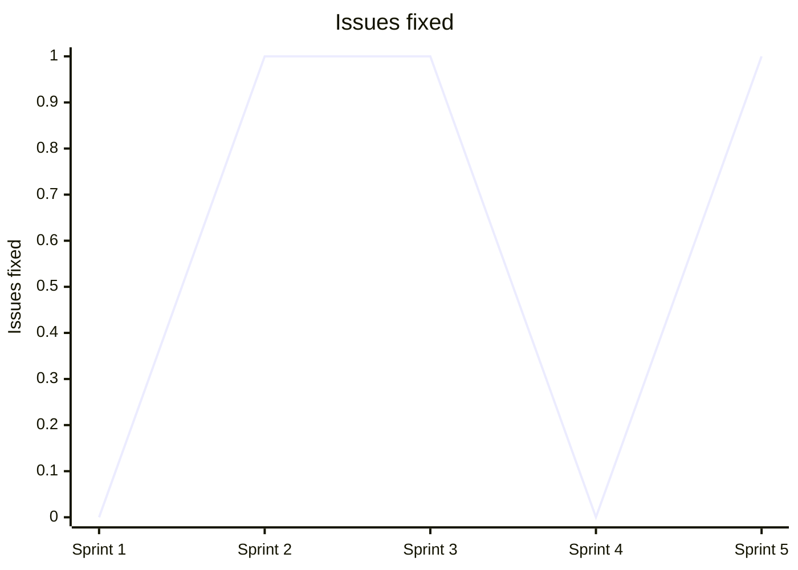
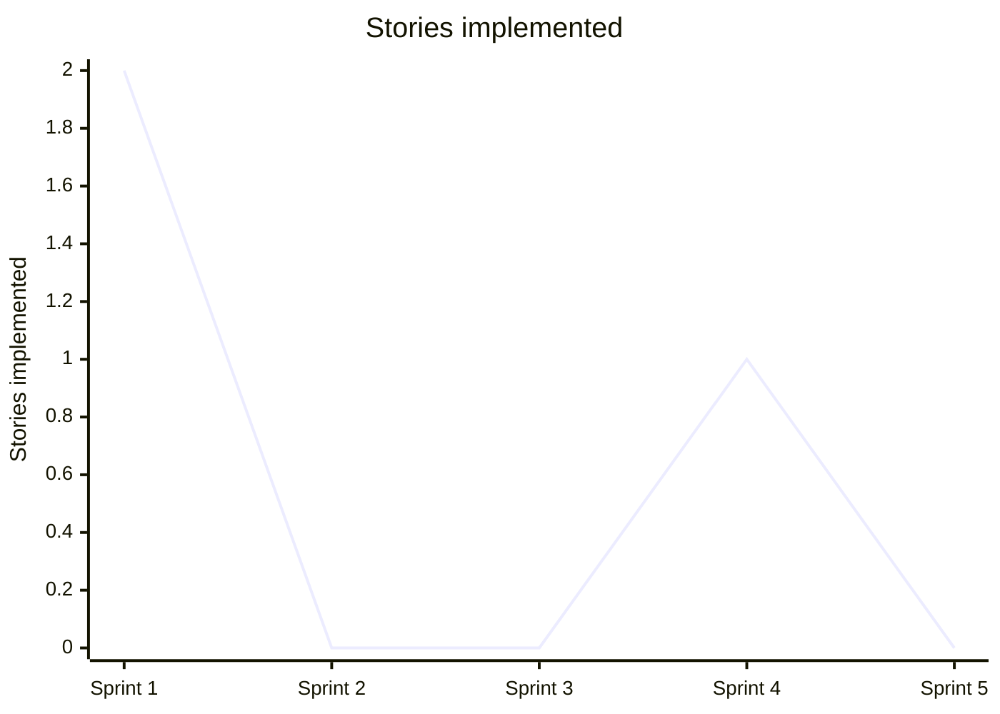
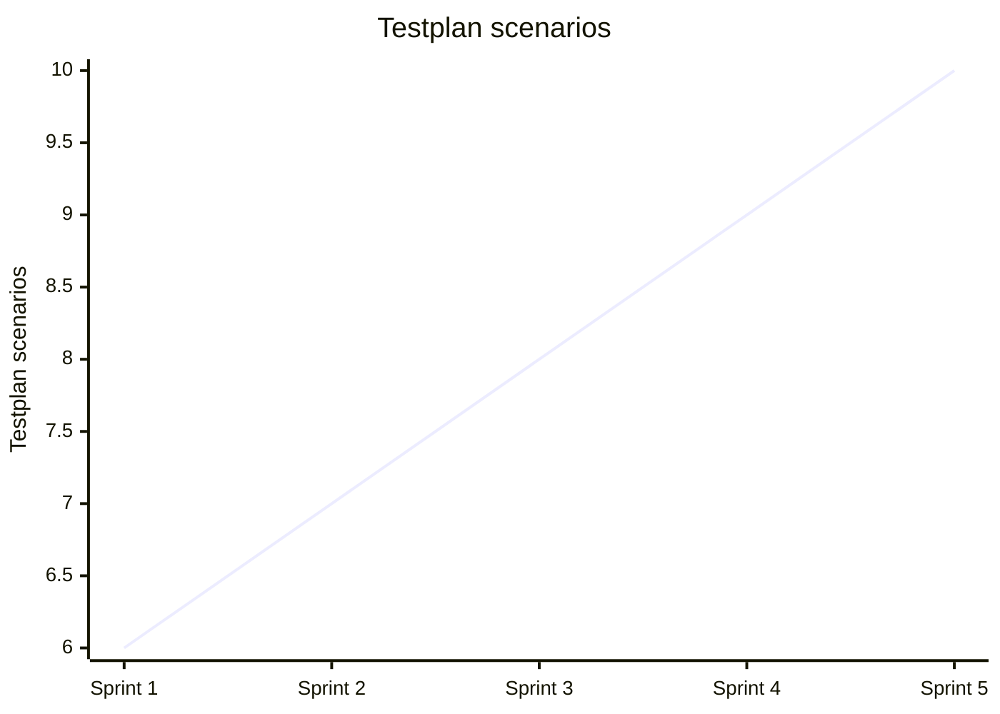
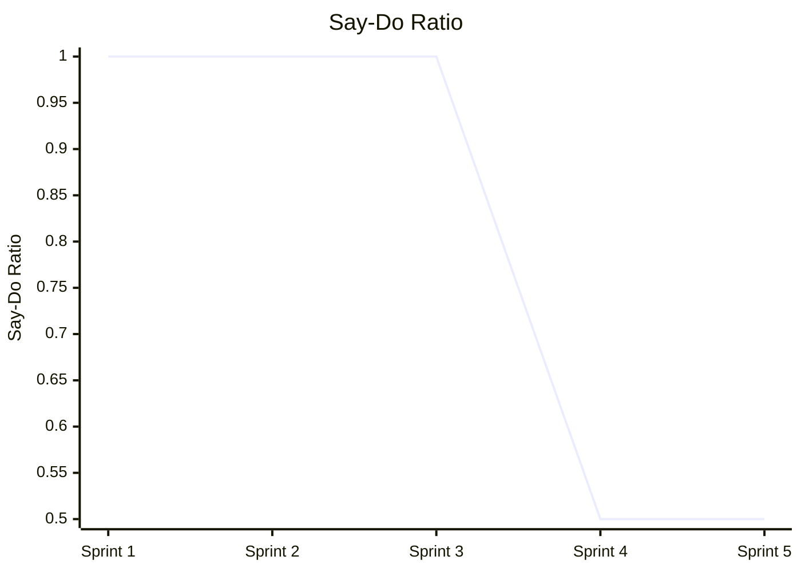

# Team Performance Evaluation Report

- Run ID: 0.2.1-run93
- Horseless Carriage commit: 8f887c9634e79160cf4a2d9fa5e3354a74f4e387
- Branch: eval/0.2.1-run93/main
- Model: scrum-eval-cheap
- Sprints requested: 5, completed: 5
- Started: 2026-11-12T14:24:59.040574+00:00
- Finished: 2026-11-12T14:41:37.581964+00:00

## Blockers

No stories are blocked as of the last completed sprint.

## Methodology note
This run used a scripted, unattended driver (`run_eval.py`) that pre-approves every sprint goal/backlog and auto-merges any PR that opens against the eval branch, standing in for the human review gate real usage requires. Results reflect the team's real behavior under those conditions, not under full human-in-the-loop review - a lower bar in that one specific respect.

## Per-sprint metrics
| Sprint | Real Sprint # | Tokens Used | Stories Planned | Sprint Report? | PR Merges (after) |
|---|---|---|---|---|---|
| 1 | 1 | 3881366 | 2 | yes | 2/2 |
| 2 | 2 | 2198138 | 1 | yes | 1/1 |
| 3 | 3 | 1634068 | 1 | yes | 1/1 |
| 4 | 4 | 3857029 | 2 | yes | 1/1 |
| 5 | 5 | 1997927 | 1 | yes | 1/2 |

## KPI Trends

| KPI | Sprint 1 | Sprint 2 | Sprint 3 | Sprint 4 | Sprint 5 |
|---|---|---|---|---|---|
| Velocity (items accepted) | 2 | 1 | 1 | 1 | 1 |
| Issues fixed | 0 | 1 | 1 | 0 | 1 |
| Stories implemented | 2 | 0 | 0 | 1 | 0 |
| Testplan scenarios | 6 | 7 | 8 | 9 | 10 |
| Say-Do Ratio | 1 | 1 | 1 | 0.5 | 0.5 |
| Quality (defect escape rate) | n/a | n/a | n/a | n/a | n/a |
| Test Coverage | 0.97 | 0.97 | 0.97 | 0.97 | 0.97 |

### Velocity (items accepted)



### Issues fixed



### Stories implemented



### Testplan scenarios



### Say-Do Ratio



### Quality (defect escape rate)

No data available for this run - not available - no defect/bug-lifecycle tracking exists yet (Scrum Master's calculate_kpis did run this run, this specific metric just has no data source yet).

### Test Coverage

```mermaid
xychart-beta
    title "Test Coverage"
    x-axis ["Sprint 1", "Sprint 2", "Sprint 3", "Sprint 4", "Sprint 5"]
    y-axis "Test Coverage"
    line [0.97, 0.97, 0.97, 0.97, 0.97]
```

## Token & Cost Summary

- Total tokens used: 13,568,528
- Expected cost: $1.3569 - $5.4274 (rough estimate from litellm's static pricing for `gemini/gemini-flash-lite-latest` - token_usage doesn't split prompt/completion tokens, so this is an all-input-vs-all-output bound, not an exact figure)

## Code Quality

**Score: 3/5**

The Flask application in app.py provides clean, basic CRUD handlers and JSON endpoints for lists and tasks, backed by pytest tests in tests/test_app.py and tests/conftest.py. However, data persistence is entirely volatile in-memory dictionary state, and error handling or input validation is minimal. Additionally, root-level stray test files (test_app.py) had to be deleted during development due to test collection errors.

## Requirements Quality

**Score: 2/5**

The Product Requirements Document (PRD-TodoList-MVP.md) outlines core MVP features, but the execution fell short of the product vision. Out of six planned user stories, only three (US-0001, US-0002, US-0003) were completed and accepted across five sprints. Core features like deleting tasks (US-0004), deleting lists (US-0005), and viewing all lists and tasks comprehensively (US-0006) remain unimplemented in the ROADMAP.md.

## Team Efficiency

**Score: 2/5**

The team demonstrated rigorous adherence to process documentation, logging detailed transcripts and sprint reports across five iterations. However, velocity was extremely low, with entire sprints spent on internal process issues or fixing test collection errors. The Say-Do ratio dropped to 0.5 in later sprints, leaving critical user-facing backlog items undone despite ample token budget headroom.

## Top Problems

1. **Core user stories for deleting tasks and lists were left unimplemented and marked as to-do in the product roadmap.** (severity: high)
   - Evidence: specs/ROADMAP.md shows US-0004, US-0005, and US-0006 stuck in unplanned/unimplemented states under version v1.0.0.
   - Suggested fix: Prioritize feature delivery over meta-process issues in early sprints to ensure core CRUD requirements are met.

2. **Stray test files created at the repository root level caused test collection failures during pull request reviews.** (severity: medium)
   - Evidence: specs/reports/TRANSCRIPT-005.md notes DevTeam 'Deleting rogue test_app.py at the root level using delete_file'.
   - Suggested fix: Enforce strict file placement conventions in developer instructions to prevent stray test scripts outside the tests/ directory.

3. **Sprint velocity is severely bottlenecked, with multiple sprints failing to meet their planned story commitments.** (severity: high)
   - Evidence: specs/reports/SPRINT-REPORT-005.md records a Say-Do Ratio of 0.5 with only 1/2 stories completed despite utilizing under 35% of the token budget.
   - Suggested fix: Streamline inter-agent handoffs and review loops to prevent overhead from consuming sprint iteration cycles.
