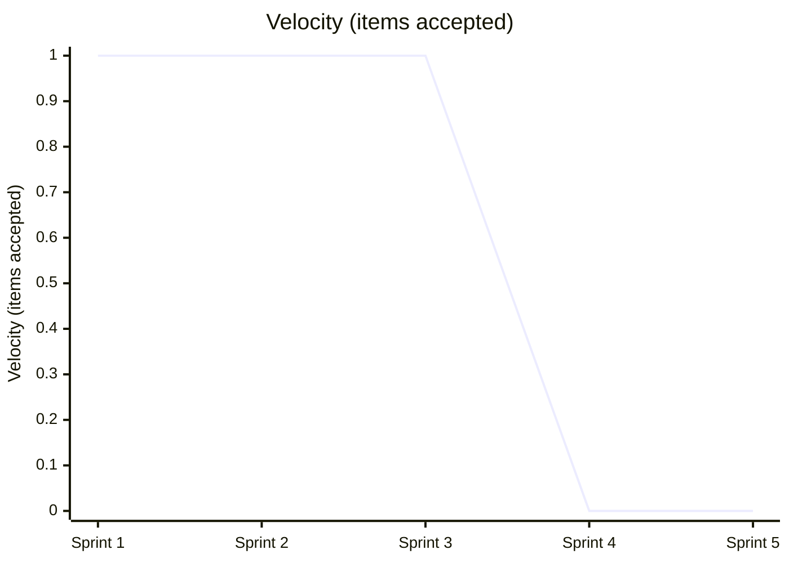
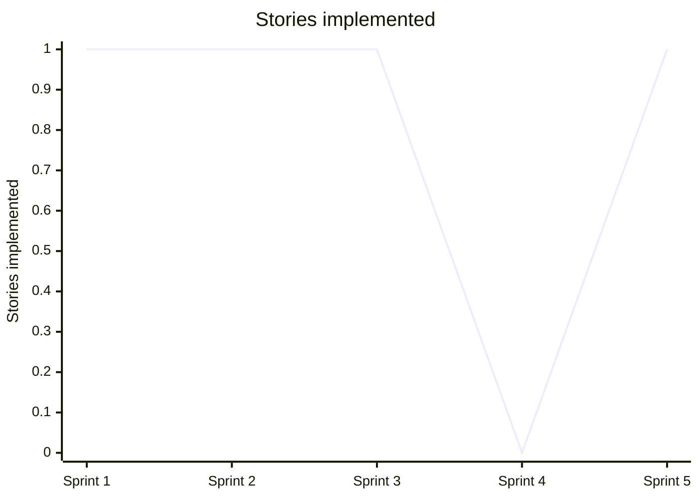
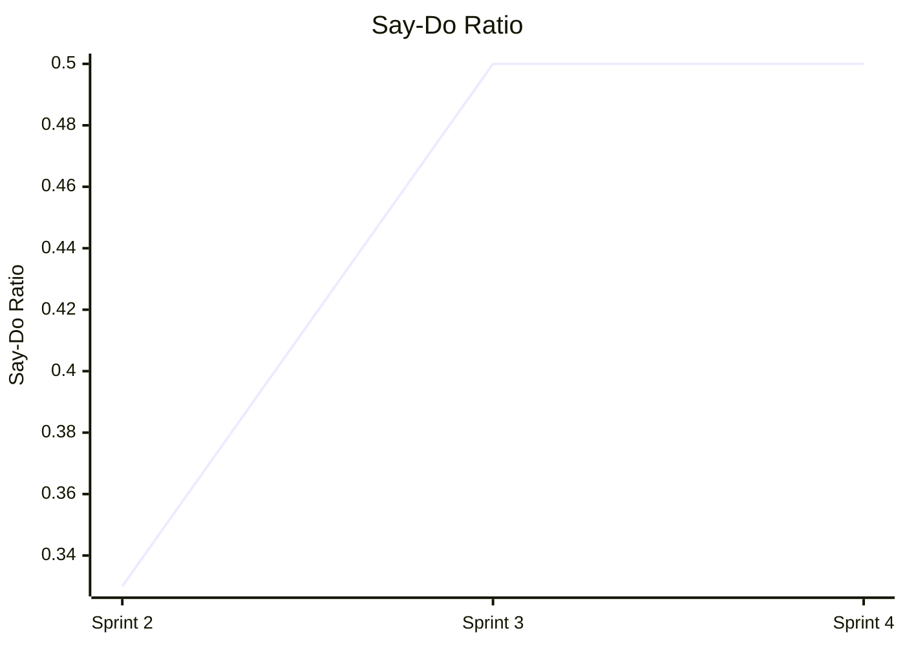

# Team Performance Evaluation Report

- Run ID: 0.1.0-run66
- Horseless Carriage commit: b5b0ef1d5fc49703fc7756e3e594cf9cccfcc9f2
- Branch: eval/0.1.0-run66/main
- Model: scrum-eval-cheap
- Sprints requested: 5, completed: 5
- Started: 2026-10-14T12:46:18.655877+00:00
- Finished: 2026-10-14T13:01:24.033490+00:00

## Blockers

No stories are blocked as of the last completed sprint.

## Methodology note
This run used a scripted, unattended driver (`run_eval.py`) that pre-approves every sprint goal/backlog and auto-merges any PR that opens against the eval branch, standing in for the human review gate real usage requires. Results reflect the team's real behavior under those conditions, not under full human-in-the-loop review - a lower bar in that one specific respect.

## Per-sprint metrics
| Sprint | Tokens Used | Stories Planned | Sprint Report? | PR Merges (after) |
|---|---|---|---|---|
| 1 | 4585459 | 6 | no | 0/0 |
| 2 | 1097310 | 0 | yes | 1/1 |
| 3 | 3211277 | 0 | yes | 0/0 |
| 4 | 3378923 | 0 | yes | 1/1 |
| 5 | 5023214 | 0 | no | 0/0 |

## KPI Trends

| KPI | Sprint 1 | Sprint 2 | Sprint 3 | Sprint 4 | Sprint 5 |
|---|---|---|---|---|---|
| Velocity (items accepted) | 1 | 1 | 1 | 0 | 0 |
| Issues fixed | 0 | 0 | 0 | 0 | 0 |
| Stories implemented | 1 | 1 | 1 | 0 | 1 |
| Testplan scenarios | 6 | 6 | 7 | 7 | 9 |
| Say-Do Ratio | n/a | 0.33 | 0.5 | 0.5 | n/a |
| Quality (defect escape rate) | n/a | n/a | n/a | n/a | n/a |
| Test Coverage | n/a | 0 | 0 | 0 | n/a |

### Velocity (items accepted)



### Issues fixed

```mermaid
xychart-beta
    title "Issues fixed"
    x-axis ["Sprint 1", "Sprint 2", "Sprint 3", "Sprint 4", "Sprint 5"]
    y-axis "Issues fixed"
    line [0, 0, 0, 0, 0]
```

### Stories implemented



### Testplan scenarios


### Say-Do Ratio



(2 of 5 sprints have no data point for this KPI and are omitted above - see the table for exactly which.)

### Quality (defect escape rate)

No data available for this run - not available - no defect/bug-lifecycle tracking exists yet (Scrum Master's calculate_kpis did run this run, this specific metric just has no data source yet).

### Test Coverage

```mermaid
xychart-beta
    title "Test Coverage"
    x-axis ["Sprint 2", "Sprint 3", "Sprint 4"]
    y-axis "Test Coverage"
    line [0, 0, 0]
```

(2 of 5 sprints have no data point for this KPI and are omitted above - see the table for exactly which.)

## Token & Cost Summary

- Total tokens used: 17,296,183
- Expected cost: $1.7296 - $6.9185 (rough estimate from litellm's static pricing for `gemini/gemini-flash-lite-latest` - token_usage doesn't split prompt/completion tokens, so this is an all-input-vs-all-output bound, not an exact figure)

## Code Quality

**Score: 3/5**

The application core in app.py implements basic SQLAlchemy models and Flask routes that align with the PRD for creating lists and adding tasks. However, the test suite in tests/test_app.py references non-existent routes like /lists and /lists/Work/tasks, which completely diverge from the actual implementation endpoints in app.py. Additionally, error handling and validation are minimal across the codebase.

## Requirements Quality

**Score: 2/5**

While the PRD (specs/requirements/PRD-Todo-App.md) clearly states the product vision, the user stories and roadmap are in a disorganized, partially updated state. Stories US-0004 through US-0006 remain unimplemented and unintegrated into the execution cycle, reflecting poor backlog grooming and inconsistent status updates across sprints.

## Team Efficiency

**Score: 2/5**

The team consumed over 17 million tokens across multiple sprints while only completing 3 out of 6 user stories, yielding a low Say-Do ratio and heavy process overhead. Multiple sprints failed to plan or deliver new stories, relying instead on repetitive retrospectives and redundant administrative reporting.

## Top Problems

1. **Test suite makes assertions against non-existent URL routes, causing a mismatch with actual application endpoints.** (severity: high)
   - Evidence: tests/test_app.py calls client.post('/lists', ...) and client.post('/lists/Work/tasks', ...), whereas app.py defines routes as @app.route('/list', ...) and @app.route('/list/<int:list_id>/task', ...).
   - Suggested fix: Update tests/test_app.py to match the actual route paths defined in app.py.

2. **Multiple core user stories remain incomplete and un-vetted despite multiple sprint cycles.** (severity: high)
   - Evidence: specs/ROADMAP.md lists US-0005 (Delete Task) and US-0006 (Delete List) as having [ ] IMPLEMENTED.
   - Suggested fix: Allocate dedicated sprint velocity to implement and test the remaining delete functionalities defined in the PRD.

3. **Excessive token expenditure and process overhead with low functional output per sprint.** (severity: medium)
   - Evidence: Per-sprint metrics show over 5 million tokens used in Sprint 5 with 0 stories planned or completed.
   - Suggested fix: no clear fix - token budgets and agent orchestration limits are inherent to the evaluation framework's fixed-length run constraint.

4. **Retrospective action items and process issues are logged repeatedly without driving execution improvement.** (severity: low)
   - Evidence: specs/reports/RETRO-003.md and subsequent sprint reports continue logging ISSUE-0001, ISSUE-0002, and ISSUE-0003 across multiple sprints as open.
   - Suggested fix: Enforce closure criteria on retro actions so agents actively resolve identified process impediments rather than accumulating backlog tickets.
