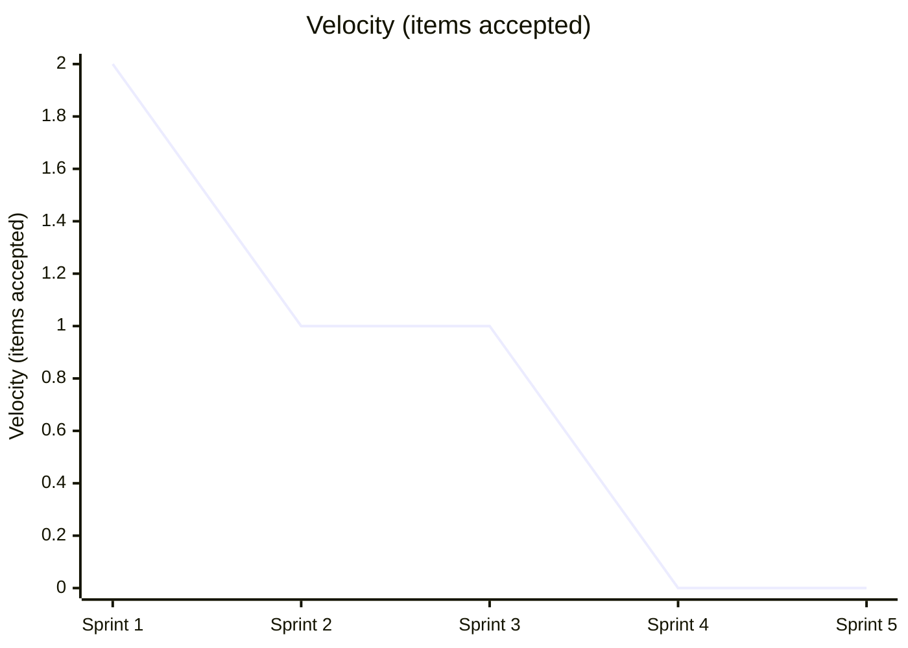
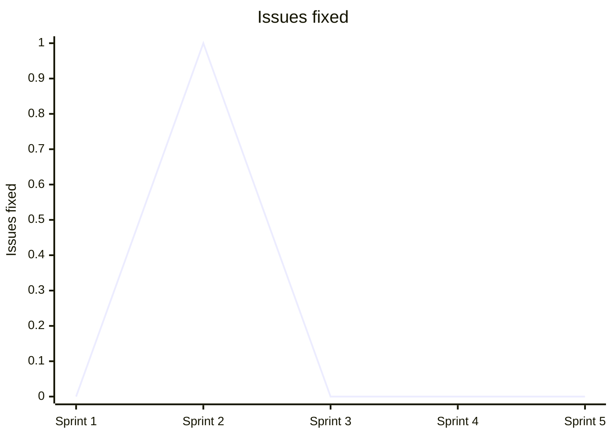
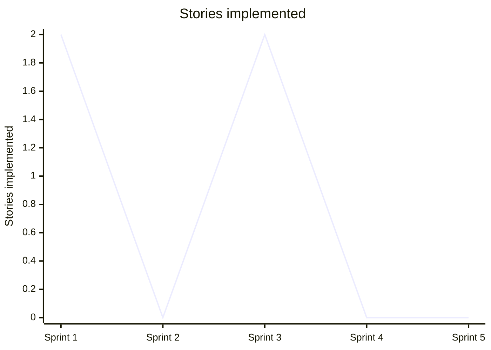
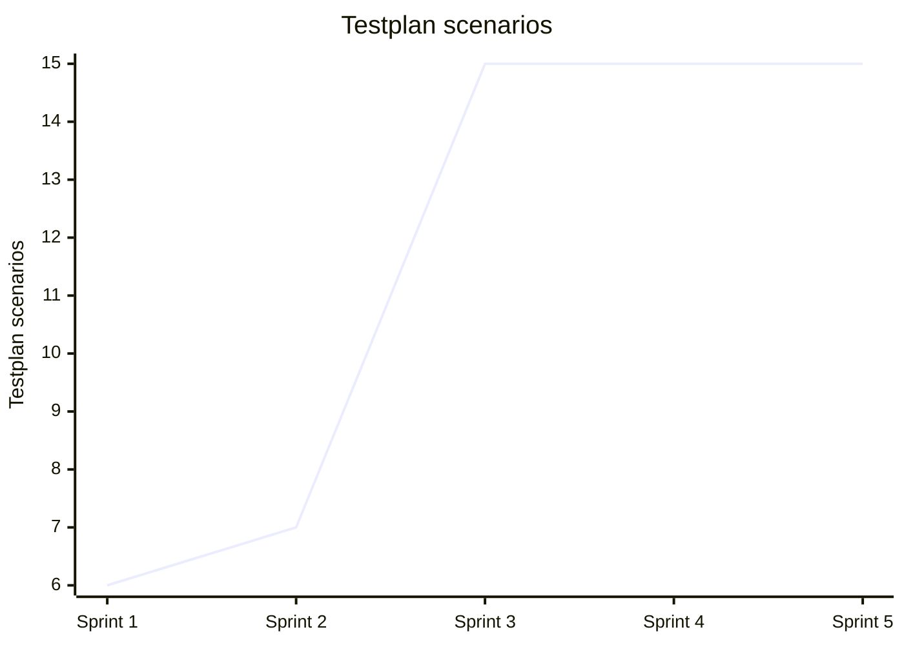
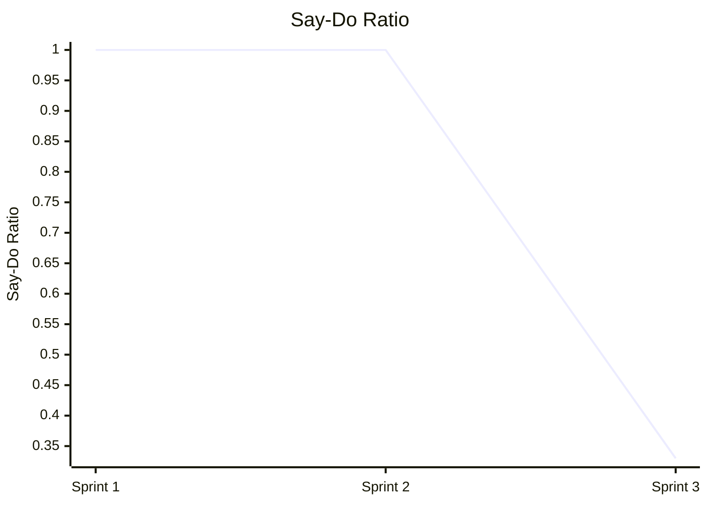

# Team Performance Evaluation Report

- Run ID: 0.1.0-run85
- Horseless Carriage commit: 8011465c3bc0810ba460ba7c9e2965f83e81883e
- Branch: eval/0.1.0-run85/main
- Model: scrum-eval-cheap
- Sprints requested: 5, completed: 5 (3 of which were genuinely distinct real sprints - see 'Real Sprint #' below)
- Started: 2026-11-06T15:01:10.599383+00:00
- Finished: 2026-11-06T15:13:04.073505+00:00

## Blockers

No stories are blocked as of the last completed sprint.

## Methodology note
This run used a scripted, unattended driver (`run_eval.py`) that pre-approves every sprint goal/backlog and auto-merges any PR that opens against the eval branch, standing in for the human review gate real usage requires. Results reflect the team's real behavior under those conditions, not under full human-in-the-loop review - a lower bar in that one specific respect.

## Per-sprint metrics
| Sprint | Real Sprint # | Tokens Used | Stories Planned | Sprint Report? | PR Merges (after) |
|---|---|---|---|---|---|
| 1 | 1 | 3362755 | 2 | yes | 1/1 |
| 2 | 2 | 1356347 | 1 | yes | 1/2 |
| 3 | 3 | 6578792 | 3 | fallback | 2/4 |
| 4 | 3 (continued) | 6578792 | 0 | fallback | 1/3 |
| 5 | 3 (continued) | 6578792 | 0 | fallback | 0/2 |

## KPI Trends

| KPI | Sprint 1 | Sprint 2 | Sprint 3 | Sprint 4 | Sprint 5 |
|---|---|---|---|---|---|
| Velocity (items accepted) | 2 | 1 | 1 | 0 | 0 |
| Issues fixed | 0 | 1 | 0 | 0 | 0 |
| Stories implemented | 2 | 0 | 2 | 0 | 0 |
| Testplan scenarios | 6 | 7 | 15 | 15 | 15 |
| Say-Do Ratio | 1 | 1 | 0.33 | n/a | n/a |
| Quality (defect escape rate) | n/a | n/a | n/a | n/a | n/a |
| Test Coverage | 0.97 | 0.97 | 0.97 | n/a | n/a |

### Velocity (items accepted)



### Issues fixed



### Stories implemented



### Testplan scenarios



### Say-Do Ratio



(2 of 5 sprints have no data point for this KPI and are omitted above - see the table for exactly which.)

### Quality (defect escape rate)

No data available for this run - not available - no defect/bug-lifecycle tracking exists yet (Scrum Master's calculate_kpis did run this run, this specific metric just has no data source yet).

### Test Coverage

```mermaid
xychart-beta
    title "Test Coverage"
    x-axis ["Sprint 1", "Sprint 2", "Sprint 3"]
    y-axis "Test Coverage"
    line [0.97, 0.97, 0.97]
```

(2 of 5 sprints have no data point for this KPI and are omitted above - see the table for exactly which.)

## Token & Cost Summary

- Total tokens used: 11,297,894
- Expected cost: $1.1298 - $4.5192 (rough estimate from litellm's static pricing for `gemini/gemini-flash-lite-latest` - token_usage doesn't split prompt/completion tokens, so this is an all-input-vs-all-output bound, not an exact figure)

## Code Quality

**Score: 2/5**

The application code in app.py implements a basic in-memory Flask list and task creation workflow, but lacks critical features like task completion toggling, deletion, and user authentication. While templates/index.html includes CSS classes for completed tasks (.completed), the underlying routes to toggle or delete tasks are entirely missing. Furthermore, persistence relies solely on an ephemeral in-memory list (lists_db = []), meaning all data is lost upon application restart.

## Requirements Quality

**Score: 3/5**

The PRDs and user stories (such as specs/requirements/PRD-TodoList-MVP.md and specs/stories/US-0001.md through US-0010.md) are well-structured and cleanly documented. However, execution stalled out after sprint 2, leaving the v0.2 authentication epic (US-0007 through US-0010) completely unimplemented despite being planned. The disconnect between documented backlog items and actual code delivery indicates a breakdown in multi-sprint planning execution.

## Team Efficiency

**Score: 2/5**

The team exhausted its total token budget prematurely (reaching 6,578,792 / 5,000,000 tokens) by Sprint 3, resulting in mechanical fallback sprint reports for Sprints 3, 4, and 5. While early sprints (Sprint 1 and 2) executed cleanly with 100% say/do ratios and prompt dependency additions in requirements.txt, the later sprints suffered from token exhaustion and stalled out without making code progress.

## Top Problems

1. **Missing core task management features such as completion toggling and deletion.** (severity: high)
   - Evidence: app.py contains only create_list and add_task routes, omitting endpoints for US-0003, US-0004, and US-0005.
   - Suggested fix: Implement missing routes in app.py and corresponding form actions in templates/index.html for task completion, task deletion, and list deletion.

2. **Unauthenticated application state violating the v0.2 authentication epic requirements.** (severity: high)
   - Evidence: PRD-Auth-MVP.md and user stories US-0007 through US-0010 are marked ready or draft in specs/ROADMAP.md, but no authentication code or database models exist in app.py.
   - Suggested fix: Implement User models, bcrypt password hashing, and login/registration routes as specified in PRD-Auth-MVP.md.

3. **Ephemeral in-memory data store causes total data loss on restart.** (severity: medium)
   - Evidence: app.py defines `lists_db = []` instead of using Flask-SQLAlchemy, despite Flask-SQLAlchemy>=2.5.0 and instance/todo.db being present.
   - Suggested fix: Wire up Flask-SQLAlchemy models in app.py to persist lists and tasks to instance/todo.db.

4. **Token budget exhaustion caused three consecutive sprints to fail to execute agent-driven reporting.** (severity: medium)
   - Evidence: SPRINT-REPORT-003.md, SPRINT-REPORT-004.md, and SPRINT-REPORT-LATEST.md rely on mechanical fallback reports due to token usage of 6,578,792 / 5000000.
   - Suggested fix: no clear fix - token budgets and agent prompt verbosity cannot be altered without changing the evaluation harness configuration.
