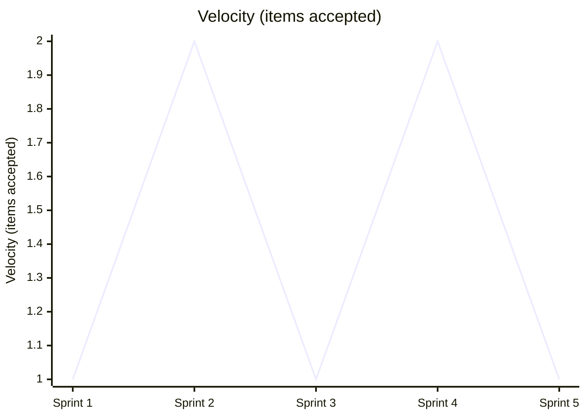
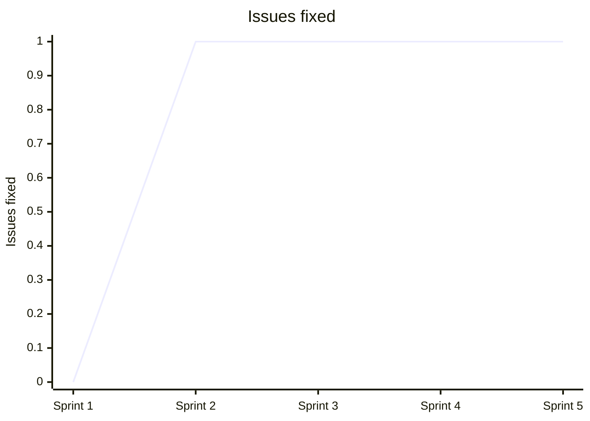
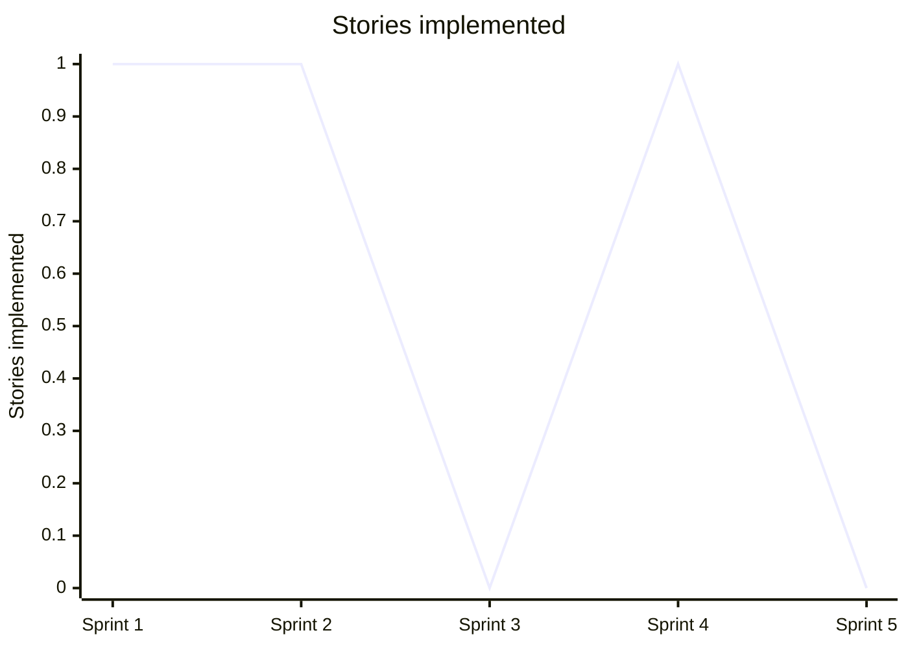
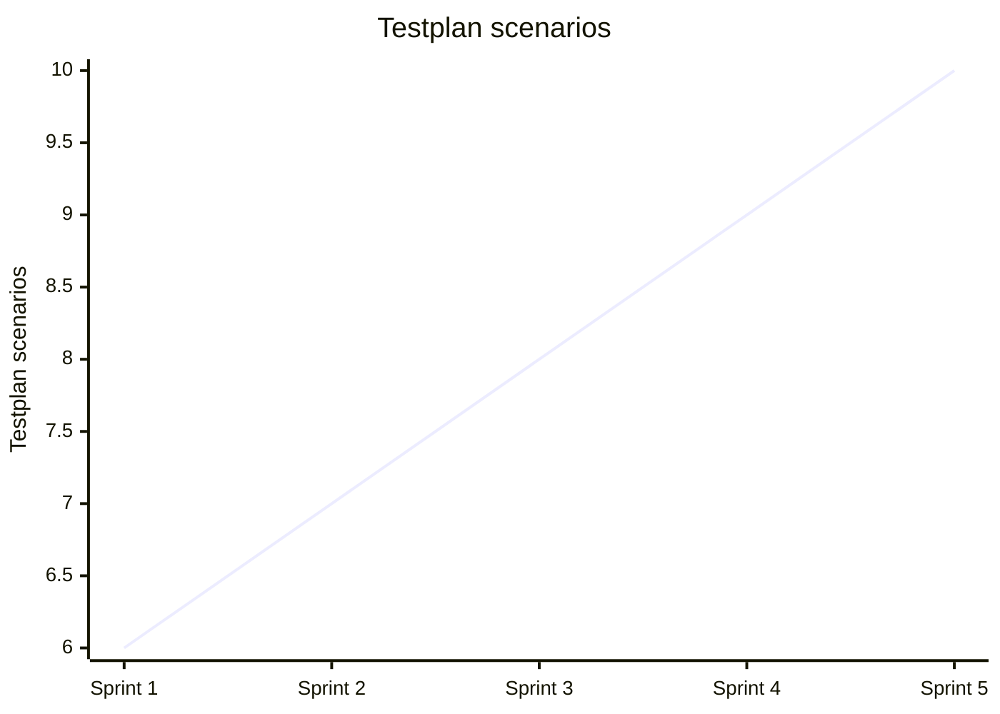
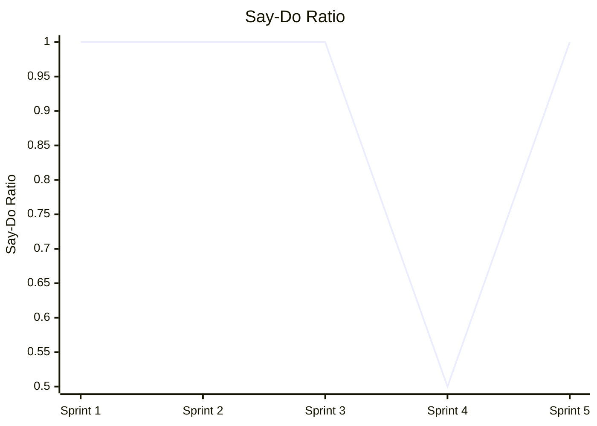

# Team Performance Evaluation Report

- Run ID: 0.1.0-run80
- Horseless Carriage commit: cac04b46d984e0ba2e32c9041d4edb2d62d27a58
- Branch: eval/0.1.0-run80/main
- Model: scrum-eval-cheap
- Sprints requested: 5, completed: 5
- Started: 2026-11-02T08:58:11.651005+00:00
- Finished: 2026-11-02T09:16:39.437577+00:00

## Blockers

No stories are blocked as of the last completed sprint.

## Methodology note
This run used a scripted, unattended driver (`run_eval.py`) that pre-approves every sprint goal/backlog and auto-merges any PR that opens against the eval branch, standing in for the human review gate real usage requires. Results reflect the team's real behavior under those conditions, not under full human-in-the-loop review - a lower bar in that one specific respect.

## Per-sprint metrics
| Sprint | Real Sprint # | Tokens Used | Stories Planned | Sprint Report? | PR Merges (after) |
|---|---|---|---|---|---|
| 1 | 1 | 1874781 | 1 | yes | 1/1 |
| 2 | 2 | 5752504 | 2 | yes | 1/1 |
| 3 | 3 | 1874605 | 1 | yes | 1/1 |
| 4 | 4 | 3339972 | 2 | yes | 1/2 |
| 5 | 5 | 1577088 | 1 | yes | 1/3 |

## KPI Trends

| KPI | Sprint 1 | Sprint 2 | Sprint 3 | Sprint 4 | Sprint 5 |
|---|---|---|---|---|---|
| Velocity (items accepted) | 1 | 2 | 1 | 2 | 1 |
| Issues fixed | 0 | 1 | 1 | 1 | 1 |
| Stories implemented | 1 | 1 | 0 | 1 | 0 |
| Testplan scenarios | 6 | 7 | 8 | 9 | 10 |
| Say-Do Ratio | 1 | 1 | 1 | 0.5 | 1 |
| Quality (defect escape rate) | n/a | n/a | n/a | n/a | n/a |
| Test Coverage | 0.96 | 0.96 | 0.96 | 0.96 | 0.96 |

### Velocity (items accepted)



### Issues fixed



### Stories implemented



### Testplan scenarios



### Say-Do Ratio



### Quality (defect escape rate)

No data available for this run - not available - no defect/bug-lifecycle tracking exists yet (Scrum Master's calculate_kpis did run this run, this specific metric just has no data source yet).

### Test Coverage

```mermaid
xychart-beta
    title "Test Coverage"
    x-axis ["Sprint 1", "Sprint 2", "Sprint 3", "Sprint 4", "Sprint 5"]
    y-axis "Test Coverage"
    line [0.96, 0.96, 0.96, 0.96, 0.96]
```

## Token & Cost Summary

- Total tokens used: 14,418,950
- Expected cost: $1.4419 - $5.7676 (rough estimate from litellm's static pricing for `gemini/gemini-flash-lite-latest` - token_usage doesn't split prompt/completion tokens, so this is an all-input-vs-all-output bound, not an exact figure)

## Code Quality

**Score: 3/5**

The application core in app.py implements basic list creation, task addition, and completion toggling via Flask routes and global dictionaries. However, features US-0004 (Delete Task), US-0005 (Delete Entire List), and US-0006 (View All Lists and Tasks) remain unimplemented and marked as Todo in specs/ROADMAP.md. Test isolation issues were addressed via conftest.py fixtures, but overall functionality falls short of the complete PRD-Todo-App.md product vision.

## Requirements Quality

**Score: 2/5**

While the product requirements document (specs/requirements/PRD-Todo-App.md) clearly outlines six user stories, the team spent excessive cycle time filing, processing, and implementing internal meta-issues (SPEC-ISSUE-0001 through SPEC-ISSUE-0005) rather than delivering user-facing value. Consequently, user stories US-0004, US-0005, and US-0006 are left completely unimplemented under release v1.0.0 in specs/ROADMAP.md.

## Team Efficiency

**Score: 2/5**

The team consumed substantial token budgets across 5 sprints (e.g., 5,752,504 tokens in Sprint 2) while repeatedly prioritizing process overhead, retrospectives, and PR engagement tracking over feature delivery. Out of 6 core user stories required by the PRD, only 3 (US-0001, US-0002, US-0003) were completed, demonstrating low velocity relative to resource consumption.

## Top Problems

1. **Core product requirements remain incomplete at the end of the evaluation run.** (severity: high)
   - Evidence: specs/ROADMAP.md shows US-0004, US-0005, and US-0006 under v1.0.0 with unchecked implementation boxes ([ ] IMPLEMENTED).
   - Suggested fix: Reallocate sprint capacity from meta-issues to user story implementation in future iterations.

2. **Excessive focus on internal process compliance and meta-issues over user functionality.** (severity: medium)
   - Evidence: specs/requirements/SPEC-ISSUE-0001.md through SPEC-ISSUE-0005.md consume backlog slots and sprint reports for PR engagement rules.
   - Suggested fix: Streamline workflow rules to minimize administrative overhead for AI agent teams.

3. **Application state relies on fragile global in-memory dictionaries without persistence.** (severity: medium)
   - Evidence: app.py defines global 'lists = {}' and 'tasks = {}' objects which lose state across application restarts.
   - Suggested fix: Implement a lightweight database or robust session-based persistence layer.
