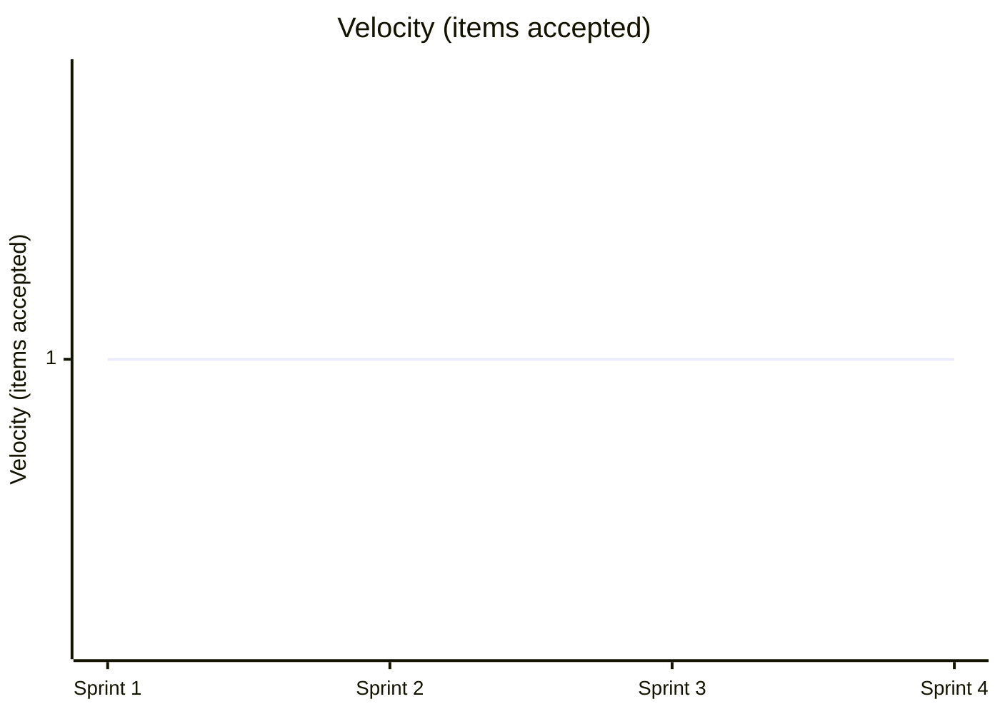
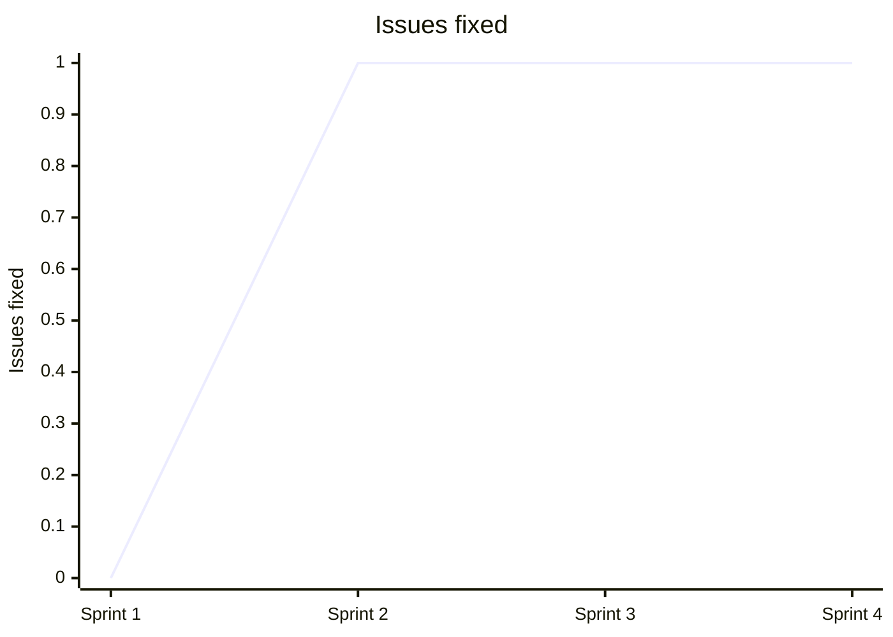
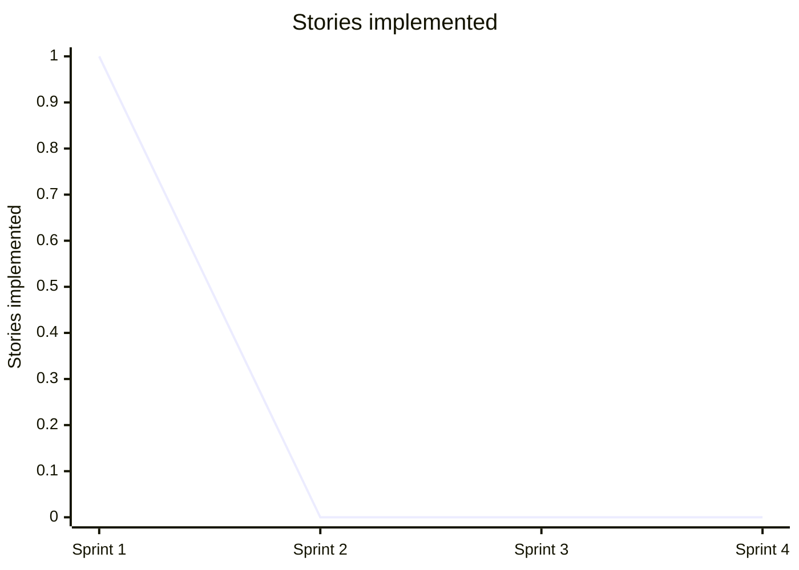
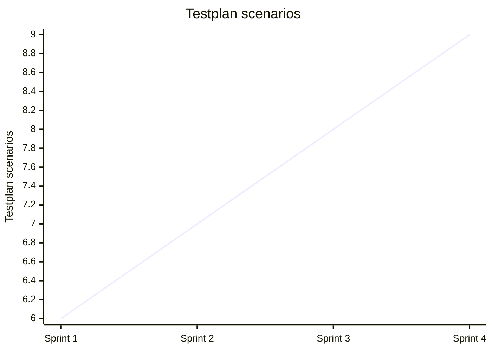

# Team Performance Evaluation Report

- Run ID: 0.1.0-run81
- Horseless Carriage commit: 5d68ca535471c28be35cea6e6198802f830f1edc
- Branch: eval/0.1.0-run81/main
- Model: scrum-eval-cheap
- Sprints requested: 5, completed: 4
- Started: 2026-11-02T10:37:40.539246+00:00
- Finished: 2026-11-02T10:47:28.432913+00:00

## ⚠️ Evaluation Stopped Early

Only 4 of 5 requested sprints completed - **a sprint hit a critical token/USD budget halt with no clean close-out afterward**.

- Stop reason: `budget_critical_halt`

## Blockers

- **US-0002** (Add Task to List) - technical: ScrumMaster and QA bounced transfer_to_agent 6x with no progress - 🔁 [TRANSFER LOOP DETECTED] 6 transfer_to_agent hops in a row with no other tool call in between (most recently ScrumMaster -> QA) - refusing this transfer. This looks like an unproductive rotation between roles rather than a direct two-agent ping-pong. Stop transferring and actually call a tool that makes progress, or explain the blocker in plain text instead. (raised by ScrumMaster)
- **US-0003** (View Lists and Tasks) - technical: Architect and ScrumOrchestrator bounced transfer_to_agent 6x with no progress - 🔁 [TRANSFER LOOP DETECTED] 6 transfer_to_agent hops in a row with no other tool call in between (most recently Architect -> ScrumOrchestrator) - refusing this transfer. This looks like an unproductive rotation between roles rather than a direct two-agent ping-pong. Stop transferring and actually call a tool that makes progress, or explain the blocker in plain text instead. (raised by Architect)

## Methodology note
This run used a scripted, unattended driver (`run_eval.py`) that pre-approves every sprint goal/backlog and auto-merges any PR that opens against the eval branch, standing in for the human review gate real usage requires. Results reflect the team's real behavior under those conditions, not under full human-in-the-loop review - a lower bar in that one specific respect.

## Per-sprint metrics
| Sprint | Real Sprint # | Tokens Used | Stories Planned | Sprint Report? | PR Merges (after) |
|---|---|---|---|---|---|
| 1 | 1 | 3094653 | 1 | yes | 1/1 |
| 2 | 2 | 1744602 | 1 | yes | 1/1 |
| 3 | 3 | 1218667 | 1 | yes | 1/1 |
| 4 | 4 | 3012188 | 1 | yes | 0/0 |

## KPI Trends

| KPI | Sprint 1 | Sprint 2 | Sprint 3 | Sprint 4 |
|---|---|---|---|---|
| Velocity (items accepted) | 1 | 1 | 1 | 1 |
| Issues fixed | 0 | 1 | 1 | 1 |
| Stories implemented | 1 | 0 | 0 | 0 |
| Testplan scenarios | 6 | 7 | 8 | 9 |
| Say-Do Ratio | 1 | 1 | 1 | 1 |
| Quality (defect escape rate) | n/a | n/a | n/a | n/a |
| Test Coverage | 0.96 | 0.96 | 0.96 | 0.96 |

### Velocity (items accepted)



### Issues fixed



### Stories implemented



### Testplan scenarios



### Say-Do Ratio

```mermaid
xychart-beta
    title "Say-Do Ratio"
    x-axis ["Sprint 1", "Sprint 2", "Sprint 3", "Sprint 4"]
    y-axis "Say-Do Ratio"
    line [1, 1, 1, 1]
```

### Quality (defect escape rate)

No data available for this run - not available - no defect/bug-lifecycle tracking exists yet (Scrum Master's calculate_kpis did run this run, this specific metric just has no data source yet).

### Test Coverage

```mermaid
xychart-beta
    title "Test Coverage"
    x-axis ["Sprint 1", "Sprint 2", "Sprint 3", "Sprint 4"]
    y-axis "Test Coverage"
    line [0.96, 0.96, 0.96, 0.96]
```

## Token & Cost Summary

- Total tokens used: 9,070,110
- Expected cost: $0.9070 - $3.6280 (rough estimate from litellm's static pricing for `gemini/gemini-flash-lite-latest` - token_usage doesn't split prompt/completion tokens, so this is an all-input-vs-all-output bound, not an exact figure)

## Code Quality

**Score: 2/5**

The codebase contains a minimal Flask application in app.py that only supports creating to-do lists via POST requests to '/lists' and rendering an index template. It completely lacks endpoints or logic for adding tasks, marking tasks complete, deleting tasks, or deleting entire lists. Furthermore, frontend interactivity in templates/index.html and comprehensive unit test coverage in tests/test_app.py are severely limited or missing.

## Requirements Quality

**Score: 2/5**

While the product owner successfully authored epics and user stories (US-0001 through US-0006) in specs/stories/, the actual implementation stalled out after US-0001. Subsequent sprints spent all their velocity on internal meta-issues and technical debt (SPEC-ISSUE-0001 through SPEC-ISSUE-0004) rather than delivering the product vision features. As a result, roadmap tracking in specs/ROADMAP.md shows US-0002 through US-0006 stuck in un-implemented states.

## Team Efficiency

**Score: 2/5**

The AI Scrum team burned substantial token budgets (over 9 million tokens across 4 sprints) on repetitive workflow ceremonies, retrospectives, and internal process tickets instead of shipping user-facing value. Sprints 2 through 4 repeatedly implemented meta-issues regarding test path configurations and branching workflows rather than advancing the core product backlog. The say/do ratio reported as 1.0 is technically accurate for the tiny scope chosen, but reflects severe scope evasion.

## Top Problems

1. **Core product requirements (US-0002 through US-0006) remain completely unimplemented.** (severity: high)
   - Evidence: specs/ROADMAP.md shows US-0002 through US-0006 with checkboxes unchecked for IMPLEMENTED, REVIEWED, TESTED, and ACCEPTED.
   - Suggested fix: Direct the Product Owner and DevTeam to prioritize user story implementation over meta-issues in future sprint backlogs.

2. **Application code in app.py only implements list creation and lacks task management routes.** (severity: high)
   - Evidence: app.py defines only '/' and '/lists' routes, omitting endpoints for adding, completing, or deleting tasks.
   - Suggested fix: Implement task routes and data structures in app.py corresponding to US-0002 through US-0005.

3. **Excessive sprint velocity spent on repetitive technical debt tickets instead of features.** (severity: medium)
   - Evidence: Specs/reports/RETRO-004.md lists multiple recurring technical issues (SPEC-ISSUE-0001 through SPEC-ISSUE-0004) consuming entire sprints.
   - Suggested fix: Consolidate environment and path configuration fixes into a single setup phase rather than dragging them across multiple sprint retrospectives.

4. **Self-approval restrictions on pull requests caused unnecessary agent transfer loops and blockers.** (severity: medium)
   - Evidence: TRANSCRIPT-004.md shows QA raising a blocker for SPEC-ISSUE-0001 due to 'GitHub API restrictions on self-approving pull request reviews.'
   - Suggested fix: Configure repository review bypass rules or adjust agent workflow permissions for automated evaluation environments.
