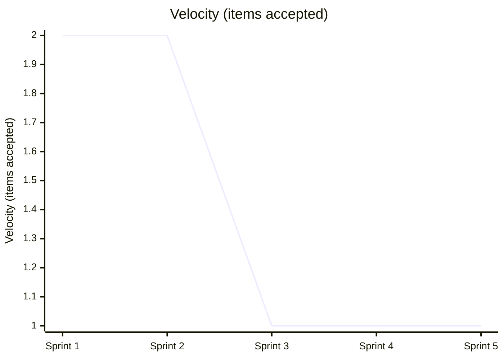
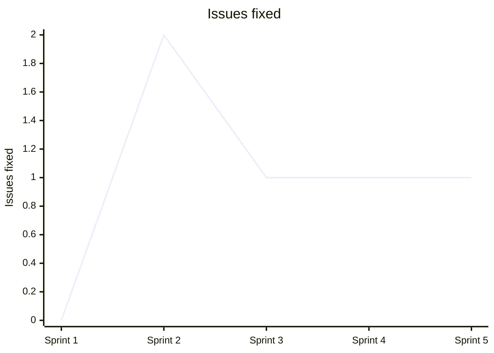
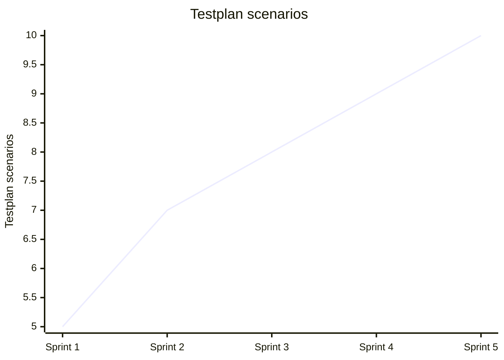

# Team Performance Evaluation Report

- Run ID: 0.1.0-run79
- Horseless Carriage commit: 918bd45976a1092ce877a400c27b8ebf7da4d6a2
- Branch: eval/0.1.0-run79/main
- Model: scrum-eval-cheap
- Sprints requested: 5, completed: 5
- Started: 2026-10-30T09:52:29.785456+00:00
- Finished: 2026-10-30T10:05:06.965740+00:00

## Blockers

No stories are blocked as of the last completed sprint.

## Methodology note
This run used a scripted, unattended driver (`run_eval.py`) that pre-approves every sprint goal/backlog and auto-merges any PR that opens against the eval branch, standing in for the human review gate real usage requires. Results reflect the team's real behavior under those conditions, not under full human-in-the-loop review - a lower bar in that one specific respect.

## Per-sprint metrics
| Sprint | Real Sprint # | Tokens Used | Stories Planned | Sprint Report? | PR Merges (after) |
|---|---|---|---|---|---|
| 1 | 1 | 3418668 | 2 | yes | 1/1 |
| 2 | 2 | 2338966 | 2 | yes | 1/1 |
| 3 | 3 | 1645184 | 1 | yes | 1/1 |
| 4 | 4 | 1388150 | 1 | yes | 1/1 |
| 5 | 5 | 1698527 | 1 | yes | 1/1 |

## KPI Trends

| KPI | Sprint 1 | Sprint 2 | Sprint 3 | Sprint 4 | Sprint 5 |
|---|---|---|---|---|---|
| Velocity (items accepted) | 2 | 2 | 1 | 1 | 1 |
| Issues fixed | 0 | 2 | 1 | 1 | 1 |
| Stories implemented | 2 | 0 | 0 | 0 | 0 |
| Testplan scenarios | 5 | 7 | 8 | 9 | 10 |
| Say-Do Ratio | 1 | 1 | 1 | 1 | 1 |
| Quality (defect escape rate) | n/a | n/a | n/a | n/a | n/a |
| Test Coverage | 0.97 | 0.97 | 0.97 | 0.97 | 0.97 |

### Velocity (items accepted)



### Issues fixed



### Stories implemented


### Testplan scenarios



### Say-Do Ratio

```mermaid
xychart-beta
    title "Say-Do Ratio"
    x-axis ["Sprint 1", "Sprint 2", "Sprint 3", "Sprint 4", "Sprint 5"]
    y-axis "Say-Do Ratio"
    line [1, 1, 1, 1, 1]
```

### Quality (defect escape rate)

No data available for this run - not available - no defect/bug-lifecycle tracking exists yet (Scrum Master's calculate_kpis did run this run, this specific metric just has no data source yet).

### Test Coverage

```mermaid
xychart-beta
    title "Test Coverage"
    x-axis ["Sprint 1", "Sprint 2", "Sprint 3", "Sprint 4", "Sprint 5"]
    y-axis "Test Coverage"
    line [0.97, 0.97, 0.97, 0.97, 0.97]
```

## Token & Cost Summary

- Total tokens used: 10,489,495
- Expected cost: $1.0489 - $4.1958 (rough estimate from litellm's static pricing for `gemini/gemini-flash-lite-latest` - token_usage doesn't split prompt/completion tokens, so this is an all-input-vs-all-output bound, not an exact figure)

## Code Quality

**Score: 3/5**

The application core in app.py provides a working Flask implementation for list creation and task addition, backed by automated tests in test_app.py. However, the codebase stops after Sprint 1 functionality, completely omitting the backend logic for completing, deleting tasks, and deleting lists. The remaining sprints were entirely consumed by internal process housekeeping and meta-issues rather than product feature delivery.

## Requirements Quality

**Score: 2/5**

The PRD-Todo-MVP.md accurately outlines the required features (lists, tasks, completion, deletion), but the product roadmap in specs/ROADMAP.md and sprint execution reports show severe scope drift. Out of five planned user stories (US-0001 through US-0005), three core requirements (US-0003, US-0004, US-0005) were left unimplemented. Instead, the team spent sprints 2 through 5 processing internal meta-issues and retrospective actions.

## Team Efficiency

**Score: 1/5**

The AI team exhibited extreme process overhead, consuming over 10 million total tokens across 5 sprints while delivering only 2 user stories. Sprints 2 through 5 were entirely co-opted by recursive generation and resolution of internal process issues (SPEC-ISSUE-0001 through SPEC-ISSUE-0006) rather than building product features. The team failed to manage velocity or align sprint capacity with the core product vision.

## Top Problems

1. **Core MVP user stories US-0003, US-0004, and US-0005 were left uncompleted and abandoned in backlog.** (severity: high)
   - Evidence: specs/ROADMAP.md shows US-0003, US-0004, and US-0005 with [ ] IMPLEMENTED / [ ] ACCEPTED.
   - Suggested fix: Reallocate sprint capacity away from meta-issues in sprints 2-5 to focus on implementing task completion, task deletion, and list deletion.

2. **Excessive token and sprint budget consumed on internal process meta-issues instead of product features.** (severity: high)
   - Evidence: specs/requirements/SPEC-ISSUE-0001 through SPEC-ISSUE-0006 represent internal tracking loops rather than user value.
   - Suggested fix: Disable or constrain autonomous creation of internal process/retro-action specification issues during fixed-length evaluations.

3. **App implementation in app.py lacks routes and handlers for task completion toggling and deletion.** (severity: high)
   - Evidence: app.py contains only index, create_list, and add_task routes; no toggle or delete endpoints exist.
   - Suggested fix: Implement corresponding Flask routes for PUT/POST toggling and deletion in app.py matching US-0003, US-0004, and US-0005.

4. **Test suite in test_app.py covers only initial list and task creation, lacking coverage for missing MVP features.** (severity: medium)
   - Evidence: test_app.py has only test_index_and_create_list and test_add_task_to_list.
   - Suggested fix: Add pytest test cases verifying task completion toggling and item/list deletion flows.
