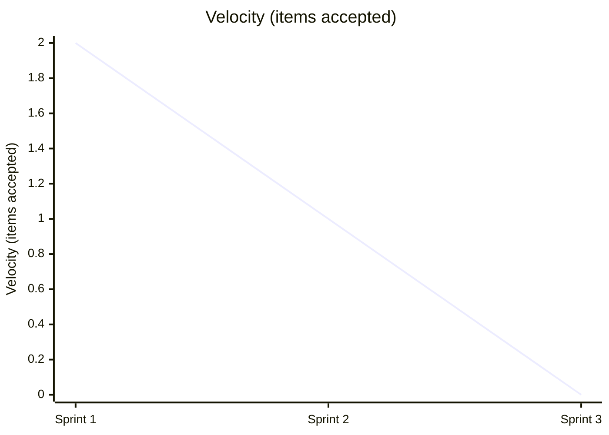
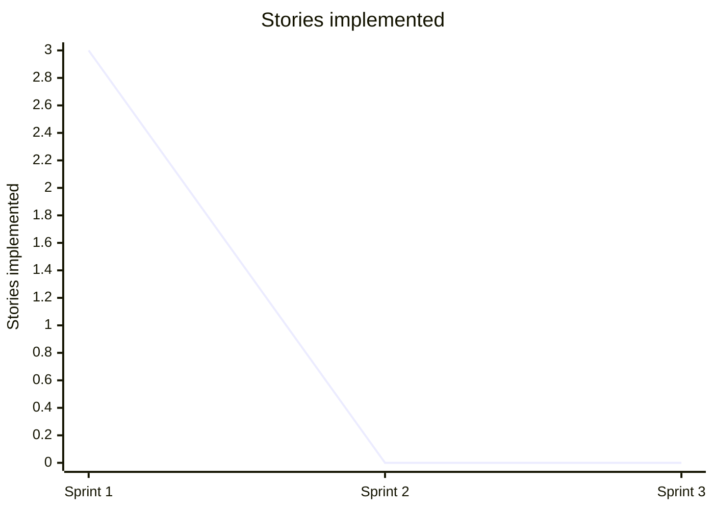

# Team Performance Evaluation Report

- Run ID: 0.1.0-run64
- Horseless Carriage commit: a4fc7c0613db3a2f171282a6e2347950eca15424
- Branch: eval/0.1.0-run64/main
- Model: scrum-eval-cheap
- Sprints requested: 5, completed: 3
- Started: 2026-10-14T09:13:55.566438+00:00
- Finished: 2026-10-14T09:19:29.285553+00:00

## ⚠️ Evaluation Stopped Early

Only 3 of 5 requested sprints completed - **a sprint hit a critical token/USD budget halt with no clean close-out afterward**.

- Stop reason: `budget_critical_halt`

## Blockers

No stories are blocked as of the last completed sprint.

## Methodology note
This run used a scripted, unattended driver (`run_eval.py`) that pre-approves every sprint goal/backlog and auto-merges any PR that opens against the eval branch, standing in for the human review gate real usage requires. Results reflect the team's real behavior under those conditions, not under full human-in-the-loop review - a lower bar in that one specific respect.

## Per-sprint metrics
| Sprint | Tokens Used | Stories Planned | Sprint Report? | PR Merges (after) |
|---|---|---|---|---|
| 1 | 5385342 | 1 | no | 0/1 |
| 2 | 5905166 | 0 | yes | 1/2 |
| 3 | 6600696 | 0 | yes | 1/2 |

## KPI Trends

| KPI | Sprint 1 | Sprint 2 | Sprint 3 |
|---|---|---|---|
| Velocity (items accepted) | 2 | 1 | 0 |
| Issues fixed | 0 | 0 | 0 |
| Stories implemented | 3 | 0 | 0 |
| Testplan scenarios | 6 | 6 | 6 |
| Say-Do Ratio | 1 | n/a | 1 |
| Quality (defect escape rate) | n/a | n/a | n/a |
| Test Coverage | 0.99 | n/a | 0.99 |

### Velocity (items accepted)



### Issues fixed

```mermaid
xychart-beta
    title "Issues fixed"
    x-axis ["Sprint 1", "Sprint 2", "Sprint 3"]
    y-axis "Issues fixed"
    line [0, 0, 0]
```

### Stories implemented



### Testplan scenarios

```mermaid
xychart-beta
    title "Testplan scenarios"
    x-axis ["Sprint 1", "Sprint 2", "Sprint 3"]
    y-axis "Testplan scenarios"
    line [6, 6, 6]
```

### Say-Do Ratio

```mermaid
xychart-beta
    title "Say-Do Ratio"
    x-axis ["Sprint 1", "Sprint 3"]
    y-axis "Say-Do Ratio"
    line [1, 1]
```

(1 of 3 sprints have no data point for this KPI and are omitted above - see the table for exactly which.)

### Quality (defect escape rate)

No data available for this run - not available - no defect/bug-lifecycle tracking exists yet (Scrum Master's calculate_kpis did run this run, this specific metric just has no data source yet).

### Test Coverage

```mermaid
xychart-beta
    title "Test Coverage"
    x-axis ["Sprint 1", "Sprint 3"]
    y-axis "Test Coverage"
    line [0.99, 0.99]
```

(1 of 3 sprints have no data point for this KPI and are omitted above - see the table for exactly which.)

## Token & Cost Summary

- Total tokens used: 17,891,204
- Expected cost: $1.7891 - $7.1565 (rough estimate from litellm's static pricing for `gemini/gemini-flash-lite-latest` - token_usage doesn't split prompt/completion tokens, so this is an all-input-vs-all-output bound, not an exact figure)

## Code Quality

**Score: 4/5**

The application is cleanly built using Flask and Flask-SQLAlchemy with an inline SQLite database, providing complete end-to-end functionality for the MVP. The UI in templates/index.html is well-structured and styling handles completed tasks cleanly via CSS. Additionally, tests/test_app.py covers critical user actions such as index loading, list creation, task toggling, and list deletion.

## Requirements Quality

**Score: 2/5**

The project documentation contains significant discrepancies between tracking files and actual implementation states. In specs/ROADMAP.md, stories US-0004, US-0005, and US-0006 are incorrectly marked as unchecked ('[ ] IMPLEMENTED') despite the backend routes and UI features being fully written in app.py and templates/index.html. Furthermore, the team failed to produce a Sprint 1 report and misaligned sprint numbering in their generated summaries.

## Team Efficiency

**Score: 2/5**

The automated agent team severely exceeded token budgets across multiple sprints, averaging over 5.8 to 6.6 million tokens per sprint against a 5,000,000 token limit. The transcript shows an excessive loop of agent handoffs and redundant build checks when dependency issues arose. This indicates that orchestration overhead and prompt context handoffs need substantial optimization.

## Top Problems

1. **Roadmap status is out of sync with actual code completion, leaving completed features marked as unimplemented.** (severity: high)
   - Evidence: specs/ROADMAP.md lists US-0004, US-0005, and US-0006 as [ ] IMPLEMENTED, even though their respective endpoints and UI elements exist in app.py and templates/index.html.
   - Suggested fix: Update specs/ROADMAP.md checkboxes during feature PR merges to accurately reflect the implementation status of US-0004, US-0005, and US-0006.

2. **Sprint token budgets are consistently exceeded across all recorded sprints.** (severity: high)
   - Evidence: specs/reports/SPRINT-REPORT-001.md states 'Tokens used: 6,528,568 / 5,000,000 (131%)'.
   - Suggested fix: no clear fix - token consumption limits in multi-agent orchestration frameworks require architectural pruning of transcript histories that exceeds current agent capabilities.

3. **Initial test collection fails due to incomplete requirements.txt dependencies during early agent setup.** (severity: medium)
   - Evidence: specs/reports/RETRO-001.md states: 'Ensure test fixtures and database dependencies are correctly specified in requirements.txt from the start to prevent early test collection errors.'
   - Suggested fix: Include Flask-SQLAlchemy and core testing dependencies in the base requirements.txt template prior to agent execution.

4. **Sprint report generation failed entirely for the first sprint.** (severity: medium)
   - Evidence: Per-sprint metrics table shows Sprint 1 has 'no' sprint report generated.
   - Suggested fix: Add an automated orchestrator hook to enforce sprint report creation before allowing sprint closure transitions.
